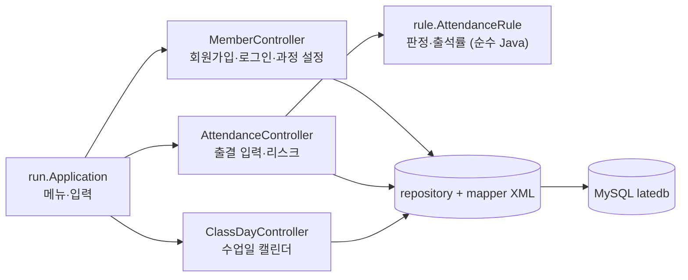
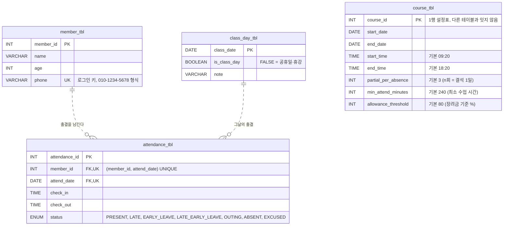

# 지각 잡는 자바 — 3WHY_java-latecatcher
> 고용24 출결 규칙(지각·조퇴 환산, 출석률 80%)을 코드로 옮겨, **"지금 몇 번 더 늦으면 장려금·수료가 위험한지"** 바로 알려 주는 JDBC 콘솔 프로그램
> 솔트룩스 LLM 에이전트 서비스 과정 · JDBC 팀 프로젝트 · 팀 **3WHY**

<br>

## 목차
1. [프로젝트 개요](#1-프로젝트-개요)
2. [팀 R&R](#2-팀-rr)
3. [수행 절차 및 방법](#3-수행-절차-및-방법)
4. [수행 결과](#4-수행-결과)
5. [회고](#5-회고)
6. [참고 문서](#6-참고-문서)

<br>

---
## 1. 프로젝트 개요

### 1-1. 주제 선정 배경
- 우리는 매일 고용24 앱으로 QR 출결을 찍는다. 출석률에 **훈련장려금과 수료**가 걸려 있다.
- 그런데 "지각 2번 + 결석 1번이면 이번 달 출석률이 몇 %지?"를 바로 알려 주는 화면은 없다. 규칙 계산이 머릿속 암산이다.
- 고용24에는 개인 출결을 내보내는 API도, 파일 내려받기도 없다. 그래서 **데이터는 손으로 넣고, 규칙은 코드가 계산**하기로 했다.

### 1-2. 기획 의도
- 수업에서 받은 **JDBC 구독관리 스켈레톤**(OTT 구독 관리)을 **훈련생 출결 리스크 매니저**로 바꾸며 Java → MySQL → JDBC에서 배운 것을 실습한다.
- 출결 규칙(상태 판정·환산 결석·출석률)은 DB와 콘솔 없이 **순수 Java(`AttendanceRule`)** 에 두고 **JUnit**으로 검증한다.
- GitHub 협업 흐름(이슈 → 브랜치 → PR → 리뷰 approve 2 → 머지)을 세 명이 함께 연습한다.
- 사용자는 우리 팀 3명에서 시작한다. **만드는 동안 실제로 쓴다.**

### 1-3. 프로젝트 내용
| 구분 | 내용 |
| --- | --- |
| 프로젝트명 | 지각 잡는 자바 (java-latecatcher) |
| 팀명 | 3WHY |
| 수행 기간 | 2026.10.21 ~ 2026.10.27 |
| 주요 기능 | 휴대폰 번호 회원가입·로그인, 과정 설정, 수업일 캘린더, 출결 입력과 상태 자동 판정, 내 출결 리스크(출석률·80% 미달 경고) |
| 협업 도구 | GitHub (Issues, Pull Requests, Ruleset), Notion |


### 1-4. 프로젝트 구조

수업 기준 구조(`run` / `model` / `repository` / `controller` / `view` / `mapper` / `common`)를 그대로 따르고, 출결 규칙을 담는 **`rule` 패키지 하나만 추가**했다. `service` 계층은 만들지 않았다 — 규칙은 `rule`, 흐름은 `controller`에 둔다.

```text
3WHY_java-latecatcher/
├─ build.gradle
├─ data/sample.txt                        # 고용24 출결 표를 복사한 모양의 견본 (v0.2 가져오기용)
├─ docs/                                  # PLAN, CONVENTION, SCHEDULE, ERD
└─ src
   ├─ main
   │  ├─ java/latecatcher
   │  │  ├─ run/Application.java          # 시작 메뉴·출결 메뉴, 입력 루프
   │  │  ├─ controller/                   # MemberController, AttendanceController, ClassDayController
   │  │  ├─ model/                        # Member, Course, ClassDay, Attendance, AttendanceStatus(enum)
   │  │  ├─ repository/                   # Member·Course·ClassDay·AttendanceRepository (JDBC)
   │  │  ├─ rule/AttendanceRule.java      # + 출결 규칙 — 판정·환산 결석·출석률·미입력 (순수 Java)
   │  │  ├─ view/                         # MemberView, AttendanceView, ClassDayView
   │  │  ├─ mapper/*-query.xml            # SQL (Properties.loadFromXML)
   │  │  └─ common/JDBCTemplate.java      # DB 연결
   │  └─ resources
   │     ├─ db.properties.example         # 접속 정보 견본 (db.properties는 gitignore)
   │     └─ db/schema.sql, insert.sql     # 스키마와 샘플 데이터
   └─ test/java/latecatcher/rule/AttendanceRuleTest.java
```



- View는 입력과 출력만 하고, 판단·판정·저장은 Controller가 한다. 나중에 메신저 입력 같은 다른 입력 경로를 붙여도 같은 판정·저장 경로를 쓰게 하기 위해서다.
- `AttendanceRule`은 DB를 모르므로 JUnit으로 규칙만 따로 테스트할 수 있다.


### 1-5. 개발 환경
| 구분 | 사용 기술 |
| --- | --- |
| 언어 | Java 17 이상 (`build.gradle` 기준 17, 팀 개발 JDK는 Temurin 21) |
| 빌드 | Gradle 9.3.0 (Gradle Wrapper 포함) |
| DB | MySQL 8.0, `mysql-connector-j` 9.7.0 |
| 라이브러리 | Lombok 1.18.46 |
| 테스트 | JUnit (`junit-bom` 6.0.0, Jupiter) |
| IDE | IntelliJ IDEA (macOS) |


<br>

---


## 2. 팀 R&R
> **3WHY** — 팀원 세 명의 이름이 모두 **Y**로 시작해서 *3Y → 3WHY* 🙌

| 팀원 | 역할 | 기반 책임 (0단계) | 담당 기능 |
| --- | --- | --- | --- |
| YY | 팀장 | **데이터 설계** — 합의 ERD, `schema.sql`·`insert.sql` / GitHub 저장소 세팅(라벨·템플릿·Ruleset), CONVENTION·PLAN·SCHEDULE 문서 | L-02 로그인, L-05 출결 규칙(`AttendanceRule` + JUnit), L-05 출결 입력 |
| RY | 팀원 | **문서 구조** — 노션 페이지 트리, README 목차 | L-01 회원가입, L-11 회원 탈퇴, L-04 수업일 캘린더, L-08 내 출결 리스크, L-09 반 전체 현황 |
| YI | 팀원 | **코드 구조** — 패키지·빌드 설정, 파일 뼈대·TODO | L-03 과정 설정, L-12 프로그램 종료·메뉴 통합 |

- 기능은 층이 아니라 **기능 단위로 세로 분할**했다. 한 사람이 한 기능을 model → repository → controller → view까지 만든다.

<br>

---

## 3. 수행 절차 및 방법

### 3-1. 수행 절차

| 단계 | 기간 | 주요 내용 |
| --- | --- | --- |
| 기획 | 10.21 ~ 10.22 | 주제 선정(스켈레톤 변형), 노션 페이지 개설, 요구사항 명세 확정, 저장소 세팅 |
| 설계 | 10.22 | 세 명이 각자 ERD 초안 → 종합 → ERD 회의로 합의 ERD 확정, `schema.sql`·`insert.sql`, 패키지 구조·파일 뼈대 |
| 구현 | 10.23 ~ 10.26 | 기능별 이슈·브랜치·PR, approve 2 리뷰, **단계별 머지** (1 기반 → 2 기록 → 3 조회 → 4 통합) |
| 테스트 | 10.26 ~ 10.27 | `AttendanceRuleTest`(JUnit), `insert.sql` 샘플로 기능별 확인, 상태 점검 회의 |
| 마무리 | 10.27 | README·노션 산출물 정리, 발표 |

협업 규칙(커밋·브랜치·라벨·이슈·PR)은 [docs/CONVENTION.md](docs/CONVENTION.md)에 있다.

### 3-2. 요구사항 명세서 (개발 우선순위 선정)

우선순위 기준 — **상**: 프로그램 동작에 필수 / **중**: 핵심 사용성 / **하**: 부가 기능

| ID | 기능명 | 설명 | 우선순위 | 담당 |
| :---: | --- | --- | :---: | :---: |
| L-01 | 회원가입 | 이름·나이·휴대폰 번호를 입력받아 등록. 빈 값, 나이(1 이상), 번호 형식(`010-1234-5678`)과 중복을 확인 | 상 | RY |
| L-02 | 로그인 | 휴대폰 번호로 회원을 조회해 로그인 상태로 보관 (비밀번호 없음) | 상 | YY |
| L-03 | 과정 설정 | 과정명, 훈련 기간, 수업 시작·종료 시각, 출결 기준값(환산 횟수, 장려금·수료 기준 %) 등록 | 상 | YI |
| L-04 | 수업일 캘린더 | 훈련 기간의 날짜를 **한 트랜잭션으로** 생성(주말 제외)하고 달력 형태로 조회 | 중 | RY |
| L-05 | 출결 입력 | 날짜·구분(출석/결석)·입실·퇴실 시각을 받아 상태를 판정해 저장. 같은 날짜 중복은 안내 | 상 | YY |
| ~~L-06~~ | ~~출결 가져오기~~ | 고용24 출결 표를 복사한 텍스트 파일 가져오기 — **v0.2로 미룸** | — | — |
| ~~L-07~~ | ~~결석 일괄 마감~~ | **삭제.** 기록이 없는 날은 결석이 아니라 "미입력"으로 본다 | — | — |
| L-08 | 내 출결 리스크 | 이번 달 출석률·환산 결석을 계산하고 "결석 며칠 / 지각 몇 번 더면 80% 미달"을 경고 | 상 | RY |
| L-09 | 반 전체 현황 | 월별 출석률 순위, 80% 미달·경계(85% 이하) 명단, 기록 없음 명단 | 중 | RY |
| L-10 | 로그아웃 | 로그인 정보를 지우고 시작 메뉴로 | 하 | YY |
| L-11 | 회원 탈퇴 | 회원 정보와 출결 기록 삭제 (FK `ON DELETE CASCADE`) | 하 | RY |
| L-12 | 프로그램 종료·메뉴 통합 | 시작 메뉴·출결 메뉴에서 종료, 전체 메뉴 흐름 통합 | 중 | YI |

기능별 유스케이스와 v0.2 계획(L-06 출결 가져오기, L-13 공휴일 API, L-14 디스코드 알림, L-16 관리자 권한)은 [docs/PLAN.md 4절](docs/PLAN.md#4-기능)에 있다.


### 3-3. DB 설계 (ERD)

세 명이 각자 그린 ERD 초안을 종합해 **10/22 ERD 회의에서 합의**했다. 전체 ERD와 정규화 점검은 [docs/erd.md](docs/erd.md)에 있다.



| 결정 | 이유 |
| --- | --- |
| **로그인은 휴대폰 번호** (아이디·비밀번호 없음) | 스켈레톤 방식 그대로. `phone`에 `NOT NULL` + `UNIQUE` + 형식 `CHECK` |
| **`UNIQUE(member_id, attend_date)`** | 하루 한 기록. 같은 날짜 중복 입력을 DB가 막고, Java는 오류 1062를 "이미 기록이 있습니다"로 바꾼다 |
| **`attend_date` → `class_day_tbl` FK** | 수업일 캘린더에 있는 날에만 출결을 남길 수 있다 |
| **회원 삭제 시 `ON DELETE CASCADE`** | 회원 탈퇴(L-11) 때 출결 기록도 함께 지운다 |
| **`course_tbl`은 1행 설정표** | 과정이 하나뿐이라 회원·출결과 잇지 않는다. 여러 과정 설계는 [docs/erd-extended.md](docs/erd-extended.md)에 보관 |
| **v0.2용 열·테이블을 미리 둠** | `member_tbl.role`, `attendance_tbl.source`, `import_log_tbl` — v0.2에서 `ALTER TABLE` 없이 기능만 붙이기 위해 |
| **월별 집계 뷰 `v_monthly_attendance`** | SQL은 상태별 개수만 구하고, 출석률 계산은 Java가 한다 (L-09용) |


### 3-4. 출결 규칙 (코드의 심장)

규칙 수치는 상수가 아니라 `course_tbl`의 설정값으로 읽는다. 구현은 [`AttendanceRule`](src/main/java/latecatcher/rule/AttendanceRule.java), 근거와 결정 기록은 [docs/PLAN.md 3절](docs/PLAN.md#3-출결-규칙-코드의-심장)에 있다.

**상태 판정 순서 (`AttendanceRule.judge`)** — 위에서부터 먼저 걸리는 것으로 정한다. 기본값은 수업 09:20 ~ 18:20, 최소 수업 시간 4시간이다.

1. 입실이나 퇴실 시각이 없다 → **결석**
2. 들은 시간(퇴실 − 입실과 시작 시각 중 **늦은 쪽**)이 4시간 **미만**이다 → **결석** (지각이어도)
3. 시작 시각 이후 입실 + 종료 시각 이전 퇴실 → **지각·조퇴**
4. 시작 시각 이후 입실 → **지각**
5. 종료 시각 이전 퇴실 → **조퇴**
6. 그 밖 → **출석**

- 정각은 지각·조퇴가 아니다 (09:20 입실 = 출석, 18:20 퇴실 = 조퇴 아님). 정확히 4시간이면 최소 수업 시간을 채운 것으로 본다.
- 일찍 온 시간은 수업 시간에 넣지 않는다. 10:20에 입실하면 14:20 이후 퇴실해야 4시간을 채운다.

| 상태 | 라벨 | 환산 횟수 |
| --- | --- | :---: |
| `PRESENT` | 출석 | 0 |
| `LATE` | 지각 | 1 |
| `EARLY_LEAVE` | 조퇴 | 1 |
| `LATE_EARLY_LEAVE` | 지각·조퇴 | 2 |
| `OUTING` | 외출 (v0.2 가져오기로만 들어옴) | 1 |
| `ABSENT` | 결석 | 0 (결석 1일로 계산) |
| `EXCUSED` | 공결 | 0 (분모·분자에서 제외) |

**출석률 공식**

```text
환산 결석 = 결석 일수 + floor(환산 횟수 합계 / 3)          (3 = partial_per_absence)
출석률   = (기록 일수 − 공결 − 환산 결석) / (기록 일수 − 공결) × 100
기록 일수 = 훈련 시작일 ~ 어제 사이의 수업일 가운데 출결 기록이 있는 날
미입력 일수 = 같은 기간의 수업일 − 기록 일수   (계산에 넣지 않고 화면에만 보여 준다)
```

- **계산 기준일은 어제다.** 오늘은 아직 퇴실 전이라, 넣으면 수업 중인 사람이 결석이 된다. 고용24도 "당일 출석결과는 익일 반영"이다.
- **기록이 없는 날은 결석이 아니라 미입력이다.** 결석도 직접 입력하므로, 비어 있는 날은 "아직 입력하지 않은 날"이다. 대신 미입력 일수를 함께 보여 준다.

<br>

---

## 4. 수행 결과

### 4-1. 실행 방법

**준비물:** JDK 17 이상, MySQL 8.0, IntelliJ IDEA

**① 저장소 받기**

```bash
git clone https://github.com/20260921-saltlux-llm-agent-service-2nd/3WHY_java-latecatcher.git
cd 3WHY_java-latecatcher
```

**② DB 만들기** — `schema.sql`로 `latedb`와 테이블을 만들고, `insert.sql`로 샘플 데이터(과정 1개, 수업일, 회원 4명, 9~10월 출결)를 넣는다.

```bash
mysql -u root -p < src/main/resources/db/schema.sql
mysql -u root -p < src/main/resources/db/insert.sql
```

> ⚠ `schema.sql`은 `latedb`의 기존 테이블을 **지우고 다시 만든다.** `insert.sql`을 두 번 실행하면 휴대폰 번호 중복으로 실패하므로, 다시 넣을 때는 `schema.sql`부터 실행한다.
> 프로그램이 쓸 MySQL 계정에 `latedb` 권한이 있어야 한다 (예: `schema.sql` 위쪽 주석의 `CREATE USER` · `GRANT`).

**③ 접속 정보 설정** — 견본을 복사한 뒤 `user`, `password`를 자기 MySQL 계정으로 바꾼다. `db.properties`는 gitignore라 커밋되지 않는다.

```bash
cp src/main/resources/db.properties.example src/main/resources/db.properties
```

**④ 실행** — IntelliJ에서 [`latecatcher.run.Application`](src/main/java/latecatcher/run/Application.java)의 `main`을 실행한다.

- 작업 디렉터리는 **프로젝트 루트**여야 한다. `db.properties`와 `mapper/*.xml`을 프로젝트 루트 기준 상대 경로로 읽는다.
- `./gradlew run`은 아직 쓸 수 없다. `build.gradle`의 `mainClass`가 스켈레톤 값(`solution.Answer`) 그대로라 `ClassNotFoundException`이 난다.

**⑤ 테스트**

```bash
./gradlew test        # 실행 권한 오류가 나면: chmod +x gradlew 또는 sh gradlew test
```

> 프로젝트 경로에 한글이 들어 있으면 Gradle 테스트가 `ClassNotFoundException`으로 실행되지 않는다. 영어 경로에 clone한다.

**샘플 계정 (`insert.sql`)** — 출결은 10/21까지 들어 있다.

| 휴대폰 번호 | 회원 | 10월 기록으로 본 사례 |
| --- | --- | --- |
| `010-1111-1111` | RY | 모범 사례 — 기록 13일, 공결 1 → 출석률 100% |
| `010-2222-2222` | YY | 경계 사례 — 환산 결석 2 → 83.3%, 지각 1번 더면 80% 미만 |
| `010-3333-3333` | YI | 10월 기록 없음 — 출결 입력(L-05) 확인용 |
| `010-4444-4444` | 더미 회원 | 미달 사례 — 지각·조퇴 1, 4시간 미만 결석 1 → 75.0% |


### 4-2. 메뉴와 사용 예

```text
===== 출결 관리 시스템 =====          ===== 과정 메뉴 =====
1. 회원가입                            1. 내 출결 리스크 보기
2. 로그인                              2. 출결 입력
9. 프로그램 종료                       3. 반 전체 현황(월별 순위, 80% 미달자, 기록 없음)
                                       4. 과정 설정
                                       5. 수업일 캘린더
                                       6. 회원 탈퇴
                                       7. 로그 아웃
                                       9. 프로그램 종료
```

**출결 입력 (L-05, 메뉴 2)** — YI 계정(`010-3333-3333`)으로 입력한 예

```text
[출결 입력]
날짜 (예: 2026-10-06), 취소 : Enter): 2026-10-02
구분 (1. 출석 / 2. 결석): 1
입실 시각 (예: 09:05): 09:30
퇴실 시각 (예: 18:25, 퇴실 전이면 Enter): 18:25
10/02 출결을 저장했습니다: 지각
```

| 입력 | 결과 |
| --- | --- |
| 10/01 출석 09:15 – 18:25 | 출석 |
| 10/02 출석 09:30 – 18:25 | 지각 |
| 10/06 출석 09:15 – 17:00 | 조퇴 |
| 10/07 출석 10:20 – 14:20 | 지각·조퇴 |
| 10/08 출석 10:20 – 13:20 | 결석 (4시간 미만) |
| 10/12 결석 | 결석 |
| 10/09 한글날, 10/10 토요일 | "수업일이 아닙니다." 후 다시 입력 |
| 오늘·내일 | "오늘 출결은 내일 입력하세요." 후 다시 입력 |
| 퇴실 시각을 비움 | "퇴실한 뒤 입력하세요." 후 다시 입력 |
| 이미 입력한 날짜 | "이미 기록이 있습니다." 후 다시 입력 (덮어쓰지 않음) |

**내 출결 리스크 (L-08, 메뉴 1)** — YY 계정(`010-2222-2222`)으로 10/27에 조회한 예 (PR #34 기준)

```text
[내 출결 리스크 조회]
과정 번호 입력: 1

===== 10월 내 출결 (10/01 ~ 10/26) =====
수업일 16일 · 기록 12일 (미입력 4일)
출석 6  지각 3  조퇴 1  외출 1  결석 1
환산 결석 2일 → 출석률 83.3%

⚠ 결석 1일 더 하면 장려금 기준(80%) 미달
⚠ 지각·조퇴 1번 더 하면 장려금 기준(80%) 미달
미입력 4일 — 결석이었다면 결석으로 입력하세요
```

<!-- TODO: 발표 전에 실행 화면 캡처를 넣는다 (회원가입·로그인, 출결 입력, 내 출결 리스크, 수업일 캘린더) -->


### 4-3. 기능별 구현 현황 (10/27 오전 기준)

| ID | 기능 | 메뉴 | 상태 | PR |
| :---: | --- | :---: | :---: | --- |
| L-01 | 회원가입 | 시작 1 | ✅ 완료 | #27 |
| L-02 | 로그인 | 시작 2 | ✅ 완료 | #25, #35 (L-03 머지 때 끊긴 연결 복구) |
| L-03 | 과정 설정 | 4 | ✅ 완료 | #26, #33 |
| L-04 | 수업일 캘린더 | 5 | ✅ 완료 | #31 |
| L-05 | 출결 규칙 (`AttendanceRule`) | — | ✅ 완료 | #28, #30 |
| L-05 | 출결 입력 | 2 | 🔍 리뷰 중 | #35 |
| L-08 | 내 출결 리스크 | 1 | 🔍 리뷰 중 | #34 |
| L-09 | 반 전체 현황 | 3 | ⬜ 미구현 | 이슈 #11 (뷰 `v_monthly_attendance`만 준비) |
| L-10 | 로그아웃 | 7 | 🟡 일부 | — |
| L-11 | 회원 탈퇴 | 6 | 🟡 일부 | #27 (탈퇴 로직만, 메뉴 미연결) |
| L-12 | 프로그램 종료·메뉴 통합 | 9 | 🟡 일부 | 이슈 #15 (종료만 동작) |

**알려진 한계**
- 로그아웃: 메뉴에는 `7`로 보이지만 코드는 `8`에서 처리한다. 로그인 정보도 지우지 않는다.
- 수업일 캘린더는 주말만 빼고 생성한다. 공휴일·휴강 등록 메뉴가 없어 샘플 공휴일은 `insert.sql`에 넣어 두었다.
- 과정을 여러 개 등록해도 출결 판정은 가장 먼저 등록한 과정(가장 작은 `course_id`)을 쓴다. 여러 과정 관리는 v0.1 범위 밖이다.
- 잘못 입력한 출결을 고치거나 지우는 기능이 없다 (v0.2에서 고용24 표 가져오기로 바로잡을 계획).


### 4-4. 테스트

[`AttendanceRuleTest`](src/test/java/latecatcher/rule/AttendanceRuleTest.java) — **37개 통과**. DB 없이 규칙만 검증한다.

| 묶음 | 확인하는 경계값 |
| --- | --- |
| 상태 판정 | 정각 입실·퇴실은 출석, 1분 늦으면 지각, 지각이면서 조퇴, 입실·퇴실 기록 없음 |
| 최소 수업 시간 | 정확히 4시간은 인정, 1분 모자라면 결석, 지각 후 3시간·4시간, 일찍 온 시간 제외, 기준값 변경 |
| 환산 결석 | 지각 2·3·5회, 결석 1일 + 지각 3회, 기준이 2회일 때, 지각·조퇴는 2회 |
| 출석률 | 정확히 80%, 80% 미만, 공결은 분모·분자에서 제외, 기록 0일·모두 공결이면 계산하지 않음 |
| 미입력·기준일 | 수업일 − 기록 일수, 오늘(퇴실 없는 줄) 제외, 원본 목록은 바꾸지 않음 |

PR #34가 머지되면 리스크 계산 `AttendanceRiskTest` 6개가 더해진다.

<br>

---


## 5. 회고

### 5-1. 기획 의도와의 부합 정도
<!-- 처음 의도한 기능과 흐름이 결과물에 얼마나 반영되었는지 -->
- 핵심인 **출결 규칙**(판정·환산·출석률)을 순수 Java로 옮기고 JUnit 37개로 경계값을 검증했다.
- 출결 입력(L-05)과 내 출결 리스크(L-08)가 이어지면 "몇 번 더 늦으면 위험한가"를 보여 주는 처음 의도한 흐름이 완성된다.
- 반 전체 현황(L-09)과 고용24 표 가져오기(v0.2)는 하지 못했다.
- (팀 의견 추가)


### 5-2. 달성도

| ID | 기능명 | 구현 여부 | 비고 |
| :---: | --- | :---: | --- |
| L-01 | 회원가입 | ✅ | |
| L-02 | 로그인 | ✅ | |
| L-03 | 과정 설정 | ✅ | |
| L-04 | 수업일 캘린더 | ✅ | 휴일 등록 메뉴 없음 |
| L-05 | 출결 규칙 | ✅ | |
| L-05 | 출결 입력 | 🔍 | PR #35 리뷰 중 |
| L-08 | 내 출결 리스크 | 🔍 | PR #34 리뷰 중 |
| L-09 | 반 전체 현황 | ⬜ | (미구현 사유) |
| L-10 | 로그아웃 | 🟡 | 메뉴 번호 불일치 |
| L-11 | 회원 탈퇴 | 🟡 | 메뉴 미연결 |
| L-12 | 프로그램 종료·메뉴 통합 | 🟡 | 종료만 동작 |

**전체 달성도: 5 / 11 (45%)** — 리뷰 중인 PR 2개가 머지되면 7 / 11 (64%)

### 5-3. 완성도 및 자체 평가

| 항목 | 평가 | 의견 |
| --- | :---: | --- |
| 기능 완성도 | ☆☆☆☆☆ | |
| 코드 구조 | ☆☆☆☆☆ | |
| 예외 처리 | ☆☆☆☆☆ | |
| 협업 | ☆☆☆☆☆ | |

### 5-4. 느낀 점

**YY**
> 내용작성

**RY**
> 내용작성

**YI**
> 내용작성


### 5-5. 개선할 점

- `build.gradle`의 `mainClass`를 `latecatcher.run.Application`으로 고쳐 `./gradlew run`으로 실행할 수 있게 한다.
- 반 전체 현황(L-09), 로그아웃·회원 탈퇴 메뉴 연결, 공휴일·휴강 등록을 마무리한다.
- v0.2: 고용24 출결 표 가져오기(L-06, 트랜잭션), 관리자 권한(L-16), 공휴일 API(L-13), 디스코드 알림(L-14)
- (팀 의견 추가)

<br>

---

## 6. 참고 문서

| 문서 | 내용 |
| --- | --- |
| [docs/PLAN.md](docs/PLAN.md) | 프로젝트 계획 — 출결 규칙, 기능·유스케이스, 데이터 설계, 역할 분담 |
| [docs/CONVENTION.md](docs/CONVENTION.md) | 커밋·브랜치·라벨·이슈·PR 규칙 |
| [docs/SCHEDULE.md](docs/SCHEDULE.md) | 일정과 단계별 머지 계획 |
| [docs/erd.md](docs/erd.md) | 합의 ERD와 정규화 점검 |
| [docs/erd-extended.md](docs/erd-extended.md) | 회의 전 확장 ERD (비밀번호 로그인, 여러 과정) |
