# 지각 잡는 자바 — 3WHY_java-latecatcher
> 고용24 출결 규칙(지각·조퇴 환산, 출석률 80%)을 코드로 옮겨, **"지금 몇 번 더 늦으면 장려금·수료가 위험한지"** 바로 알려 주는 JDBC 콘솔 프로그램
> 솔트룩스 LLM 에이전트 서비스 과정 · JDBC 팀 프로젝트 · 팀 **3WHY**

<br>

## 1. 프로젝트 개요

### 주제 선정 배경 및 기획 의도

직업훈련 과정에서는 매일 고용24 앱의 QR코드로 출결을 기록하며, 출석률은 훈련장려금 지급과 교육과정 수료에 중요한 영향을 미칩니다. 하지만 지각, 조퇴, 결석에 따른 출석률을 즉시 확인하기 어려워 직접 계산해야 하는 불편함이 있습니다. 이러한 문제를 해결하기 위해 출결 정보를 수동으로 입력하면 출석률과 결석 환산 결과를 자동으로 계산하는 프로그램을 기획했습니다. Java와 MySQL, JDBC를 활용하여 출결 관리 기능을 구현하고, JUnit을 통한 계산 규칙 검증과 GitHub 협업을 통해 실무 개발 역량을 강화하는 것을 목표로 합니다.

- **프로젝트명**: 지각 잡는 자바 (java-latecatcher)
- **팀명**: 3WHY >>>>> **3WHY** — 팀원 세 명의 이름이 모두 **Y**로 시작해서 *3Y → 3WHY* 🙌
- **수행 기간**: 2026.10.21 ~ 2026.10.27
- **주요 기능**: 휴대폰 번호 회원가입·로그인, 과정 설정, 수업일 캘린더, 출결 입력과 상태 자동 판정, 내 출결 리스크(출석률·80% 미달 경고), 반 전체 현황
- **협업 도구**: GitHub (Issues, Pull Requests, Ruleset), Notion

### 개발 환경
| 구분 | 사용 기술 |
| --- | --- |
| 언어 | Java 17 이상 (`build.gradle` 기준 17, 팀 개발 JDK는 Temurin 21) |
| 빌드 | Gradle 9.3.0 (Gradle Wrapper 포함) |
| DB | MySQL 8.0, `mysql-connector-j` 9.7.0 |
| 라이브러리 | Lombok 1.18.46 |
| 테스트 | JUnit (`junit-bom` 6.0.0, Jupiter) |
| IDE | IntelliJ IDEA (Windows) |


### 프로젝트 구조

수업 기준 구조(`run` / `model` / `repository` / `controller` / `view` / `mapper` / `common`)를 그대로 따르고, 출결 규칙을 담는 **`rule` 패키지 하나만 추가**했다. `service` 계층은 만들지 않았다 — 규칙은 `rule`, 흐름은 `controller`에 둔다.

```text
3WHY_java-latecatcher/
├─ build.gradle
├─ data/sample.txt                        # 고용24 출결 표를 복사한 모양의 견본 (v0.2 가져오기용)
├─ docs/                                  # PLAN, CONVENTION, SCHEDULE, ERD
│  └─ images/                             # README 실행 화면 캡처
└─ src
   ├─ main
   │  ├─ java/latecatcher
   │  │  ├─ run/Application.java          # 시작 메뉴·과정 메뉴, 입력 루프
   │  │  ├─ controller/                   # MemberController, AttendanceController, ClassDayController
   │  │  ├─ model/                        # Member, Course, ClassDay, Attendance, AttendanceStatus(enum), MonthlySummary, ClassStatusRow
   │  │  ├─ repository/                   # Member·Course·ClassDay·AttendanceRepository (JDBC)
   │  │  ├─ rule/                         # + 출결 규칙 (순수 Java)
   │  │  │  ├─ AttendanceRule.java        #   판정·환산 결석·출석률·미입력
   │  │  │  └─ AttendanceRisk.java        #   "결석 며칠 / 지각 몇 번 더면 미달" 계산
   │  │  ├─ view/                         # MemberView, AttendanceView, ClassDayView
   │  │  ├─ mapper/*-query.xml            # SQL (Properties.loadFromXML)
   │  │  └─ common/JDBCTemplate.java      # DB 연결
   │  └─ resources
   │     ├─ db.properties.example         # 접속 정보 견본 (db.properties는 gitignore)
   │     └─ db/schema.sql, insert.sql     # 스키마와 샘플 데이터
   └─ test/java/latecatcher/rule/        # AttendanceRuleTest, AttendanceRiskTest
```

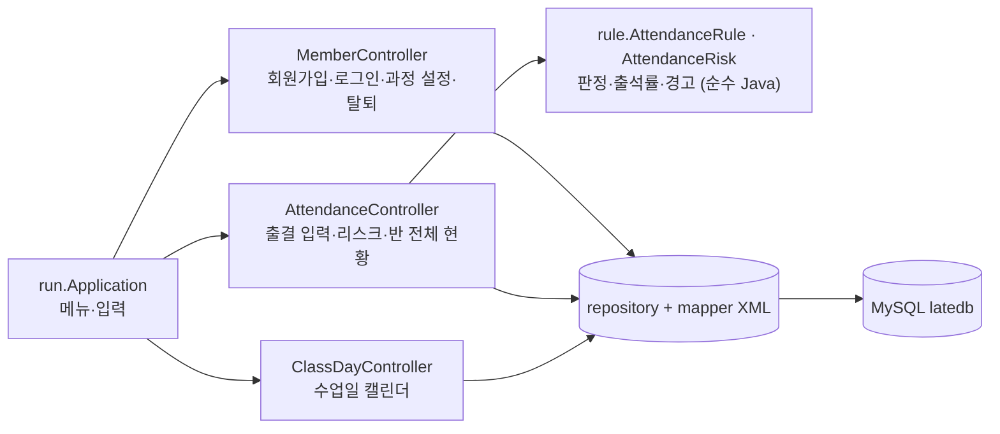

- View는 입력과 출력만 하고, 판단·판정·저장은 Controller가 한다. 나중에 메신저 입력 같은 다른 입력 경로를 붙여도 같은 판정·저장 경로를 쓰게 하기 위해서다.
- `AttendanceRule`·`AttendanceRisk`는 DB를 모르므로 JUnit으로 규칙만 따로 테스트할 수 있다.


<br>

---


## 2. 팀 R&R
> - 기능은 층이 아니라 **기능 단위로 세로 분할**했다. 한 사람이 한 기능을 model → repository → controller → view까지 만든다.

**YY · 팀장**
- **기반 · 데이터 설계** — 합의 ERD, `schema.sql`·`insert.sql` / GitHub 저장소 세팅(라벨·템플릿·Ruleset), CONVENTION·PLAN·SCHEDULE 문서
- **기능** — L-02 로그인, L-05 출결 규칙(`AttendanceRule` + JUnit), L-05 출결 입력, L-10 로그아웃, L-12 메뉴 통합 마무리

**RY · 팀원**
- **기반 · 문서 구조** — 노션 페이지 트리, README 구성
- **기능** — L-01 회원가입, L-11 회원 탈퇴, L-04 수업일 캘린더, L-08 내 출결 리스크, L-09 반 전체 현황

**YI · 팀원**
- **기반 · 코드 구조** — 패키지·빌드 설정, 파일 뼈대·TODO
- **기능** — L-03 과정 설정, L-12 프로그램 종료


<br>

---

## 3. 수행 절차 및 방법

### 수행 절차

| 단계 | 기간 | 주요 내용 |
| --- | --- | --- |
| 기획 | 10.21 ~ 10.22 | 주제 선정(스켈레톤 변형), 노션 페이지 개설, 요구사항 명세 확정, 저장소 세팅 |
| 설계 | 10.22 | 세 명이 각자 ERD 초안 → 종합 → ERD 회의로 합의 ERD 확정, `schema.sql`·`insert.sql`, 패키지 구조·파일 뼈대 |
| 구현 | 10.23 ~ 10.26 | 기능별 이슈·브랜치·PR, approve 2 리뷰, **단계별 머지** (1 기반 → 2 기록 → 3 조회 → 4 통합) |
| 테스트 | 10.26 ~ 10.27 | `AttendanceRuleTest`(JUnit), `insert.sql` 샘플로 기능별 확인, 상태 점검 회의, 새 컴퓨터에서 clone부터 실행까지 점검 |
| 마무리 | 10.27 | README·노션 산출물 정리, 발표 |

협업 규칙(커밋·브랜치·라벨·이슈·PR)은 [docs/CONVENTION.md](docs/CONVENTION.md)에 있다.

### 요구사항 명세서 (개발 우선순위 선정)

우선순위 기준 — **상**: 프로그램 동작에 필수 / **중**: 핵심 사용성 / **하**: 부가 기능

| ID | 기능명 | 설명 | 우선순위 | 담당 |
| :---: | --- | --- | :---: | :---: |
| L-01 | 회원가입 | 이름·나이·휴대폰 번호를 입력받아 등록. 빈 값, 나이(1 이상), 번호 형식(`010-1234-5678`)과 중복을 확인 | 상 | RY |
| L-02 | 로그인 | 휴대폰 번호로 회원을 조회해 로그인 상태로 보관 (비밀번호 없음) | 상 | YY |
| L-03 | 과정 설정 | 과정명, 훈련 기간, 수업 시작·종료 시각, 출결 기준값(환산 횟수, 장려금·수료 기준 %) 등록 | 상 | YI |
| L-04 | 수업일 캘린더 | 훈련 기간의 날짜를 **한 트랜잭션으로** 생성(주말 제외)하고 날짜별로 조회 | 중 | RY |
| L-05 | 출결 입력 | 날짜·구분(출석/결석)·입실·퇴실 시각을 받아 상태를 판정해 저장. 같은 날짜 중복은 안내 | 상 | YY |
| ~~L-06~~ | ~~출결 가져오기~~ | 고용24 출결 표를 복사한 텍스트 파일 가져오기 — **v0.2로 미룸** | — | — |
| ~~L-07~~ | ~~결석 일괄 마감~~ | **삭제.** 기록이 없는 날은 결석이 아니라 "미입력"으로 본다 | — | — |
| L-08 | 내 출결 리스크 | 이번 달 출석률·환산 결석을 계산하고 "결석 며칠 / 지각 몇 번 더면 80% 미달"을 경고 | 상 | RY |
| L-09 | 반 전체 현황 | 월별 출석률 순위, 장려금 기준(기본 80%) 미달·경계(기준 + 5%p 이하, 기본 80~85%) 명단, 기록 없음 명단 | 중 | RY |
| L-10 | 로그아웃 | 로그인 정보를 지우고 시작 메뉴로 | 하 | YY |
| L-11 | 회원 탈퇴 | Y 확인 후 회원 정보와 출결 기록 삭제 (FK `ON DELETE CASCADE`) | 하 | RY |
| L-12 | 프로그램 종료·메뉴 통합 | 시작 메뉴·과정 메뉴에서 종료, 전체 메뉴 흐름 통합, 잘못된 입력 처리 | 중 | YI, YY |

기능별 유스케이스와 v0.2 계획(L-06 출결 가져오기, L-13 공휴일 API, L-14 디스코드 알림, L-16 관리자 권한)은 [docs/PLAN.md 4절](docs/PLAN.md#4-기능)에 있다.


### DB 설계 (ERD)

세 명이 각자 그린 ERD 초안을 종합해 **10/22 ERD 회의에서 합의**했다. 전체 ERD와 정규화 점검은 [docs/erd.md](docs/erd.md)에 있다.

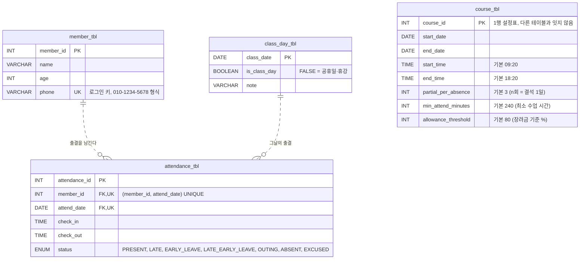

| 결정 | 이유 |
| --- | --- |
| **로그인은 휴대폰 번호** (아이디·비밀번호 없음) | 스켈레톤 방식 그대로. `phone`에 `NOT NULL` + `UNIQUE` + 형식 `CHECK` |
| **`UNIQUE(member_id, attend_date)`** | 하루 한 기록. 같은 날짜 중복 입력을 DB가 막고, Java는 오류 1062를 "이미 기록이 있습니다"로 바꾼다 |
| **`attend_date` → `class_day_tbl` FK** | 수업일 캘린더에 있는 날에만 출결을 남길 수 있다 |
| **회원 삭제 시 `ON DELETE CASCADE`** | 회원 탈퇴(L-11) 때 출결 기록도 함께 지운다 |
| **`course_tbl`은 1행 설정표** | 과정이 하나뿐이라 회원·출결과 잇지 않는다. 여러 과정 설계는 [docs/erd-extended.md](docs/erd-extended.md)에 보관 |
| **v0.2용 열·테이블을 미리 둠** | `member_tbl.role`, `attendance_tbl.source`, `import_log_tbl` — v0.2에서 `ALTER TABLE` 없이 기능만 붙이기 위해 |
| **월별 집계 뷰 `v_monthly_attendance`** | SQL은 상태별 개수만 구하고, 출석률 계산은 Java가 한다 (L-09용) |


### 출결 규칙 (코드의 심장)

규칙 수치는 상수가 아니라 `course_tbl`의 설정값으로 읽는다. 구현은 [`AttendanceRule`](src/main/java/latecatcher/rule/AttendanceRule.java), 근거와 결정 기록은 [docs/PLAN.md 3절](docs/PLAN.md#3-출결-규칙-코드의-심장)에 있다.

**상태 판정 순서 (`AttendanceRule.judge`)** — 위에서부터 먼저 걸리는 것으로 정한다. 기본값은 수업 09:20 ~ 18:20, 최소 수업 시간 4시간이다.

1. 입실이나 퇴실 시각이 없다 → **결석**
2. 들은 시간(퇴실 − 입실과 시작 시각 중 **늦은 쪽**)이 4시간 **미만**이다 → **결석** (지각이어도)
3. 시작 시각 이후 입실 + 종료 시각 이전 퇴실 → **지각·조퇴**
4. 시작 시각 이후 입실 → **지각**
5. 종료 시각 이전 퇴실 → **조퇴**
6. 그 밖 → **출석**

- 정각은 지각·조퇴가 아니다 (09:20 입실 = 출석, 18:20 퇴실 = 조퇴 아님). 정확히 4시간이면 최소 수업 시간을 채운 것으로 본다.
- 일찍 온 시간은 수업 시간에 넣지 않는다. 10:20에 입실하면 14:20 이후 퇴실해야 4시간을 채운다.

| 상태 | 라벨 | 환산 횟수 |
| --- | --- | :---: |
| `PRESENT` | 출석 | 0 |
| `LATE` | 지각 | 1 |
| `EARLY_LEAVE` | 조퇴 | 1 |
| `LATE_EARLY_LEAVE` | 지각·조퇴 | 2 |
| `OUTING` | 외출 (v0.2 가져오기로만 들어옴) | 1 |
| `ABSENT` | 결석 | 0 (결석 1일로 계산) |
| `EXCUSED` | 공결 | 0 (분모·분자에서 제외) |

**출석률 공식**

```text
환산 결석 = 결석 일수 + floor(환산 횟수 합계 / 3)          (3 = partial_per_absence)
출석률   = (기록 일수 − 공결 − 환산 결석) / (기록 일수 − 공결) × 100
기록 일수 = 훈련 시작일 ~ 어제 사이의 수업일 가운데 출결 기록이 있는 날
미입력 일수 = 같은 기간의 수업일 − 기록 일수   (계산에 넣지 않고 화면에만 보여 준다)
```

- **계산 기준일은 어제다.** 오늘은 아직 퇴실 전이라, 넣으면 수업 중인 사람이 결석이 된다. 고용24도 "당일 출석결과는 익일 반영"이다.
- **기록이 없는 날은 결석이 아니라 미입력이다.** 결석도 직접 입력하므로, 비어 있는 날은 "아직 입력하지 않은 날"이다. 대신 미입력 일수를 함께 보여 준다.

<br>

---

## 4. 수행 결과

### 실행 방법 (내 컴퓨터에서 돌려 보기)

> 같은 반 훈련생이 **자기 컴퓨터에서 받기 → DB 만들기 → 실행 → 자기 출결 입력**까지 따라 할 수 있게 쓴 안내다.
> 모든 단계를 **IntelliJ IDEA** 안에서 한다. 단축키는 Windows 기준이다.

#### ⓪ 준비물

| 항목 | 비고 |
| --- | --- |
| **IntelliJ IDEA Ultimate** | 수업에서 쓰는 IntelliJ. ③에서 **Database** 창을 쓴다 |
| **JDK 17 이상** | 없으면 ②에서 IntelliJ로 내려받는다 (팀은 Temurin 21) |
| **MySQL 8.0 서버** | 켜져 있어야 한다 |
| **이 프로젝트용 MySQL 사용자** | **root 대신 따로 만든 사용자를 쓰는 것을 권장한다.** 사용자 생성과 `latedb` 권한(ALL PRIVILEGES) 부여는 각자 한다 |

#### ① 프로젝트 받기 — IntelliJ에서 clone

1. IntelliJ 시작 화면 → **Clone Repository** 또는 **Get from VCS** (프로젝트가 열려 있으면 **File → New → Project from Version Control**)
2. **URL**: `https://github.com/20260921-saltlux-llm-agent-service-2nd/3WHY_java-latecatcher.git`
3. **Directory**: `C:\dev\3WHY_java-latecatcher` — **한글과 공백이 없는 경로**로 바꾼다
4. **Clone** → **Trust Project**. Git이 없다는 안내가 뜨면 **Download and Install**을 누른다.

> ⚠ 경로에 한글이 있으면 Gradle 테스트가 실행되지 않는다. Windows **사용자 이름이 한글**(`C:\Users\홍길동`)이어도 같은 문제가 날 수 있다 → [문제 해결](#문제-해결--이런-메시지가-나오면)의 "Gradle user home".

#### ② IntelliJ 설정 확인 — 처음 한 번

1. **Gradle 동기화를 기다린다.** 오른쪽 아래 진행 막대가 사라질 때까지 둔다. 처음에는 Gradle과 라이브러리(MySQL 드라이버, Lombok, JUnit)를 내려받느라 몇 분 걸린다.
2. **JDK** — **File → Project Structure** (`Ctrl+Alt+Shift+S`) → **Project → SDK**가 17 이상인지 본다.
   없으면 SDK 목록 → **Download JDK** → Version **21**, Vendor **Eclipse Temurin** → Download.
3. **Gradle JVM** — **File → Settings** (`Ctrl+Alt+S`) → **Build, Execution, Deployment → Build Tools → Gradle** → **Gradle JVM**을 2번의 JDK로 맞춘다.
4. **(Windows 권장) 한글 깨짐 예방**
   - 같은 Gradle 화면에서 **Build and run using**과 **Run tests using**을 **IntelliJ IDEA**로 바꾼다.
   - **Settings → Editor → File Encodings**에서 **Global Encoding**, **Project Encoding**, **Default encoding for properties files**를 모두 **UTF-8**로 둔다.

#### ③ DB 만들기 — IntelliJ Database 창에서 `.sql` 실행

`schema.sql`이 `latedb`와 테이블을 만들고, `insert.sql`이 샘플 데이터(우리 과정 1개, 수업일 120일, 회원 4명, 9~10월 출결)를 넣는다.

1. 오른쪽 사이드바의 **Database** 창을 연다 (**View → Tool Windows → Database**).
2. **+** → **Data Source** → **MySQL**
3. **Host** `localhost`, **Port** `3306`, **User**·**Password**는 ⓪의 이 프로젝트용 사용자(④의 `db.properties`와 같은 계정)를 넣는다. **Database** 칸은 비워 둔다.
   아래에 **Download missing driver files**가 보이면 누른다 → **Test Connection**이 **Succeeded**면 **OK**.
4. **Project** 창 → `src/main/resources/db/schema.sql` 오른쪽 클릭 → **Run 'schema.sql'** → 3에서 만든 데이터 소스를 고른다 → 실행.
5. 같은 방법으로 `src/main/resources/db/insert.sql`을 실행한다.
6. 확인 — Database 창에서 새로고침(🔄) → `latedb` → `member_tbl`을 더블 클릭하면 샘플 회원 4명이 보인다.

> ⚠ `schema.sql`은 `latedb`에 있던 테이블을 **지우고 다시 만든다.**
> ⚠ `insert.sql`을 두 번 실행하면 `Duplicate entry '010-1111-1111'` 오류가 난다. 다시 넣을 때는 `schema.sql`부터 다시 실행한다.

#### ④ 접속 정보 — `db.properties` 만들기

1. **Project** 창 → `src/main/resources` → `db.properties.example`을 고르고 `Ctrl+C`
2. `resources` 폴더를 고르고 `Ctrl+V` → 새 이름 `db.properties` → **OK**
3. `db.properties`를 열어 `user`, `password`를 ③에서 연결한 사용자로 바꾼다 (IntelliJ는 자동 저장).

```properties
driver=com.mysql.cj.jdbc.Driver
url=jdbc:mysql://localhost:3306/latedb
# root 대신 이 프로젝트용으로 만든 MySQL 사용자를 권장한다
user=latecatcher
password=비밀번호
```

- `user=latecatcher  # 내 계정`처럼 줄 끝에 주석을 붙이지 않는다. `.properties`에서는 줄 중간의 `#`도 값에 포함된다.
- MySQL 포트를 3306이 아닌 값으로 설치했다면 `url`의 포트도 바꾼다.
- `db.properties`는 gitignore라 커밋되지 않는다.

#### ⑤ 실행

1. `Ctrl+Shift+N` → `Application` 입력 → [`Application.java`](src/main/java/latecatcher/run/Application.java)를 연다.
2. `main` 왼쪽의 **초록 ▶** → **Run 'Application.main()'** (`Ctrl+Shift+F10`)
3. 아래 **Run 창**에 `===== 출결 관리 시스템 =====`이 뜨면 그 창을 클릭하고 번호를 입력한 뒤 Enter. 다음부터는 오른쪽 위 ▶ (`Shift+F10`)로 다시 실행한다.

> 작업 디렉터리는 **프로젝트 폴더**여야 한다. `db.properties`와 SQL 파일(`mapper/*.xml`)을 프로젝트 폴더 기준 상대 경로로 읽기 때문이다. IntelliJ 기본값이 프로젝트 폴더라 보통은 손댈 일이 없다.

#### ⑥ 처음 써 보기

1. **1. 회원가입** — 이름, 나이, 자기 휴대폰 번호(`010-1234-5678` 형식)
2. **2. 로그인** — 방금 넣은 휴대폰 번호
3. **2. 출결 입력** — 어제까지의 수업일을 골라 입실·퇴실 시각을 넣으면 출석·지각·조퇴·결석이 자동으로 판정된다
4. **1. 내 출결 리스크 보기** — 이번 달 출석률과 "몇 번 더 하면 80% 미달"인지 확인한다

샘플 계정(`insert.sql`)으로 바로 로그인해 볼 수도 있다. 샘플 출결은 10/21까지 들어 있다.

| 휴대폰 번호 | 회원 | 10월 기록으로 본 사례 |
| --- | --- | --- |
| `010-1111-1111` | RY | 모범 사례 — 기록 13일, 공결 1 → 출석률 100% |
| `010-2222-2222` | YY | 경계 사례 — 환산 결석 2 → 83.3%, 지각 1번 더면 80% 미만 |
| `010-3333-3333` | YI | 10월 기록 없음 — 출결 입력(L-05) 확인용 |
| `010-4444-4444` | 더미 회원 | 미달 사례 — 지각·조퇴 1, 4시간 미만 결석 1 → 75.0% |

#### ⑦ 테스트 (선택)

**Project** 창 → `src/test/java` 오른쪽 클릭 → **Run 'All Tests'** (또는 **Run 'Tests in ...'**) → **43개가 모두 통과**하면 된다.

#### 문제 해결 — 이런 메시지가 나오면

DB 처리에 실패하면 프로그램이 멈추지 않고 **무엇이 실패했는지**와 **원인**을 함께 보여 준다.

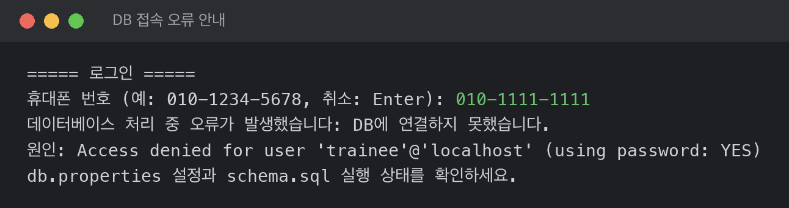

| 화면에 나온 메시지 | 원인 | 해결 |
| --- | --- | --- |
| `db.properties 파일을 읽지 못했습니다.` | `db.properties`를 만들지 않았다 | ④ |
| `회원 SQL 파일을 읽지 못했습니다.`<br>원인: `src/main/java/latecatcher/mapper/member-query.xml ...` | 작업 디렉터리가 프로젝트 폴더가 아니다 | **Run → Edit Configurations → Working directory**를 프로젝트 폴더로 |
| 원인: `Access denied for user '...'@'localhost' (using password: YES)` | 사용자 이름·비밀번호가 틀렸다 | `db.properties`의 `user`, `password` |
| 원인: `Unknown database 'latedb'` | `schema.sql`을 실행하지 않았다 | ③ |
| 원인: `Access denied for user '...'@'%' to database 'latedb'` | 그 사용자에게 `latedb` 권한이 없다 | 그 사용자에게 `latedb` 권한을 준다 (⓪) |
| 원인: `Communications link failure` | MySQL 서버가 꺼져 있다 | MySQL 서버를 켠다 (Windows는 서비스 **MySQL80**) |
| ③ Test Connection이 실패한다 | 사용자 이름·비밀번호, 서버 꺼짐, 드라이버 없음 | 입력값 확인, 서버 켜기, **Download missing driver files** |
| `Duplicate entry '010-1111-1111'` (③ `insert.sql` 실행 중) | `insert.sql`을 두 번 실행했다 | `schema.sql` → `insert.sql` 다시 |
| Run 창의 한글이 `???`이나 이상한 글자로 나온다 | 콘솔 인코딩 | ②-4를 적용한다. 그래도 깨지면 **Help → Edit Custom VM Options**에 `-Dfile.encoding=UTF-8`을 한 줄 추가하고 IntelliJ를 재시작 |
| `java: cannot find symbol` (`getName()` 등) | Lombok 처리가 꺼져 있다 | **Settings → Build, Execution, Deployment → Compiler → Annotation Processors → Enable annotation processing** |
| 테스트가 `ClassNotFoundException`·`GradleWorkerMain`으로 실패 / Gradle 동기화 실패 | 프로젝트 경로나 사용자 폴더에 한글이 있다 | 프로젝트를 `C:\dev` 아래로 다시 clone한다. 사용자 이름이 한글이면 **Settings → Build Tools → Gradle → Gradle user home**을 `C:\gradle`로 바꾸고 다시 동기화 |


### 사용 화면

> 10/27에 `insert.sql` 샘플 데이터 위에서 실제로 실행한 기록이다. **초록색이 사용자가 입력한 값**이고, 반복되는 메뉴 출력은 `··· (생략) ···`으로 줄였다.
> 예시 회원은 **홍길동**(`010-5555-5555`)이고, 샘플 회원 이름은 이니셜로 바꿔 캡처했다.

```text
===== 출결 관리 시스템 =====          ===== 과정 메뉴 =====
1. 회원가입                            1. 내 출결 리스크 보기
2. 로그인                              2. 출결 입력
9. 프로그램 종료                       3. 반 전체 현황(월별 순위, 80% 미달자, 기록 없음)
                                       4. 과정 설정
                                       5. 수업일 캘린더
                                       6. 회원 탈퇴
                                       7. 로그아웃
                                       9. 프로그램 종료
```

#### 핵심 흐름 — 입실·퇴실만 넣으면 판정하고, 위험을 미리 알려 준다

**① 출결 입력 → 자동 판정 (L-05)** — 09:40 입실·16:50 퇴실은 **지각·조퇴**, 10:20 입실·13:20 퇴실은 들은 시간이 3시간이라 **결석**으로 저장된다 ([판정 순서](#출결-규칙-코드의-심장)).

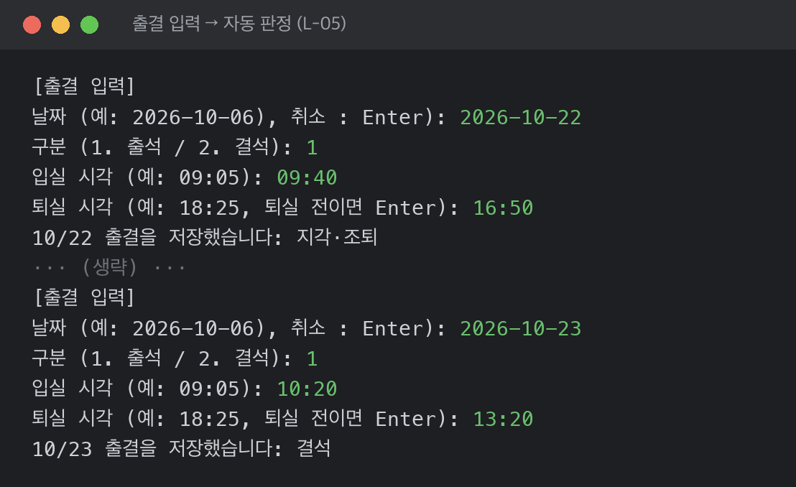

**② 내 출결 리스크 (L-08)** — 이번 달 출석률을 계산하고, **결석 며칠·지각 몇 번 더 하면 장려금 기준(80%) 아래**인지 알려 준다. (샘플 YY 계정, 출석률 83.3%)

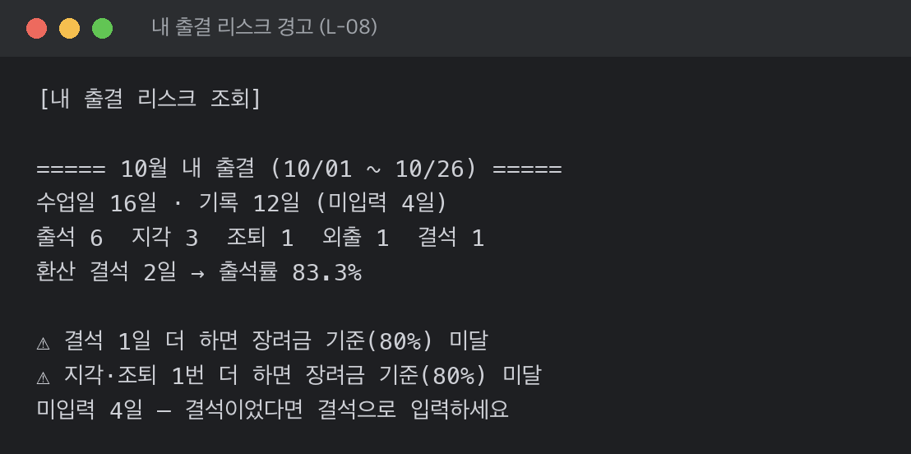

#### 기능별 화면 — 눌러서 펼친다

<details><summary><b>L-01 회원가입</b> — 정상 가입 · 나이에 문자 · 번호 형식 오류 · 이미 있는 번호</summary>

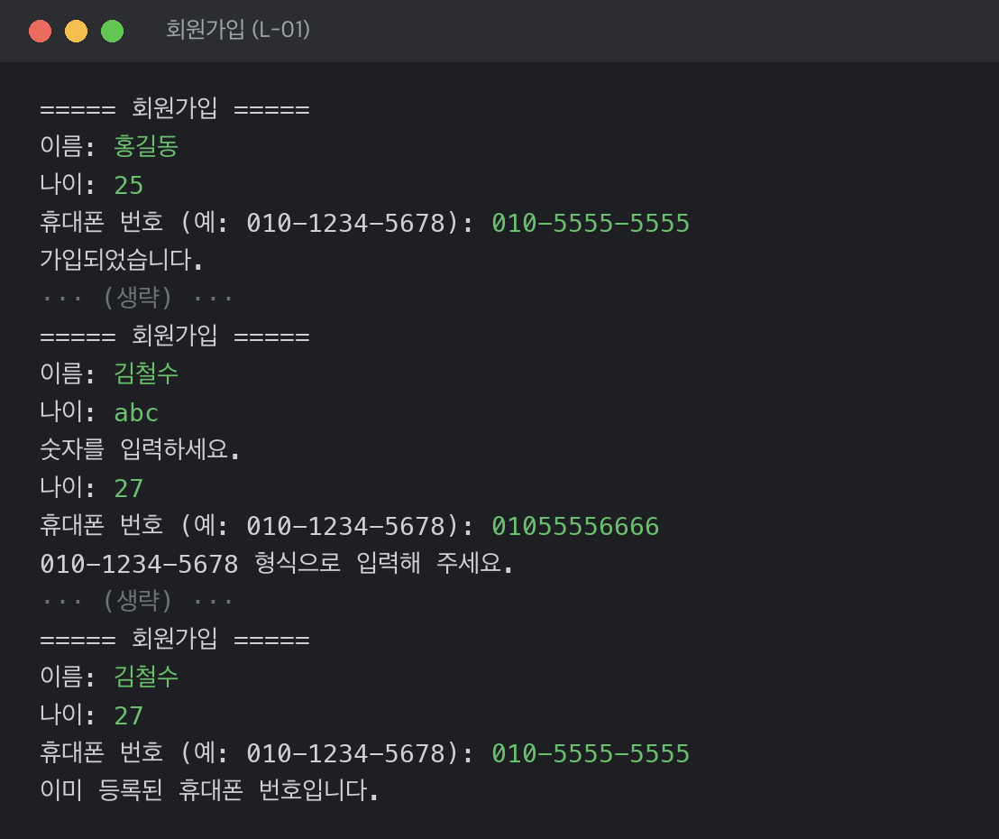

</details>

<details><summary><b>L-02 로그인</b> — 등록되지 않은 번호 · 형식 오류 후 로그인</summary>

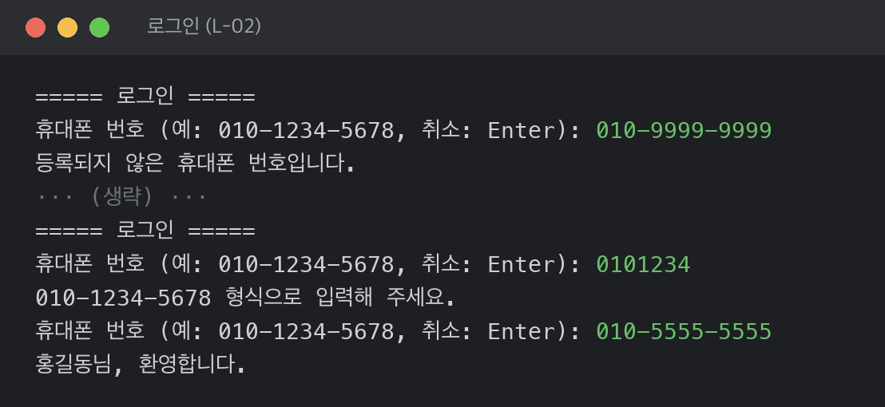

</details>

<details><summary><b>L-03 과정 설정</b> — 날짜·시각 형식 오류 후 등록</summary>

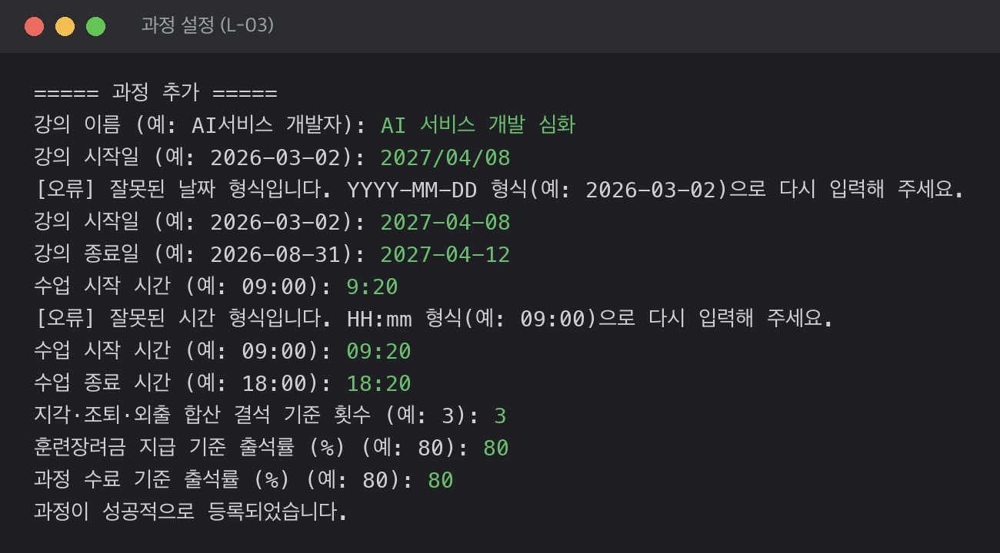

</details>

<details><summary><b>L-04 수업일 캘린더</b> — 수업일 생성(주말은 휴일) · 없는 과정 번호</summary>

L-03에서 등록한 2번 과정(2027-04-08 ~ 04-12)의 날짜를 **한 트랜잭션으로** 만든다.

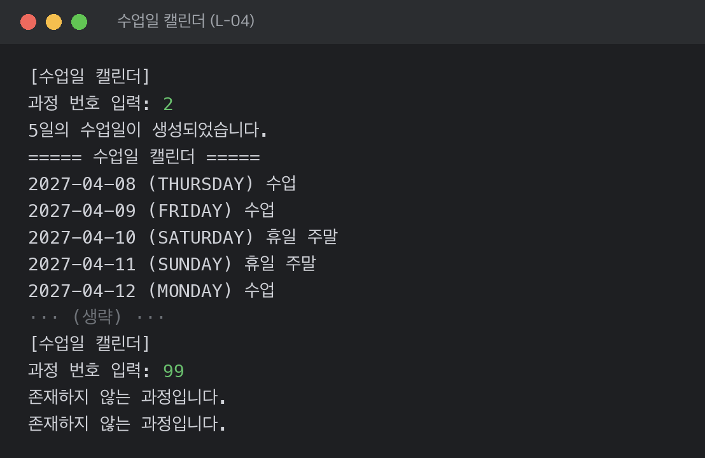

</details>

<details><summary><b>L-05 출결 입력</b> — 공휴일 · 오늘 · 날짜 형식 · 이미 입력한 날 · 퇴실 전 · Enter로 취소</summary>

프로그램이 끝나지 않고 이유를 알려 준 뒤 날짜부터 다시 묻는다. 이미 있는 기록은 덮어쓰지 않는다.

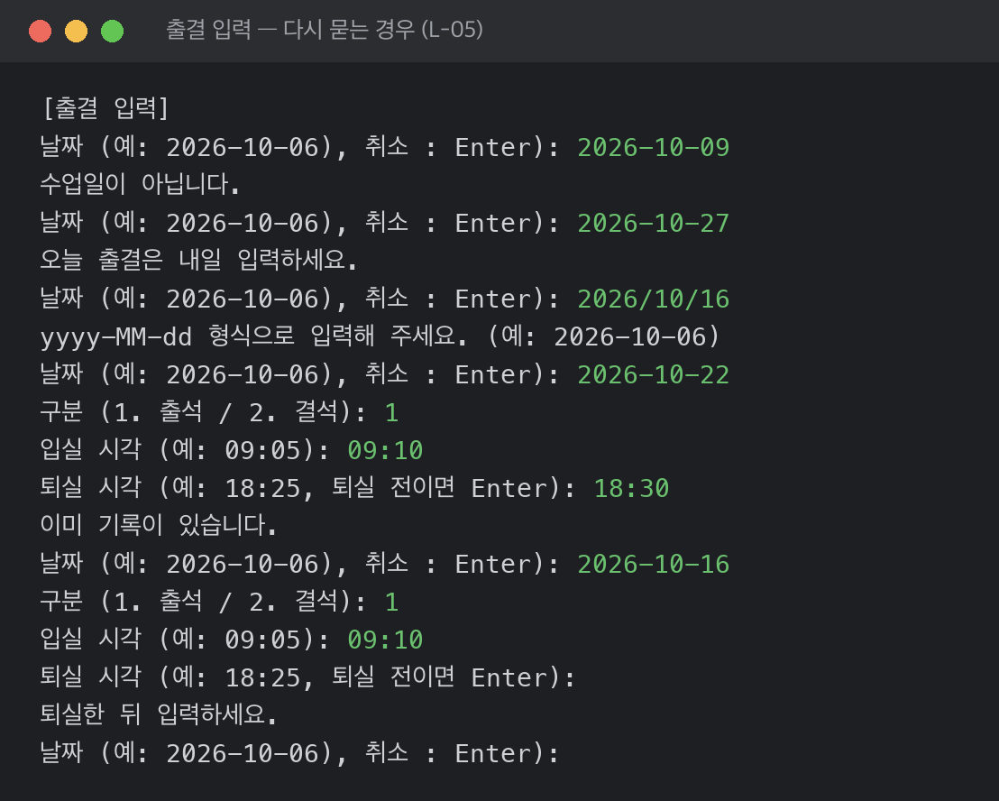

</details>

<details><summary><b>L-08 내 출결 리스크</b> — 이번 달 기록 없음 · 이미 80% 미달</summary>

기록이 없으면 계산하지 않고, 이미 기준 아래면 경고 대신 미달을 알린다.

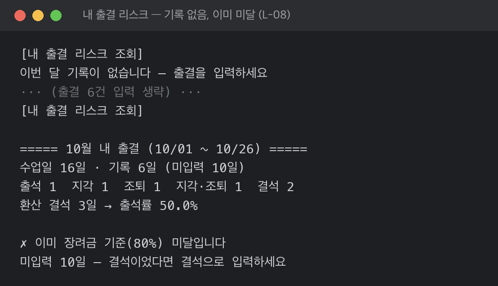

</details>

<details><summary><b>L-09 반 전체 현황</b> — 출석률 순위 · 80% 미달 · 경계(80% 이상 85% 이하) · 기록 없음 · 훈련 기간 밖 월 · 형식 오류</summary>

미달 명단은 SQL `HAVING`으로, 기록 없음은 `LEFT JOIN … IS NULL`로 구하고, 순위·경계는 L-08과 같은 `AttendanceRule`로 계산한다.

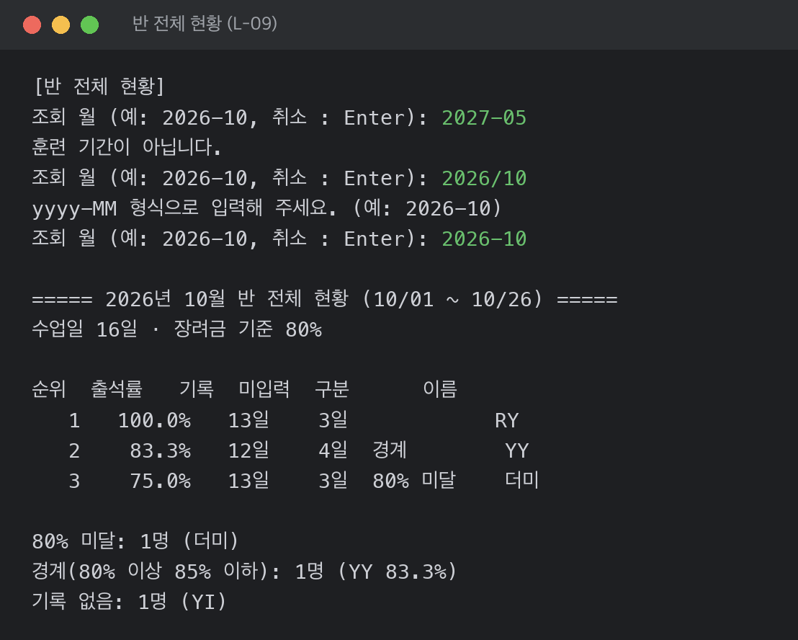

</details>

<details><summary><b>L-10 로그아웃</b> — 로그아웃 후 시작 메뉴</summary>

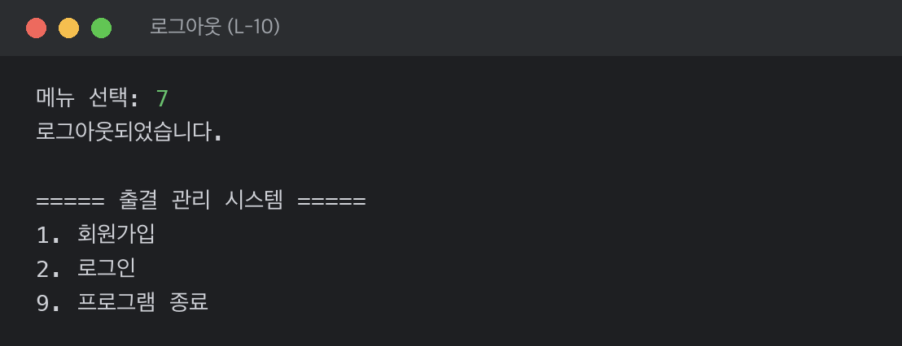

</details>

<details><summary><b>L-11 회원 탈퇴</b> — 탈퇴 취소 · 탈퇴 · 탈퇴한 번호로 로그인</summary>

`Y`를 넣어야 탈퇴한다. 그 회원의 출결 기록도 함께 지워진다 (`ON DELETE CASCADE`).

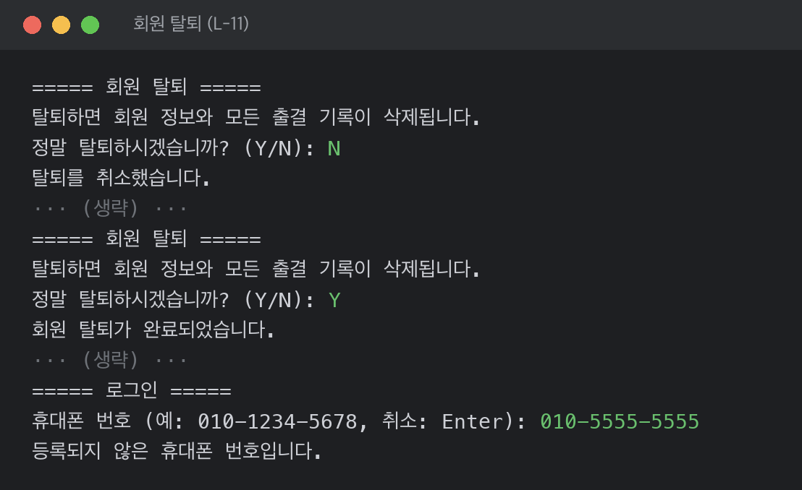

</details>

<details><summary><b>L-12 메뉴·종료</b> — 문자 입력 · 없는 메뉴 번호 · 프로그램 종료</summary>

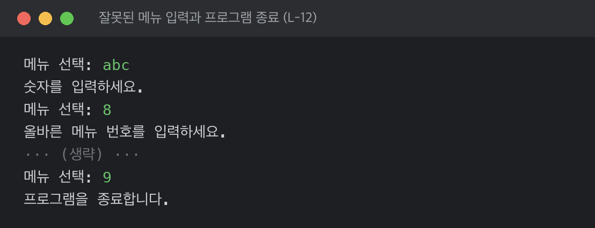

</details>

### 기능별 구현 현황 (10/27 기준)

| ID | 기능 | 메뉴 | 상태 | PR |
| :---: | --- | :---: | :---: | --- |
| L-01 | 회원가입 | 시작 1 | ✅ 완료 | #27 |
| L-02 | 로그인 | 시작 2 | ✅ 완료 | #25, #35 (L-03 머지 때 끊긴 연결 복구) |
| L-03 | 과정 설정 | 4 | ✅ 완료 | #26, #33 |
| L-04 | 수업일 캘린더 | 5 | ✅ 완료 | #31 |
| L-05 | 출결 규칙 (`AttendanceRule`) | — | ✅ 완료 | #28, #30 |
| L-05 | 출결 입력 | 2 | ✅ 완료 | #35 |
| L-08 | 내 출결 리스크 | 1 | ✅ 완료 | #34 |
| L-09 | 반 전체 현황 | 3 | ✅ 완료 | #40 |
| L-10 | 로그아웃 | 7 | ✅ 완료 | #39 |
| L-11 | 회원 탈퇴 | 6 | ✅ 완료 | #27 (탈퇴 로직), #39 (Y 확인·메뉴 연결) |
| L-12 | 프로그램 종료·메뉴 통합 | 9 | ✅ 완료 | #39 (잘못된 입력에도 종료되지 않음) |

**알려진 한계**
- 수업일 캘린더는 주말만 빼고 만든다. 공휴일·휴강 등록 메뉴가 없어 샘플 공휴일은 `insert.sql`에 넣어 두었다.
- 수업일을 만들면 "N일의 수업일이 생성되었습니다."의 N에 주말도 포함된다 (예: 04/08 ~ 04/12 → 5일 = 수업 3일 + 주말 2일). 요일은 `MONDAY`처럼 영어로 나온다.
- 없는 과정 번호를 넣으면 "존재하지 않는 과정입니다."가 두 번 나온다 (생성과 조회가 각각 안내한다).
- 반 전체 현황(L-09)이 쓰는 월별 집계 뷰는 휴일을 거르지 않는다. 지금은 수업일을 휴일로 바꾸는 기능이 없고 L-05가 휴일 입력을 막아 내 출결 리스크(L-08)와 결과가 같다.
- 과정을 여러 개 등록해도 출결 판정은 가장 먼저 등록한 과정(가장 작은 `course_id`)을 쓴다. 여러 과정 관리는 v0.1 범위 밖이다.
- 잘못 입력한 출결을 고치거나 지우는 기능이 없다 (v0.2에서 고용24 표 가져오기로 바로잡을 계획).


### 테스트

**43개 통과** — DB 없이 규칙만 검증한다.

| 테스트 | 개수 | 확인하는 경계값 |
| --- | :---: | --- |
| [`AttendanceRuleTest`](src/test/java/latecatcher/rule/AttendanceRuleTest.java) | 37 | 정각 입실·퇴실은 출석, 1분 늦으면 지각, 지각이면서 조퇴, 최소 수업 시간 정확히 4시간·1분 모자람, 지각 2·3·5회 환산, 정확히 80%, 공결 제외, 기록 0일, 오늘 줄 제외 |
| [`AttendanceRiskTest`](src/test/java/latecatcher/rule/AttendanceRiskTest.java) | 6 | 결석 며칠·지각 몇 번 더면 80% 아래인지 |

<br>

---


## 5. 회고

### 기획 의도와의 부합 정도
- 핵심인 **출결 규칙**(판정·환산·출석률)을 순수 Java로 옮기고 JUnit 43개로 경계값을 검증했다.
- 입실·퇴실 시각만 넣으면 규칙대로 판정해 저장하고(L-05), "결석 며칠·지각 몇 번 더면 80% 미달"을 바로 알려 주는(L-08) 처음 의도한 흐름이 완성됐다.
- 고용24 표 가져오기(v0.2)는 하지 못했다.
- (팀 의견 추가)


### 달성도
| ID | 기능명 | 구현 여부 | 비고 |
| :---: | --- | :---: | --- |
| L-01 | 회원가입 | ✅ | |
| L-02 | 로그인 | ✅ | |
| L-03 | 과정 설정 | ✅ | |
| L-04 | 수업일 캘린더 | ✅ | 휴일 등록 메뉴 없음 |
| L-05 | 출결 규칙 | ✅ | |
| L-05 | 출결 입력 | ✅ | |
| L-08 | 내 출결 리스크 | ✅ | |
| L-09 | 반 전체 현황 | ✅ | |
| L-10 | 로그아웃 | ✅ | |
| L-11 | 회원 탈퇴 | ✅ | |
| L-12 | 프로그램 종료·메뉴 통합 | ✅ | |

**전체 달성도: 11 / 11 (100%)** — v0.1 MVP 기준

### 느낀 점

**YY**
> JAVA와 JDBC 활용 로직을 알 수 있어서 좋았다. 특히 github를 활용해 협업의 프로세스를 연습하고 실습할 수 있어 향후 업무에도 도움이 될 것 같다.
> 특별히 MVC 패턴 기반의 계층형 구조(Controller–Repository)를 익힐 수 있어서 공부가 되었던 반면, 일부 JAVA 코드 구현에 어려움도 있어 시간이 걸렸고,
> 자바 코드의 구현은 아직은 온전히 스스로 해결하기 어렵다는 생각도 들었다.
> 전체적인 설계 문서를 먼저 만들고(PLAN.md) 기반으로 ERD.md 생성 후 협업규칙인 컨벤션(convention.md)을 정의하고 협업에 들어가서 도움이 된 것 같다.
> 그 후 이슈->브랜치->PR과정을 실습하면서 충돌 해결 또는 충돌 해결이 오히려 코드 롤백을 일으켜 다시 구현하는 과정 등이 어려웠지만 좋은 경험과 공부가 되었다.
> 마지막으로 좋은 팀원들과 함께 할 수 있어서 좋았고, 팀원 1인이 마지막까지 함께 하지 못해서 아쉬움이 크지만 동시에 그 공백을 적극적으로 메워준 팀원 RY님께 특별한 감사 말씀을 드린다. 

**RY**
> 약 한달동안 처음 접하는 JAVA와 DB를 사용하여 프로젝트를 진행했는데요,  <br> 
> 혼자 작업하는게 아니다 보니 진행하는데 있어 어려움이 있었지만 데일리 스크럼과 커뮤니케이션을 통하여  <br>
> 이슈와 버그를 해결하고 규칙을 만들어 프로젝트를 완성하였습니다.   <br>
> 좋은 팀원과 함께 프로젝트를 할 수 있어서 좋았습니다.   <br>

**YI**
> *(YI는 개인 사정으로 마지막 정리에 함께하지 못해 RY가 대신 적습니다.)*  <br>
> 프로젝트 초기에 패키지·빌드 설정과 파일 뼈대를 만들어 세 명이 같은 구조 위에서 작업을 시작할 수 있었습니다.  <br>
> L-03 과정 설정과 L-12 프로그램 종료를 맡아 주었고, 마지막까지 함께하지 못해 아쉽지만 프로젝트의 출발점을 함께 만들어 주어 고마웠습니다.  <br>


### 개선할 점
- 공휴일·휴강 등록을 마무리하고, 수업일 생성 개수·중복 안내 메시지를 다듬는다.
- 잘못 입력한 출결의 수정·삭제
- v0.2: 고용24 출결 표 가져오기(L-06, 트랜잭션), 관리자 권한(L-16), 공휴일 API(L-13), 디스코드 알림(L-14)
- 다양한 과정을 추가할 수 있게 하여 코드랩 내의 고용24출결 관리 프로그램으로 사용될 수 있도록 해 보는 것. 

<br>

---

## 6. 참고 문서

| 문서 | 내용 |
| --- | --- |
| [docs/PLAN.md](docs/PLAN.md) | 프로젝트 계획 — 출결 규칙, 기능·유스케이스, 데이터 설계, 역할 분담 |
| [docs/CONVENTION.md](docs/CONVENTION.md) | 커밋·브랜치·라벨·이슈·PR 규칙 |
| [docs/SCHEDULE.md](docs/SCHEDULE.md) | 일정과 단계별 머지 계획 |
| [docs/erd.md](docs/erd.md) | 합의 ERD와 정규화 점검 |
| [docs/erd-extended.md](docs/erd-extended.md) | 회의 전 확장 ERD (비밀번호 로그인, 여러 과정) |
