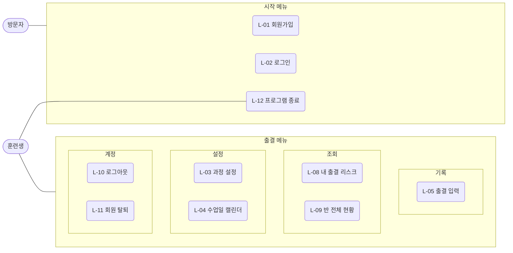

# 지각 잡는 자바 (java-latecatcher) — 3WHY 팀 프로젝트 계획

> slx-ai-campus에서 Java → MySQL → JDBC를 배운 뒤 만드는 첫 팀 프로젝트. 팀 **3WHY** (3명).
> 수업에서 받은 **JDBC 구독관리 스켈레톤**(`skeleton` 패키지, OTT 구독 관리)을
> **훈련생 출결 리스크 매니저**로 변형한다.
> GitHub 협업(이슈 → 브랜치 → PR → 리뷰 → 머지)을 함께 연습한다. 팀 규칙: [CONVENTION.md](CONVENTION.md)

---

## 1. 한 줄 정의

**고용24 출결 규칙(지각·조퇴 환산, 출석률 80%)을 코드로 옮겨서, 우리 반 훈련생 각자가 "지금 몇 번 더 늦으면 장려금·수료가 위험한지"를 바로 알 수 있게 해 주는 콘솔 프로그램.**

---

## 2. 왜 이것인가

- 우리는 매일 고용24 앱으로 QR 출결을 찍는다. 출석률에 **훈련장려금과 수료**가 걸려 있다.
- 그런데 "지각 2번 + 결석 1번이면 이번 달 출석률이 몇 %지?"를 바로 알려 주는 화면은 없다. 규칙이 머릿속 암산이다.
- 고용24는 개인 출결을 외부로 내보내는 API가 없다 (확인함). 그래서 **데이터는 손으로 넣고(v0.1) 고용24 화면의 표를 복사해 가져오며(v0.2), 규칙은 코드가 계산**한다. 고용24에는 출결 파일 내려받기도 없다 (8절).
- 사용자는 우리 팀 3명에서 시작해 반 전체로 넓힐 수 있다. **만드는 동안 실제로 쓴다.**

### 사용 장면

```text
[로그인: 010-1234-5678]
===== 이영희 — 10월 출결 =====
수업일 22일 중 어제까지 16일 · 기록 16일 (미입력 0일)
출석 12  지각 2  조퇴 1  결석 1
환산 결석: 1 + (2+1)/3 = 2일  →  출석률 87.5%

⚠ 지각/조퇴 1회 더 → 환산 결석 2일 (변화 없음, 다음 1회에 3일 = 81.3%)
⚠ 결석 1일 더      → 환산 결석 3일 = 81.3%
⚠ 결석 2일 더      → 75.0%  ✗ 장려금 기준(80%) 미달
```

---

## 3. 출결 규칙 (코드의 심장)

아래는 국민내일배움카드 과정에서 일반적으로 적용되는 규칙이다. **정확한 수치는 훈련기관 안내문으로 확정하고 이 표를 고친다.** 코드는 이 값들을 상수가 아니라 `course_tbl` 설정값으로 읽는다.

| 규칙 | 기본값 (확인 필요) | 설정 컬럼 |
| --- | --- | --- |
| 수업 시작 / 종료 시각 | **09:20 / 18:20** (slx-ai-campus, 확인됨) | `start_time`, `end_time` |
| 지각 | 시작 시각 이후 입실 | — |
| 조퇴 | 종료 시각 이전 퇴실 | — |
| 최소 수업 시간 | 들은 시간 = 퇴실 − (입실과 시작 중 **늦은 쪽**). **4시간 미만이면 결석** (지각이어도). 정확히 4시간이면 채운 것으로 본다 (10/26 결정) | `min_attend_minutes` = 240 |
| 지각이면서 조퇴 | 최소 수업 시간을 채우면 **지각·조퇴(`LATE_EARLY_LEAVE`)**로 저장하고 환산 횟수에 **2회**로 포함한다 (10/26 결정. 10/23의 "지각으로 저장, memo에 조퇴" 안을 바꿈) | 상태 `LATE_EARLY_LEAVE` |
| 퇴실 기록 없음 | **결석** (고용24 판정과 같음) | — |
| 계산 기준일 | **어제까지.** 오늘은 계산에서 뺀다 | — |
| 기록이 없는 수업일 | **미입력.** 결석 개수에 포함하지 않고 계산에서 뺀다. 미입력 일수는 화면에 따로 보여 준다 | — |
| 지각·조퇴·외출 환산 | **3회 = 결석 1일** (`floor(count / 3)`) | `partial_per_absence` = 3 |
| 외출 | 입실·퇴실 시각에 남지 않고 매니저·강사에게 사후에 서류로 처리한다. **v0.1에는 입력 경로가 없어 계산에 들어가지 않는다.** 고용24 가져오기(v0.2)로만 들어오고, 그때는 지각·조퇴처럼 환산한다 | 상태 `OUTING` |
| 단위기간 | 훈련 시작일 기준 1개월 | `unit_period_days` = 30 또는 월 단위 |
| 장려금 기준 출석률 | 단위기간 **80% 이상** | `allowance_threshold` = 80 |
| 수료 기준 출석률 | 전체 **80% 이상** | `completion_threshold` = 80 |
| 공결(인정 결석) | 출석률 분모·분자 모두 제외 | 상태 `EXCUSED` |

출석률 공식:

```text
환산 결석 = 결석 일수 + floor((지각 + 조퇴 + 외출) / 3)     (지각·조퇴인 날은 지각 1 + 조퇴 1로 포함)
출석률   = (기록 일수 − 공결 − 환산 결석) / (기록 일수 − 공결) × 100
기록 일수 = 훈련 시작일 ~ 어제 사이의 수업일 가운데 출결 기록이 있는 날   (오늘 포함하지 않음)
미입력 일수 = 같은 기간의 수업일 − 기록 일수   (계산에 넣지 않고 화면에만 보여 준다)
```

**기록이 없는 날을 빼는 이유:** 결석도 L-05에서 기록하고, 고용24에서 가져온 표에도 결석한 날이 `결석` 줄로 들어 있다. 그래서 기록이 없는 날은 결석이 아니라 **아직 입력하지 않은 날**이다. 이를 결석으로 세면 가입만 하고 입력하지 않은 사람, 마지막 가져오기 이후의 날이 모두 결석이 된다. 대신 미입력 일수를 함께 보여 주어, 결석을 입력하지 않고 비워 두면 출석률이 실제보다 높게 나올 수 있다는 것을 본인이 알게 한다. 기록이 0일이면 출석률을 계산하지 않는다 ("기록 없음").

**오늘을 빼는 이유:** 퇴실 기록이 없으면 결석이다. 그런데 오늘은 아직 퇴실하지 않았어도 퇴실 기록이 없으니, 오늘을 넣으면 수업 중인 사람도 결석으로 계산된다. 고용24도 "당일 출석결과는 익일 반영"이다. 그래서 오늘 줄은 DB에 있어도 출석률·환산 결석·경고 계산에 넣지 않는다. 기준일은 `LocalDate.now().minusDays(1)`로 정하고, `AttendanceRule`에는 인자로 넘겨 테스트에서 날짜를 고정할 수 있게 한다.

이 계산은 **순수 Java(`AttendanceRule`)** 에 둔다. SQL은 상태별 개수만 구하고, Java가 규칙을 적용한다. 그래야 JUnit으로 규칙만 따로 테스트할 수 있다.

**상태 판정 순서 (`AttendanceRule.judge`)** — 위에서부터 먼저 걸리는 것으로 정한다.

1. 입실이나 퇴실 시각이 없다 → `ABSENT`
2. 들은 시간(퇴실 − 입실과 시작 중 늦은 쪽)이 최소 수업 시간(`min_attend_minutes`, 240분) **미만**이다 → `ABSENT` (지각이어도)
3. 입실이 시작 시각 **이후**이고 퇴실이 종료 시각 **이전**이다 → `LATE_EARLY_LEAVE`
4. 입실이 시작 시각 **이후**다 → `LATE`
5. 퇴실이 종료 시각 **이전**이다 → `EARLY_LEAVE`
6. 그 밖 → `PRESENT`

- 최소 수업 시간 검사를 지각·조퇴보다 **먼저** 한다. 4시간을 채우지 못하면 지각·조퇴가 아니라 결석이다.
- 들은 시간은 입실과 시작 시각 중 **늦은 쪽**부터 잰다. 일찍 온 시간(예: 08:50~09:20)은 수업 시간에 포함하지 않는다. 지각하면 입실 시각부터 잰다 (10:20 입실이면 14:20부터 조퇴 인정).
- 정각은 지각·조퇴가 아니다. 시작 시각에 입실(09:20)하면 출석, 종료 시각에 퇴실(18:20)하면 조퇴가 아니다. 최소 수업 시간은 정확히 4시간이면 채운 것으로 본다.
- `OUTING`(외출)은 시각으로 판정하지 않는다. 사후 서류 처리라 v0.1에는 입력 경로가 없고 고용24 가져오기(v0.2)로만 들어온다 (위 표). 그래도 `AttendanceStatus.OUTING`의 환산 횟수는 1로 둔다. v0.2에서 가져온 외출을 환산에 넣기 위해서다.
- `EXCUSED`(공결)는 시각으로 판정하지 않는다. 사용자가 직접 고르는 상태다.
- `AttendanceStatus`는 상태마다 **환산 횟수**(`partialCount`)를 가진다. `LATE`·`EARLY_LEAVE`·`OUTING`은 1, `LATE_EARLY_LEAVE`는 2, 나머지는 0이다. 지각·조퇴·외출 합계는 이 값을 더해서 구한다.
- `isEarlyLeave(LocalTime checkOut, Course course)`는 "퇴실 시각이 있고 종료 시각 이전이면 `true`"만 판단한다. 최소 수업 시간 검사는 `judge`가 따로 한다. memo에 "조퇴"를 남기던 10/23 방식은 쓰지 않는다.

판정 테스트 (과정 09:20~18:20, 최소 수업 시간 240분, `AttendanceRuleTest`):

| 입력 | 기대 |
| --- | --- |
| 입실 09:20, 퇴실 18:20 | `judge` → `PRESENT` (정각은 지각·조퇴 아님) |
| 입실 09:21, 퇴실 18:20 | `judge` → `LATE` |
| 입실 09:30, 퇴실 17:00 | `judge` → `LATE_EARLY_LEAVE` (지각이면서 조퇴, 4시간 이상) |
| 입실 09:20, 퇴실 17:00 | `judge` → `EARLY_LEAVE` (지각 아님) |
| 입실 09:20, 퇴실 13:20 | `judge` → `EARLY_LEAVE` (정확히 4시간) |
| 입실 09:20, 퇴실 13:19 | `judge` → `ABSENT` (4시간 미만) |
| 입실 10:20, 퇴실 13:20 | `judge` → `ABSENT` (지각 후 3시간) |
| 입실 10:20, 퇴실 14:20 | `judge` → `LATE_EARLY_LEAVE` (지각 후 4시간) |
| 입실 12:20, 퇴실 18:20 | `judge` → `LATE` (지각 후 6시간, 종료까지 있음) |
| 입실 08:50, 퇴실 13:00 | `judge` → `ABSENT` (일찍 온 시간은 포함하지 않음, 3시간 40분) |
| 퇴실 18:20 | `isEarlyLeave` → `false` (정각은 조퇴 아님) |
| 퇴실 없음 | `judge` → `ABSENT` |

---

## 4. 기능

스켈레톤 기능 목록(F-01 ~ F-11)과 같은 형식으로 정리한다. 번호는 스켈레톤 이슈와 헷갈리지 않게 `L-`를 붙인다.
**스켈레톤** 컬럼은 대응하는 스켈레톤 기능과 활용 방식이다. 클래스 단위 변환은 [6절](#6-스켈레톤--지각-잡는-자바-변환표)을 본다.
**담당**은 [11절](#11-팀-구성과-역할-분담-3명)의 A·B·C이다 (10/22 회의 반영). 단계와 이슈·PR 번호는 [SCHEDULE.md 기능별 담당](SCHEDULE.md#기능별-담당--v01-mvp).

**v0.1은 MVP다.** 출결 규칙과 수동 입력만으로 "몇 번 더 늦으면 위험한가"를 보여 주는 데 집중한다. 고용24 표 가져오기(L-06)와 권한 구분(L-16)은 v0.2로 미룬다 ([14절](#14-열린-질문-정해지면-이-문서를-고친다) 8·9번).

### v0.1 — MVP (출결 규칙 + 수동 입력)

| 번호 | 기능명 | 영문 이름(브랜치) | 입력 | 핵심 동작 | 스켈레톤 | 담당 |
| --- | --- | --- | --- | --- | --- | --- |
| L-01 | 회원가입 | `sign-up` | 이름, 나이, 휴대폰 번호 | 빈 값과 나이(1 이상)를 검사하고, 휴대폰 번호 형식(**`010-1234-5678`**, DB `CHECK`와 같은 정규식으로 Java가 먼저 확인)과 중복을 확인한 뒤 훈련생을 등록한다. 이름을 물을 때 **"성과 이름을 띄어쓰기 없이 입력해 주세요"** 를 안내한다. 비밀번호는 없다. | F-01 그대로 + 휴대폰 번호 형식 확인 추가 | A |
| L-02 | 로그인 | `phone-login` | 휴대폰 번호 | 휴대폰 번호로 훈련생을 조회해 있으면 로그인 상태로 보관한다. 비밀번호는 없다 (10/22 ERD 회의). | F-02 그대로 | B |
| L-03 | 과정 설정 | `course-setting` | 과정명, 훈련 시작·종료일, 수업 시작·종료 시각, 규칙 수치 | `course_tbl`에 과정 1행을 저장하거나 수정한다. 규칙 수치는 3절의 설정 컬럼이다. v0.1에서는 **권한 없이 모든 훈련생**이 쓴다. | 신규 | C |
| L-04 | 수업일 캘린더 | `class-calendar` | (생성) 없음 / (휴일 등록) 날짜, 메모 | 훈련 기간의 평일을 `class_day_tbl`에 **한 트랜잭션으로** 생성한다 (하나라도 실패하면 전부 롤백 — v0.1의 트랜잭션 실습). 공휴일·휴강일은 수동으로 수업일에서 뺀다. v0.1에서는 **권한 없이 모든 훈련생**이 쓴다. | 신규 | A |
| L-05 | 출결 입력 (수동) | `attendance-checkin` | 날짜, 구분(출석/결석), 출석이면 입실·퇴실 시각 | 수업일인지 확인한다. 출석이면 입실·퇴실 시각을 둘 다 받아 과정의 시작·종료 시각으로 상태(출석/지각/조퇴)를 판정해 저장하고, 결석이면 시각 없이 `결석`으로 저장한다. 같은 날짜 중복 입력은 알려 준다. v0.1은 콘솔 입력만 받고, 나중에 메신저 입력(L-15)이 같은 저장 경로를 쓴다. | F-04 변형: 구독 추가 → 출결 추가. 만료일 계산 → 상태 판정 | B |
| ~~L-06~~ | ~~출결 가져오기~~ | — | — | **v0.2로 옮겼다** (아래 v0.2 표). | — | — |
| ~~L-07~~ | ~~결석 일괄 마감~~ | — | — | **삭제.** 결석은 L-05에서 직접 입력하고, 기록이 없는 날은 결석이 아니라 "미입력"으로 계산에서 뺀다 (3절). 다른 훈련생의 빈 날을 결석으로 채우는 문제도 함께 없어진다. 번호는 다시 쓰지 않는다. | — | — |
| L-08 | 내 출결 리스크 | `my-risk` | 없음 (이번 달) | 로그인 훈련생의 월별 출석률과 환산 결석을 계산하고, 몇 번 더 늦으면 80% 아래로 떨어지는지 경고한다. 2절 사용 장면 화면이다. | F-03 변형: 현재 구독 조회 → 이번 달 출결 집계 | C |
| L-09 | 반 전체 현황 | `class-status` | 조회 월 | 전체 훈련생의 월별 출석률 순위와 **80% 미달·경계(85% 이하) 명단**을 보여 준다. | 신규 | A |
| L-10 | 로그아웃 | `logout` | 없음 | 로그인 정보를 제거하고 시작 메뉴로 돌아간다. | F-09 그대로 | B |
| L-11 | 회원 탈퇴 | `withdraw` | 탈퇴 확인 | 훈련생의 모든 출결 기록과 회원 정보를 삭제한 후 로그인 상태를 해제한다. | F-10 변형: 구독 기록 → 출결 기록 | A |
| L-12 | 프로그램 종료 | `exit` | 메뉴 번호 9 | 시작 메뉴 또는 출결 메뉴에서 프로그램을 종료한다. | F-11 변형: 구독 관리 메뉴 → 출결 메뉴 | C |

### v0.2 — 확장 (출결 가져오기, 권한, 외부 데이터)

| 번호 | 기능명 | 영문 이름(브랜치) | 입력 | 핵심 동작 | 스켈레톤 | 담당 |
| --- | --- | --- | --- | --- | --- | --- |
| L-06 | 출결 가져오기 | `attendance-import` | 붙여 넣은 텍스트 파일 경로, 저장 확인(y/n) | 고용24 출결 화면에서 복사해 저장한 표를 읽어 미리보기를 보여 주고, 확인을 받으면 한 트랜잭션으로 저장한다. **한 줄이라도 실패하면 전체 취소**한다. 같은 날짜에 수동 입력이 있으면 **가져온 값이 최종 값**이 된다. 페이지 전체를 복사해도, 출결 표만 복사해도 같게 동작한다. 설계는 [8절](#8-출결-가져오기--파일-업로드의-콘솔-버전). **v0.1에서 제외** — MVP에 꼭 필요하지 않은 추가 기능이다 (10/22, YI 제안). | 신규 | v0.1 후 정함 |
| L-16 | 관리자 권한 | `admin-role` | — | v0.1 스키마에 미리 둔 `member_tbl.role`(`ADMIN`/`TRAINEE`)을 써서 과정 설정(L-03)·수업일 캘린더(L-04)를 관리자만 쓰게 한다. 메뉴에서 숨기고 컨트롤러에서도 다시 확인한다. v0.1에서는 권한 없이 모든 훈련생이 쓴다. | 신규 | v0.1 후 정함 |
| L-13 | 공휴일 API | `holiday-api` | 연도 | 공공데이터포털 특일정보 API로 `class_day_tbl`의 공휴일을 자동 반영한다. (`HttpClient` + JSON) | 신규 | v0.1 후 이슈로 나눔 |
| L-14 | 디스코드 알림 (검토) | `discord-notify` | 디스코드 웹훅 URL (훈련생별, 선택) | 매일 정해진 시각에 어제까지의 출석률과 경고를 훈련생 본인의 디스코드 채널로 보낸다. 웹훅은 보내기만 하므로 `HttpClient` + JSON으로 충분하다. 디스코드에서 출결을 **받는** 기능은 v0.2에서 하지 않는다 — 아래 향후 확장(L-15). | 신규 | v0.1 후 검토 |

### 향후 확장 — 계획만 (v0.1·v0.2 범위 밖)

| 번호 | 기능명 | 영문 이름(브랜치) | 입력 | 핵심 동작 | 스켈레톤 | 담당 |
| --- | --- | --- | --- | --- | --- | --- |
| L-07 | 결석 일괄 마감 | `absence-close` | 없음 | 지난 수업일 가운데 기록이 없는 날을 결석으로 저장한다 (노션 요구사항 명세). | 신규 | 정하지 않음 |
| L-15 | 메신저 출결 입력 | `messenger-checkin` | 디스코드(또는 텔레그램) 메시지 — 입실·퇴실 | 훈련생이 콘솔에 로그인하지 않고 메신저로 입실·퇴실을 보내면, 수동 입력(L-05)과 **같은 판정·저장 경로**로 기록한다. | L-05 확장 | 정하지 않음 |

- **L-07은 3절 규칙과 부딪힌다.** 지금 규칙은 기록이 없는 날을 결석이 아니라 **미입력**으로 보고 계산에서 뺀다. L-07을 만들면 "언제 미입력을 결석으로 확정하는가"를 3절에서 다시 정해야 한다. 그래서 v0.1·v0.2에는 넣지 않는다 (10/22 요구사항 명세 확정).
- **L-15 왜:** 출결 기록을 메신저로 받으면 이 프로그램을 고용24와 상관없는 모임 — SNS로 운영하는 스터디 그룹, 동아리 등 — 의 **출결부**로도 쓸 수 있다.
- **v0.1에서 미리 지킬 것:** 출결 판정·저장은 `AttendanceController`(→ `AttendanceRule`, `AttendanceRepository`)에 두고, 콘솔 입력(`AttendanceView`)은 값을 받아 넘기기만 한다. 그래야 나중에 입력 채널만 붙이면 된다. **v0.1의 L-05는 지금 계획 그대로 둔다.**
- **풀어야 할 것:** 메시지를 **받는** 봇은 디스코드 Gateway(웹소켓)나 텔레그램 폴링이 필요하고, 보통 외부 라이브러리를 쓴다. 12절의 "수업에서 배운 것만" 원칙과 부딪히므로 착수할 때 정한다. 메신저 계정과 훈련생을 잇는 방법(`member_tbl`에 메신저 ID 열 추가 등)도 그때 정한다.
- 메신저로 넣은 기록도 수동 입력과 같은 대우를 받는다. 같은 날짜를 고용24에서 가져오면(v0.2, L-06) **고용24 값이 최종**이다 ([8절](#8-출결-가져오기--파일-업로드의-콘솔-버전)).

### 스켈레톤에서 가져오지 않는 기능

| 스켈레톤 | 이유 |
| --- | --- |
| F-05 전체 구독 기록 조회 | 일자별 출결 목록은 v0.1에 두지 않는다. L-08이 월 집계를 보여 준다. 필요해지면 L-08에 일자 목록을 붙인다. |
| F-06 구독 기간 연장 | 출결에는 연장 개념이 없다. (`extendMembership` 삭제, 6절) |
| F-07 구독 기록 삭제 | 잘못 넣은 출결의 수정·삭제는 v0.1 범위 밖이다. 같은 날짜 중복은 UNIQUE 제약으로 막는다(L-05). |
| F-08 OTT별 이용 플랜 조회 | 대응하는 기능이 없다. 그룹으로 묶어 보여 주는 연습은 L-09가 맡는다. |

### 하지 않는 것

- 고용24 로그인 자동화·스크래핑 (불가능하고 약관 위반 소지)
- v0.1·v0.2에서 메신저로 출결 **입력 받기** — 향후 확장(L-15)으로 미룬다. v0.2의 메신저 연동은 디스코드 **알림**(L-14)만 검토한다
- 웹/GUI, 여러 과정 동시 관리, 커넥션 풀, 프레임워크
- 반 친구 데이터 무단 입력 — **본인 동의 + 본인 입력**만

### 유스케이스

위 기능 표를 **누가, 어떤 순서로, 무엇이 잘못될 수 있는지**로 풀어 쓴다. 번호를 새로 만들지 않고 **기능 번호(`L-xx`)를 그대로 유스케이스 번호로 쓴다** ([CONVENTION 0절](CONVENTION.md#0-번호-체계--기능-번호와-이슈-번호)).

#### 액터

| 액터 | 설명 |
| --- | --- |
| **방문자** | 로그인하지 않은 사용자. 시작 메뉴만 쓴다 |
| **훈련생** | 로그인한 사용자. v0.1에는 권한 구분이 없어 **출결 메뉴를 모두 쓴다** — 자기 출결 입력·조회, 반 전체 현황, 과정 설정·수업일 캘린더 |
| 관리자 (v0.2) | 과정 설정·수업일 캘린더를 관리자만 쓰게 하는 권한 구분은 v0.2(L-16)에서 둔다 |
| 고용24 (외부, v0.2) | 마이페이지 → 훈련현황의 출결 화면. 프로그램과 직접 연결하지 않고, 파일 내려받기도 없다. 훈련생이 표를 드래그로 복사해 텍스트 파일로 저장한다 (L-06) |
| 공공데이터포털 · 디스코드 (외부, v0.2) | L-13, L-14에서만 쓴다. 디스코드는 알림을 받기만 한다 |

#### 다이어그램 (v0.1)



#### 공통 규칙

- **계산 기준일은 어제다.** 출석률·환산 결석·경고는 모두 "훈련 시작일 ~ 어제"의 수업일 가운데 **기록이 있는 날**만 본다 ([3절](#3-출결-규칙-코드의-심장)).
- **권한:** v0.1에는 권한 구분이 없다. 로그인한 훈련생은 출결 메뉴를 모두 쓴다. 과정 설정·수업일 캘린더를 관리자만 쓰게 하는 것은 v0.2(L-16)에서 한다.
- 저장 실패(`SQLException`)는 스택트레이스 대신 **한 줄 안내**를 보여 주고 메뉴로 돌아간다.
- 메뉴에 없는 번호나 형식이 틀린 값(날짜, 시각)은 **다시 입력받는다.**

#### 핵심 유스케이스

**L-05 출결 입력 (수동)** — 훈련생

- 사전 조건: 로그인했다. 과정 설정(L-03)과 수업일 캘린더(L-04)가 있다.
- 기본 흐름
  1. 훈련생이 출결 메뉴에서 `2`를 고른다.
  2. 날짜와 구분(`1` 출석 / `2` 결석)을 입력한다. 외출은 고르지 않는다 (사후 서류 처리, 3절).
  3. 시스템이 그날이 수업일이고 어제 이전인지 확인한다.
  4. 출석이면 입실·퇴실 시각을 **둘 다** 입력받고, 시스템이 과정의 시작·종료 시각과 최소 수업 시간으로 상태(출석/지각/조퇴/지각·조퇴/결석)를 판정한다 (`AttendanceRule`, 3절 판정 순서). 들은 시간이 4시간 미만이면 결석이다. 결석이면 시각 없이 `결석`으로 정한다.
  5. 시스템이 저장하고 "10/06 지각으로 저장했습니다"처럼 결과를 보여 준다.
- 예외 흐름
  - 3a. 수업일이 아니다(주말·공휴일·휴강) → "수업일이 아닙니다" 후 2로.
  - 3b. 오늘이다 → "오늘 출결은 내일 입력하세요" 후 2로. 오늘은 계산에서도 빠진다 (3절).
  - 4a. 출석인데 퇴실 시각이 비어 있다 → 저장하지 않고 "퇴실한 뒤 입력하세요"를 보여 준다. v0.1에는 출결 수정 기능이 없어서, 입실만 저장하면 퇴실을 나중에 넣을 수 없다.
  - 5a. 그 날짜에 이미 기록이 있다 (UNIQUE 위반) → "이미 기록이 있습니다". 스택트레이스를 보여 주지 않는다. 수동 입력은 기존 기록을 **덮어쓰지 않는다.** v0.1에는 출결 수정 기능이 없다 (v0.2에서는 고용24 표를 가져와 바로잡는다, L-06).
- 사후 조건: `attendance_tbl`에 1행이 생긴다. **결석도 기록으로 남으므로, 기록이 없는 날은 "아직 입력하지 않은 날"이라는 뜻만 갖는다** (3절).

**L-06 출결 가져오기 (v0.2)** — 훈련생, 고용24

- 사전 조건: 로그인했다. 훈련생이 고용24 출결 화면의 표를 복사해 `data/`에 텍스트 파일로 저장해 두었다 ([8절](#8-출결-가져오기--파일-업로드의-콘솔-버전)).
- 기본 흐름
  1. 훈련생이 출결 메뉴에서 `3`을 고르고 파일 경로를 입력한다.
  2. 시스템이 파일에서 **날짜로 시작하는 6칸 줄**만 골라 파싱한다. 페이지 전체를 복사한 파일이든 출결 표만 복사한 파일이든 같다. `00:00`은 기록 없음, `480 분`은 숫자로 읽는다.
  3. 시스템이 **오늘 이후 줄을 빼고** 읽은 행 수, 파싱 실패 수, 그리고 **기존 기록을 덮어쓸 날짜 수**(수동 입력 기록)를 미리 보여 준다.
  4. 훈련생이 `y`를 입력한다.
  5. 시스템이 **한 트랜잭션**으로 모든 줄을 로그인한 훈련생의 출결로 저장하고, `import_log_tbl`에 1행을 남긴다.
- 예외 흐름
  - 2a. 파일이 없다 → "파일을 찾을 수 없습니다" 후 1로.
  - 2b. 날짜로 시작하는 6칸 줄이 하나도 없다 → "출결 표를 찾을 수 없습니다" 후 1로.
  - 2c. 날짜·시각 형식이 틀리거나 `출결상태`가 모르는 값이다 → 해당 줄 번호와 이유를 보여 주고 **저장하지 않는다.**
  - 4a. `n`을 입력한다 → 아무것도 저장하지 않고 메뉴로.
  - 5a. 저장 중 한 줄이라도 실패한다 → **전부 롤백**하고 "0행 저장"을 알린다.
- 사후 조건: 성공하면 N행과 로그 1행이 함께 생기고, 같은 날짜의 기존 기록은 **고용24 값으로 바뀐다.** 실패하면 아무것도 바뀌지 않는다.

**L-08 내 출결 리스크** — 훈련생

- 사전 조건: 로그인했다.
- 기본 흐름
  1. 훈련생이 출결 메뉴에서 `1`을 고른다.
  2. 시스템이 이번 달 수업일 중 어제까지의 출결 기록으로 상태별 개수를 구하고, **기록이 없는 수업일(미입력) 수**도 구한다 (SQL).
  3. 시스템이 **기록이 있는 날만으로** 환산 결석과 출석률을 계산한다 (`AttendanceRule`, 3절 공식).
  4. 시스템이 "지각 몇 번 / 결석 며칠 더면 80% 아래"를 계산해 경고와 함께 보여 준다 (2절 사용 장면).
  5. 미입력이 있으면 "미입력 N일 — 결석이었다면 결석으로 입력하세요"를 덧붙인다.
- 예외 흐름
  - 2a. 이번 달 기록이 하나도 없다 → "이번 달 기록이 없습니다 — 출결을 입력하세요".
- 사후 조건: 데이터를 바꾸지 않는다.

**L-09 반 전체 현황** — 훈련생

- 사전 조건: 로그인했다.
- 기본 흐름
  1. 훈련생이 출결 메뉴에서 `4`를 고르고 조회 월을 입력한다.
  2. 시스템이 **그 달 기록이 1건 이상인 훈련생**의 출석률을 기록이 있는 날만으로 계산해 순위로 보여 준다. 사람마다 기록 일수와 미입력 일수를 함께 보여 준다.
  3. 시스템이 **80% 미달**(HAVING)과 **경계(85% 이하)** 명단을 따로 보여 준다.
  4. 시스템이 그 달 **기록이 0건인 훈련생**을 순위에서 빼고 "기록 없음: N명 (이름…)"으로 따로 보여 준다 (`LEFT JOIN … IS NULL`). 조용히 빼지 않는다.
- 예외 흐름
  - 1a. 훈련 기간 밖의 월이다 → "훈련 기간이 아닙니다" 후 1로.
- 사후 조건: 데이터를 바꾸지 않는다.

#### 단순 유스케이스

| 번호 | 액터 | 사전 조건 | 성공 결과 | 주요 예외 |
| --- | --- | --- | --- | --- |
| L-01 회원가입 | 방문자 | — | 훈련생 1행 생성 | 빈 값, 나이 1 미만, 휴대폰 번호 형식 불일치(`010-1234-5678`이 아님), 이미 등록된 휴대폰 번호 → 안내 후 재입력. 이름 입력 안내: "성과 이름을 띄어쓰기 없이 입력해 주세요" |
| L-02 로그인 | 방문자 | 회원가입했다 | 로그인 상태 보관, 출결 메뉴로 | 등록되지 않은 휴대폰 번호 → 안내 후 시작 메뉴로 |
| L-03 과정 설정 | 훈련생 | 로그인 | `course_tbl` 1행 저장·수정 | 종료일이 시작일보다 빠름, 시각 형식 오류 |
| L-04 수업일 캘린더 | 훈련생 | 로그인, 과정 설정 | 훈련 기간 평일을 **한 트랜잭션으로** 생성, 휴일 등록 시 수업일에서 제외 | 이미 생성됨 → 다시 만들지 않음. 생성 중 실패 → **전부 롤백**하고 "0일 생성" |
| L-10 로그아웃 | 훈련생 | 로그인 | 로그인 정보 제거, 시작 메뉴로 | — |
| L-11 회원 탈퇴 | 훈련생 | 로그인 | 출결 기록, 가져오기 기록(v0.2), 회원 정보 삭제(FK CASCADE), 시작 메뉴로 | 확인에서 `n` → 취소 |
| L-12 프로그램 종료 | 방문자, 훈련생 | — | 프로그램 종료 | — |

---

## 5. 배운 것 → 이 프로젝트에서 실습하는 것

이 표가 이 프로젝트의 학습 목표다. PR을 올릴 때 "어느 항목을 실습했는지" 본문에 적는다.

### 5.1 Java (`01_Java/`)

| 배운 것 | 출처 | 이 프로젝트에서 |
| --- | --- | --- |
| 5층 구조 model / repository / view / controller / run | `chap99-Java-Application`, 스켈레톤 | 그대로 유지. 새 기능도 같은 층 구조로 |
| enum | `chap14_enum` | `AttendanceStatus` — 한글 라벨, 환산 횟수(0·1·2)를 enum 필드로 |
| 인터페이스·다형성 | `chap09-polymorphism` | `Notifier` 인터페이스 — v0.1 `ConsoleNotifier`(경고를 화면에 출력), v0.2 `DiscordNotifier`. 보내는 곳이 달라도 경고 계산 코드는 하나 |
| 상속·예외 | `chap07-inheritance` | `ImportException extends RuntimeException` — 몇 번째 줄이 왜 실패했는지 담는다 |
| 컬렉션·제네릭 | `chap11-collections`, `chap10-Generics` | `Map<LocalDate, Attendance>` 로 날짜별 기록, `List<MonthlySummary>` |
| 람다·스트림 | `chap15-lambda`, `chap16-stream` | 붙여 넣은 줄 → `filter(날짜로 시작하는 6칸 줄)` → `map(파싱)` → `toList()`; 랭킹 `sorted(comparing(...))`; 경고 계산 |
| java.time | `chap09-api` | `LocalDate`/`LocalTime`/`YearMonth`, 평일 생성 (`DayOfWeek`), 월 경계 계산 |
| **파일 읽기** (v0.2) | **새로 배움** (`Properties.load(FileReader)`는 이미 씀) | `Files.readAllLines(Path)` 또는 `BufferedReader` 로 붙여 넣은 텍스트 파일 읽기 (L-06). 작은 확장이지만 처음 |
| 스레드 | `chap17-thread` | v0.2 디스코드 알림 예약 전송 (`ScheduledExecutorService`) |

### 5.2 MySQL (`02_Database/`)

| 배운 것 | 출처 | 이 프로젝트에서 |
| --- | --- | --- |
| DDL + 제약조건 (PK/FK/UNIQUE/CHECK/DEFAULT/ENUM) | `04_DDL/01_DDL`, `02.Constraint` | `attendance_tbl`의 `UNIQUE(member_id, attend_date)` = "하루 한 기록", `CHECK (check_out >= check_in)`, `CHECK (phone REGEXP '^010-[0-9]{4}-[0-9]{4}$')` = 전화번호 형식, `ENUM` 상태 |
| JOIN (INNER / LEFT) | `01_DQL/07_JOIN` | **LEFT JOIN + IS NULL** 로 "그 달 기록이 하나도 없는 훈련생" = 반 전체 현황의 '기록 없음' 명단 (L-09) |
| GROUP BY / HAVING | `01_DQL/08_GroupByHaving` | 훈련생·월별 상태 개수; **HAVING** 으로 80% 미달자만 |
| 내장 함수 | `01_DQL/06_Built_In_Function` | `SUM(CASE WHEN status='LATE' THEN 1 END)`, `DATE_FORMAT(attend_date,'%Y-%m')`, `COUNT`, `FLOOR` |
| 서브쿼리 / CTE | `01_DQL/09_SubQuery` | 월별 집계를 CTE로 만들고 바깥에서 출석률 계산 |
| VIEW | `04_DDL/03_View` | `v_monthly_attendance` — 월별 집계를 뷰로 두고 Java는 뷰만 SELECT |
| INDEX | `04_DDL/04_Index` | `attendance_tbl(attend_date)` 인덱스. 월별 조회 전후 `EXPLAIN` 비교해 보기 |
| DML — INSERT/UPDATE/DELETE/**REPLACE** | `02_DML` | (v0.2) 출결 가져오기는 `REPLACE INTO` 로 같은 날짜 기록(재가져오기, 수동 입력)을 덮어쓴다 — **고용24 값이 최종** (UNIQUE 덕분에 가능) |
| **트랜잭션** | `03_Transaction` (SQL로만 배움) | **JDBC에서 처음 쓴다** — 아래 5.3 |

### 5.3 JDBC (`03_jdbc/`)

| 배운 것 | 출처 | 이 프로젝트에서 |
| --- | --- | --- |
| `JDBCTemplate.getConnection()` + `db.properties` | `05-JDBC`, 스켈레톤 | 그대로. `db.properties`는 gitignore (이미 설정됨) |
| SQL을 `mapper/*.xml`에 두고 `Properties.loadFromXML` | `06-JDBC-Exercise`, 스켈레톤 | `attendance-query.xml`, `course-query.xml` 추가 |
| `PreparedStatement` + `?` 바인딩 | `05-JDBC/section2/c_preparedStatement` | 모든 쿼리 |
| `ResultSet` → DTO 매핑 | 스켈레톤 `findByPhone` | `getObject(col, LocalDate.class)` / `LocalTime.class` — 스켈레톤의 `getTimestamp().toLocalDateTime()`에서 한 단계 확장 |
| try-with-resources, `SQLException` → `IllegalStateException` | 스켈레톤 규칙 | 그대로 유지 |
| `executeUpdate()` 반환값으로 성공 판정 | 스켈레톤 | 그대로 |
| **트랜잭션 (`setAutoCommit(false)` / `commit` / `rollback`)** | **새로 배움** — SQL `START TRANSACTION`을 JDBC로 | ① **v0.1 — 수업일 캘린더 생성(L-04):** 훈련 기간의 평일 N행 INSERT, 하나라도 실패하면 **전부 롤백** ② v0.2 — 출결 가져오기(L-06): N행 + `import_log_tbl` 1행 ③ 비교용: 회원 탈퇴는 트랜잭션 없이 **FK CASCADE**가 처리 — 둘의 차이를 PR에 적는다 |
| **`SQLIntegrityConstraintViolationException` 구분** | 새로 배움 | 같은 날 중복 입력 → UNIQUE 위반을 잡아 "이미 기록이 있습니다"로 안내 |
| **`addBatch()` / `executeBatch()`** | 새로 배움 (선택) | 수업일 생성(약 120행)이나 가져올 줄이 많으면 배치 실행. 먼저 반복 `executeUpdate`로 만들고, 시간 비교 뒤 배치로 바꿔 보기 |

> 트랜잭션은 이 프로젝트에서 **가장 중요하게 실습하는 항목**이다. v0.1에서는 수업일 캘린더(L-04) PR에 반드시 "중간 행을 고의로 실패시켜 롤백되는 것을 확인한" 기록을 넣는다.

---

## 6. 스켈레톤 → 지각 잡는 자바 변환표

현재 레포 `latecatcher` 기준. 패키지 이름은 0단계에서 `com.latecatcher.app`으로 바꾼다. 폴더 구조는 [9절](#9-프로젝트-구조).

| 스켈레톤 (OTT 구독관리) | 지각 잡는 자바 | 바뀌는 것 |
| --- | --- | --- |
| `model.Member` (memberId, name, age, phone) | `model.Member` (memberId, name, age, phone) | 훈련생. **스켈레톤 필드 그대로** (age 유지). phone은 로그인 키(필수). `role` 열은 스키마에 있지만(기본값 `TRAINEE`) v0.1 코드는 쓰지 않는다. `role` 필드와 `Role` enum은 v0.2(L-16) |
| `model.Membership` (ottType, planName, enrollDate, expiryDate, active) | `model.Attendance` (attendanceId, memberId, attendDate, checkIn, checkOut, status, memo, source) | 구독 1건 → 출결 1건. `LocalDateTime` 2개 → `LocalDate` + `LocalTime` 2개 |
| — | `model.AttendanceStatus` (enum) | `PRESENT, LATE, EARLY_LEAVE, LATE_EARLY_LEAVE, OUTING, ABSENT, EXCUSED` |
| — | `model.Course` | 과정 설정 1행 |
| — | `model.MonthlySummary` | 월별 집계 결과 (뷰 1행) |
| `repository.MemberRepository` (save / findByPhone / deleteById) | save / findByPhone / deleteById | 그대로 (휴대폰 번호로 조회) |
| `repository.MembershipRepository` | `repository.AttendanceRepository` | `addMembership` → `save`, `findAllMembershipsByMemberId` → `findByMemberAndMonth`, `extendMembership` → 삭제, + `findMembersWithoutRecord(ym)` (LEFT JOIN), (v0.2) `saveAll(List, Connection)` (가져오기 트랜잭션용) |
| — | `repository.CourseRepository`, `repository.ClassDayRepository` | 설정·캘린더 |
| — | `service` 계층? | **도입하지 않는다.** 규칙은 `rule.AttendanceRule` (순수 Java 클래스)에, 흐름은 Controller에. 아직 안 배운 계층을 만들지 않는다 |
| — | (v0.2) `importer.AttendanceImporter` (interface), `importer.Work24Importer` | 파일 → `List<Attendance>` |
| `controller.MemberController` (로그인 상태 보관) | `controller.MemberController` + `controller.AttendanceController` | 로그인 흐름 유지. 출결 메뉴는 새 컨트롤러 |
| `view.MemberView` | `view.MemberView` + `view.AttendanceView` | 리스크 화면 출력 |
| `run.Application` (회원가입/로그인 → 구독 메뉴) | `run.Application` | 구독 메뉴 → 출결 메뉴로 교체 |
| `mapper/membership-query.xml` | `mapper/attendance-query.xml`, `course-query.xml`, `classday-query.xml` | |
| `resources/db/schema.sql` (smsdb) | `resources/db/schema.sql` (**latedb**) + `insert.sql` (팀 3명 + 10월 샘플) | 아래 7절 |

---

## 7. 데이터 설계

스켈레톤 스키마 스타일(`_tbl` 접미사, 이름 붙인 제약조건) 유지. 단 PK는 이름을 붙이지 않는다. MySQL에서 PK 이름은 항상 `PRIMARY`로 고정되어 붙여도 무시되기 때문이다.

**스키마는 확장을 고려해 만든다.** v0.2 기능(L-06 출결 가져오기, L-16 관리자 권한)에 쓸 열과 테이블도 **MVP 구현을 막지 않으면 v0.1 스키마에 미리 둔다.** 아래의 `role`, `source`, `import_log_tbl`이 그렇다. 셋 다 기본값이 있거나 v0.1 코드가 건드리지 않으므로, v0.1 코드는 이 열과 테이블을 몰라도 된다. 그래야 v0.2에서 `ALTER TABLE` 없이 기능만 붙일 수 있다.

**로그인은 휴대폰 번호로 하고, 과정과 회원은 잇지 않는다 (10/22 ERD 회의).** `member_tbl`은 스켈레톤 그대로(이름·나이·휴대폰 번호)이고 아이디·비밀번호 열은 없다. `phone`(NOT NULL + UNIQUE + 형식 CHECK)으로 회원을 찾는다. `course_tbl`은 어떤 테이블과도 FK로 잇지 않는 1행 설정표다. 회의 전 확장 초안(비밀번호 로그인, 회원–과정 FK)은 [erd-extended.md](erd-extended.md)에 보관한다.

자유 입력 메모 열(`class_day_tbl.note`, `attendance_tbl.memo`)은 **`VARCHAR(255)`로 통일**한다. 관계, 식별·비식별 구분, 정규화(3NF) 점검은 [erd.md](erd.md)에 있다.

```sql
CREATE DATABASE IF NOT EXISTS latedb DEFAULT CHARACTER SET utf8mb4;
USE latedb;

CREATE TABLE course_tbl (                           -- 과정 설정, 1행만 사용. 다른 테이블과 잇지 않는다
    course_id             INT AUTO_INCREMENT,
    name                  VARCHAR(100) NOT NULL,
    start_date            DATE NOT NULL,
    end_date              DATE NOT NULL,
    start_time            TIME NOT NULL DEFAULT '09:20:00',  -- slx-ai-campus 수업 시작
    end_time              TIME NOT NULL DEFAULT '18:20:00',  -- slx-ai-campus 수업 종료
    partial_per_absence   INT  NOT NULL DEFAULT 3,   -- 지각·조퇴·외출 n회 = 결석 1일
    min_attend_minutes    INT  NOT NULL DEFAULT 240, -- 최소 수업 시간(분). 퇴실 − (입실과 시작 중 늦은 쪽)이 이보다 짧으면 결석
    allowance_threshold   INT  NOT NULL DEFAULT 80,  -- 장려금 기준 %
    completion_threshold  INT  NOT NULL DEFAULT 80,  -- 수료 기준 %
    PRIMARY KEY (course_id),
    CONSTRAINT ck_course_tbl_period CHECK (end_date >= start_date)
);

CREATE TABLE member_tbl (                           -- 스켈레톤 그대로(이름·나이·휴대폰 번호). 휴대폰 번호로 로그인
    member_id     INT AUTO_INCREMENT,
    name          VARCHAR(30) NOT NULL,                 -- 성과 이름을 띄어쓰기 없이 (예: 홍길동)
    age           INT         NOT NULL,                 -- 1 이상은 Java가 확인한다 (스켈레톤)
    phone         VARCHAR(20) NOT NULL,                 -- 로그인 키, 010-1234-5678 형식
    role          ENUM('ADMIN','TRAINEE') NOT NULL DEFAULT 'TRAINEE',  -- v0.2 권한(L-16)용. v0.1 코드는 쓰지 않는다
    PRIMARY KEY (member_id),
    CONSTRAINT uq_member_tbl_phone UNIQUE (phone),
    CONSTRAINT ck_member_tbl_phone CHECK (phone REGEXP '^010-[0-9]{4}-[0-9]{4}$')
);

CREATE TABLE class_day_tbl (                        -- 수업일 캘린더
    class_date   DATE NOT NULL,
    is_class_day BOOLEAN NOT NULL DEFAULT TRUE,     -- FALSE = 공휴일/휴강
    note         VARCHAR(255),                      -- '개천절', '휴강'
    PRIMARY KEY (class_date)
);

CREATE TABLE attendance_tbl (                       -- 출결 1건 = 훈련생 1명의 하루
    attendance_id INT AUTO_INCREMENT,
    member_id     INT  NOT NULL,
    attend_date   DATE NOT NULL,
    check_in      TIME,
    check_out     TIME,
    status        ENUM('PRESENT','LATE','EARLY_LEAVE','LATE_EARLY_LEAVE','OUTING','ABSENT','EXCUSED') NOT NULL,  -- LATE_EARLY_LEAVE = 같은 날 지각과 조퇴를 모두 인정 (환산 2회)
    memo          VARCHAR(255),
    source        ENUM('MANUAL','WORK24') NOT NULL DEFAULT 'MANUAL',  -- v0.2 가져오기(L-06)용. v0.1은 항상 MANUAL
    PRIMARY KEY (attendance_id),
    CONSTRAINT fk_attendance_tbl_member_tbl FOREIGN KEY (member_id)
        REFERENCES member_tbl (member_id) ON DELETE CASCADE,
    CONSTRAINT fk_attendance_tbl_class_day_tbl FOREIGN KEY (attend_date)
        REFERENCES class_day_tbl (class_date),
    CONSTRAINT uq_attendance_tbl_member_date UNIQUE (member_id, attend_date),
    CONSTRAINT ck_attendance_tbl_time CHECK (check_out IS NULL OR check_in IS NULL OR check_out >= check_in)
);

CREATE INDEX idx_attendance_tbl_date ON attendance_tbl (attend_date);

-- v0.2 가져오기(L-06)용. 확장을 고려해 v0.1 스키마에 미리 둔다. v0.1 코드는 쓰지 않는다
CREATE TABLE import_log_tbl (                       -- 출결 가져오기 기록 (트랜잭션의 일부)
    import_id   INT AUTO_INCREMENT,
    file_name   VARCHAR(255) NOT NULL,
    row_count   INT NOT NULL,
    imported_at DATETIME NOT NULL DEFAULT CURRENT_TIMESTAMP,
    imported_by INT,
    PRIMARY KEY (import_id),
    CONSTRAINT fk_import_log_tbl_member_tbl FOREIGN KEY (imported_by)
        REFERENCES member_tbl (member_id) ON DELETE CASCADE   -- 탈퇴(L-11)하면 가져오기 기록도 지운다
);

-- 월별 집계 뷰: SQL은 상태별 개수만 구하고, 출석률 계산은 Java(AttendanceRule)가 한다
-- LATE_EARLY_LEAVE(지각·조퇴)인 날은 late_cnt와 early_cnt에 모두 포함한다. 그래서 cnt 컬럼의 합은 기록 일수가 아니다
-- 기록 일수는 record_cnt를 쓴다
CREATE OR REPLACE VIEW v_monthly_attendance AS
SELECT m.member_id,
       m.name,
       DATE_FORMAT(a.attend_date, '%Y-%m')                       AS ym,
       COUNT(*)                                                   AS record_cnt,
       SUM(a.status = 'PRESENT')                                  AS present_cnt,
       SUM(a.status IN ('LATE', 'LATE_EARLY_LEAVE'))              AS late_cnt,
       SUM(a.status IN ('EARLY_LEAVE', 'LATE_EARLY_LEAVE'))       AS early_cnt,
       SUM(a.status = 'OUTING')                                   AS outing_cnt,
       SUM(a.status = 'ABSENT')                                   AS absent_cnt,
       SUM(a.status = 'EXCUSED')                                  AS excused_cnt
FROM member_tbl m
JOIN attendance_tbl a ON a.member_id = m.member_id
GROUP BY m.member_id, m.name, DATE_FORMAT(a.attend_date, '%Y-%m');
```

**그 달 기록이 없는 훈련생 찾기** (LEFT JOIN + IS NULL — 7절의 핵심 쿼리, L-09의 "기록 없음" 명단):

```sql
SELECT m.member_id, m.name
FROM member_tbl m
LEFT JOIN attendance_tbl a
       ON a.member_id = m.member_id
      AND a.attend_date BETWEEN ? AND ?          -- 그 달 1일 ~ min(말일, 어제)
WHERE a.attendance_id IS NULL;
```

---

## 8. 출결 가져오기 — "파일 업로드"의 콘솔 버전

> **v0.2 기능이다 (L-06).** v0.1 MVP에서는 구현하지 않는다. 설계는 v0.2 착수 때 그대로 쓰도록 남겨 둔다.

콘솔 앱에서 파일 업로드는 **경로를 입력받아 읽는 것**이다.

**왜 복사·붙여넣기인가** — 고용24에는 출결을 CSV·엑셀로 내려받는 기능이 없다(찾지 못했고, 없을 가능성이 높다). 훈련기관 창구에 요청하는 것은 선택지가 아니다. 그래서 **훈련생 각자가 자기 화면의 표를 복사해 온다.**

1. 고용24 로그인 → **마이페이지 → 훈련현황** → 우리 과정의 출결 화면을 연다.
2. 표를 **마우스로 드래그해 복사**한다. **페이지 전체(`Cmd+A`)를 복사해도, 세부내역 표만 복사해도 된다** — 둘 다 같은 결과가 나온다.
3. IntelliJ나 메모장에서 새 파일을 만들어 붙여 넣고 `data/` 아래에 **UTF-8 `.txt`** 로 저장한다 (예: `data/my-attendance.txt`).
4. 프로그램에서 메뉴 `3`을 고르고 그 경로를 입력한다.

```text
===== 출결 가져오기 =====
파일 경로: data/my-attendance.txt
출결 표 15행 (오늘 1행 제외)   파싱 실패: 0
기존 기록을 고용24 값으로 바꿀 날짜: 2일 (10/06, 10/14)
가져올까요? (y/n): y
→ 14행 저장, import_log #3 기록. (트랜잭션 커밋)
```

**복사한 텍스트의 모양** — 표의 칸은 **탭**으로 나뉘어 붙는다. 견본: [`data/sample.txt`](../data/sample.txt) (실제로 복사했을 때와 같은 모양, 이름과 값은 지어낸 것)

```text
[솔트룩스]LLM 지능형 에이전트 서비스개발 부트캠프
당일 출석결과는 익일 반영됩니다.
…  (요약 표, 설명 문구)
일자,입실시간,퇴실시간,수업시간,실수업시간,출결상태을(를) 제공하는 표
일자	입실시간	퇴실시간	수업시간	실수업시간	출결상태
2026-09-29	09:12	18:40	08:00	480 분	출석
2026-10-06	00:00	00:00	08:00	0 분	결석
2026-10-27	13:02	18:35	08:00	300 분	지각
```

**읽는 규칙**

- **`yyyy-MM-dd`로 시작하고 탭으로 나누면 6칸인 줄만** 출결로 읽는다. 나머지 줄(과정명, 요약 표, 설명, 빈 줄)은 모두 건너뛴다. 그래서 **페이지 전체를 복사한 파일과 출결 표만 복사한 파일이 같은 결과**를 낸다. 요약의 `훈련기간` 줄은 `훈련기간`으로 시작하고 날짜도 `2026.09.29` 모양이라 걸리지 않는다. 요약 숫자 줄(`120일 120일 114일 6일 95% 95.4%`)은 탭으로 6칸이지만 날짜로 시작하지 않아 걸리지 않는다 — **6칸만으로 고르지 말고 날짜 검사를 함께 한다.**
- 머리줄(`일자 입실시간 퇴실시간 수업시간 실수업시간 출결상태`)이 있으면 열 순서가 맞는지 확인하고, 다르면 중단한다. 머리줄 없이 날짜 줄만 복사해도 읽는다.
- 출결 줄이 하나도 없으면 "출결 표를 찾을 수 없습니다"를 보여 주고 중단한다. 출결 표까지 복사하지 않은 경우다.

| 열 | 값 모양 | 읽는 방법 |
| --- | --- | --- |
| `일자` | `2026-10-01` | `LocalDate.parse` |
| `입실시간`, `퇴실시간` | `09:12`, 기록이 없으면 `00:00` | `00:00`은 **기록 없음**(`null`)으로 읽는다 |
| `수업시간` | `08:00` | 그날 정해진 수업 시간 |
| `실수업시간` | `480 분` | 숫자만 떼어 분으로 읽는다 |
| `출결상태` | `출석` `지각` `조퇴` `외출` `결석` | `AttendanceStatus`로 바꾼다. 모르는 값이면 그 줄은 파싱 실패 |

- 표에 **훈련생 이름·전화번호 열이 없다.** 고용24는 본인 출결만 보여 주므로, 가져온 모든 줄은 **로그인한 훈련생**의 것으로 저장한다. 요약의 `훈련생명`은 저장에 쓰지 않는다.
- **오늘 이후 줄은 가져오지 않는다.** "당일 출석결과는 익일 반영"이라 오늘은 입실 시각이 있어도 퇴실 `00:00`, 상태 `결석`으로 보인다. 가져오더라도 계산에서는 빠진다 ([3절 계산 기준일](#3-출결-규칙-코드의-심장)).
- `조퇴`·`외출` 문구는 요약 표의 항목 이름으로 추정했다. 실제 줄에서 처음 보면 견본과 이 표를 고친다.

**같은 날짜가 이미 있을 때 — 고용24 값이 최종** — 고용24 기록이 공식 출결이므로, 가져온 줄은 같은 (훈련생, 날짜)의 기존 기록을 **덮어쓴다** (`REPLACE INTO`, `source`는 `WORK24`).

| 이미 있는 기록 | 가져오기(L-06) | 수동 입력(L-05) |
| --- | --- | --- |
| 없음 | 새로 저장 | 새로 저장 |
| 수동 입력 (`MANUAL`) | **고용24 값으로 바꾼다** | "이미 기록이 있습니다" |
| 고용24에서 가져옴 (`WORK24`) | 다시 가져온 값으로 바꾼다 | "이미 기록이 있습니다" — 수동 입력은 고용24 값을 덮어쓰지 않는다 |

미리보기에서 바뀔 날짜 수를 보여 주어, 훈련생이 자기 수동 입력이 바뀐다는 것을 알고 `y`를 누르게 한다.

**견본의 기대값** — 견본은 우리 과정의 **훈련기간 전체(2026-09-29 ~ 2027-03-24)를 다 마친 상태**를 가정한다. 평일에서 공휴일(10/5 개천절 대체, 10/9 한글날, 12/25, 1/1, 2/8~2/9 설 연휴·대체, 3/1)을 빼면 고용24의 **총 훈련일수 120일**과 같다. 규칙 테스트의 기대값으로 쓴다.

| 출석 | 결석 | 지각 | 조퇴 | 외출 | 환산 결석 | 출석일 | 출석률 (출석일 / 120) |
| --- | --- | --- | --- | --- | --- | --- | --- |
| 109 | 4 (50% 미만 1 포함) | 3 | 2 | 2 | 4 + ⌊7 / 3⌋ = **6** | 120 − 6 = **114** | **95.0%** |

### 흐름과 책임

```text
Application  ──경로──▶  AttendanceController.importFile(path)
                           │ 1. Work24Importer.read(path)  → List<Attendance>   (파일 읽기 + 출결 줄 고르기 + 스트림 파싱, 실패 줄은 ImportException)
                           │ 2. 미리보기 출력, y/n 확인
                           │ 3. AttendanceRepository.saveAll(list, fileName, loginMemberId)
                           ▼        con.setAutoCommit(false)
                                    REPLACE INTO attendance_tbl ... × N
                                    INSERT INTO import_log_tbl ...
                                    con.commit()        ← 하나라도 SQLException이면 con.rollback()
```

- `data/` 폴더는 **gitignore** (개인 출결은 개인정보). `data/sample.txt`만 커밋.
- `출결상태`는 고용24가 판정한 값이므로 그대로 저장한다. `AttendanceRule`의 판정은 수동 입력(L-05)에만 쓴다.
- 한 줄이라도 파싱이나 저장에 실패하면 가져오기 전체를 중단한다 — "일부만 들어간 상태"를 만들지 않는 것이 트랜잭션의 요점.

---

## 9. 프로젝트 구조

수업에서 정한 **기준 구조**를 그대로 따르고, 이 프로젝트에 필요한 것만 **추가**한다.
패키지 이름은 기준 구조의 `com.프로젝트명.app`에 프로젝트 이름을 넣어 **`com.latecatcher.app`** 으로 한다.

### 기준 구조 (수업 공통)

```text
src/main
├─ java
│  └─ com.프로젝트명.app
│     ├─ run
│     │  └─ Application.java
│     ├─ model
│     │  ├─ Member.java
│     │  └─ ...
│     ├─ repository
│     │  ├─ MemberRepository.java
│     │  └─ ...
│     ├─ controller
│     │  ├─ MemberController.java
│     │  └─ ...
│     ├─ view
│     │  ├─ MemberView.java
│     │  └─ ...
│     ├─ mapper
│     │  ├─ member-query.xml
│     │  └─ ...
│     └─ common
│        └─ JDBCTemplate.java
└─ resources
   └─ db.properties
```

### 이 프로젝트의 구조 (`+` = 기준 구조에 추가한 것)

```text
java-latecatcher/
├─ build.gradle                         # mainClass → com.latecatcher.app.run.Application
├─ + data/
│  ├─ sample.txt                        # 커밋 (고용24 표를 복사한 모양의 견본)
│  └─ *                                 # gitignore (개인 출결)
├─ docs/  PLAN.md, CONVENTION.md, SCHEDULE.md (일정), erd.md (합의 ERD, 0-B), erd-extended.md·erd-extended.excalidraw (확장안 보관)
├─ .github/  ISSUE_TEMPLATE/, PULL_REQUEST_TEMPLATE.md
└─ src
   ├─ main
   │  ├─ java
   │  │  └─ com.latecatcher.app
   │  │     ├─ run
   │  │     │  └─ Application.java
   │  │     ├─ model
   │  │     │  ├─ Member.java
   │  │     │  ├─ + Attendance.java
   │  │     │  ├─ + AttendanceStatus.java     # enum
   │  │     │  ├─ + Course.java
   │  │     │  └─ + MonthlySummary.java
   │  │     ├─ repository
   │  │     │  ├─ MemberRepository.java
   │  │     │  ├─ + AttendanceRepository.java
   │  │     │  ├─ + CourseRepository.java
   │  │     │  └─ + ClassDayRepository.java
   │  │     ├─ controller
   │  │     │  ├─ MemberController.java
   │  │     │  └─ + AttendanceController.java
   │  │     ├─ view
   │  │     │  ├─ MemberView.java
   │  │     │  └─ + AttendanceView.java
   │  │     ├─ mapper
   │  │     │  ├─ member-query.xml
   │  │     │  ├─ + attendance-query.xml
   │  │     │  ├─ + course-query.xml
   │  │     │  └─ + classday-query.xml
   │  │     ├─ common
   │  │     │  └─ JDBCTemplate.java
   │  │     ├─ + rule                         # 추가 패키지
   │  │     │  └─ AttendanceRule.java
   │  │     └─ + importer                     # 추가 패키지 — v0.2 (L-06)
   │  │        ├─ AttendanceImporter.java
   │  │        ├─ Work24Importer.java
   │  │        └─ ImportException.java
   │  └─ resources
   │     ├─ db.properties                   # gitignore (이미 설정됨)
   │     ├─ + db.properties.example
   │     └─ + db
   │        ├─ schema.sql
   │        └─ insert.sql
   └─ + test
      └─ java
         └─ com.latecatcher.app
            └─ rule
               └─ AttendanceRuleTest.java
```

### 추가한 것과 이유

| 추가 | 위치 | 이유 |
| --- | --- | --- |
| `rule` 패키지 | `com.latecatcher.app.rule` | 출결 규칙(상태 판정, 출석률 계산)을 DB와 콘솔 없이 **순수 Java**로 두어 JUnit으로 테스트하기 위해. controller에 두면 테스트할 때 DB가 필요해진다 |
| `importer` 패키지 (v0.2) | `com.latecatcher.app.importer` | 붙여 넣은 표 읽기·파싱은 DB 접근(repository)도 흐름 조정(controller)도 아니라서 따로 둔다 |
| 모델·repository·controller·view·mapper 파일 | 기준 패키지 안 | 출결·과정·수업일 기능. 기준 패키지에 파일만 추가한다 |
| `db.properties.example` | `resources` | `db.properties`는 gitignore라서, 팀원이 복사해 쓸 견본을 커밋한다 |
| `db/schema.sql`, `db/insert.sql` | `resources/db` | 7절 스키마와 샘플 데이터 |
| `data/` | 프로젝트 루트 | (v0.2) 출결 가져오기 입력 파일(고용24 표를 붙여 넣은 텍스트). `sample.txt`만 커밋 |
| `src/test` | 프로젝트 루트 | `AttendanceRuleTest` (13절 성공 기준) |

### 규칙

- **기준 구조의 패키지 7개(`run`, `model`, `repository`, `controller`, `view`, `mapper`, `common`)는 이름과 위치를 바꾸지 않는다.**
- 새 패키지가 필요하면 이 절의 "추가한 것과 이유" 표에 이유와 함께 먼저 적고, PR에서 리뷰받는다.
- `service` 계층은 만들지 않는다 (6절). 규칙은 `rule`, 흐름은 `controller`에 둔다.
- mapper XML은 기준 구조대로 `java` 아래 패키지 폴더에 둔다. repository가 **파일 경로 문자열**로 읽기 때문에, 패키지 이름을 바꾸면 각 repository의 `QUERY_FILE` 경로도 함께 바꾼다.

  ```java
  // 변경 전 (스켈레톤)
  private static final String QUERY_FILE = "src/main/java/latecatcher/mapper/member-query.xml";
  // 변경 후
  private static final String QUERY_FILE = "src/main/java/com/latecatcher/app/mapper/member-query.xml";
  ```

---

## 10. 콘솔 메뉴

스켈레톤의 "시작 메뉴 → 로그인 → 기능 메뉴" 흐름을 유지한다.

```text
===== 지각 잡는 자바 =====
1. 회원가입
2. 로그인
9. 프로그램 종료

===== 이영희 — 출결 메뉴 =====
1. 내 출결 리스크 보기 (이번 달)
2. 출결 입력 (출석: 날짜/입실/퇴실, 결석: 날짜)
4. 반 전체 현황 (월별 순위, 80% 미달자, 기록 없음)
5. 과정 설정 / 수업일 캘린더
6. 회원 탈퇴
7. 로그아웃
9. 프로그램 종료
```

v0.1에는 권한 구분이 없어 모든 훈련생에게 같은 메뉴가 보인다. **3번은 v0.2의 출결 가져오기(L-06) 자리**로 비워 둔다 — 번호를 당기지 않아야 v0.2에서 메뉴 번호가 바뀌지 않는다. 관리자만 5번을 보게 하는 것도 v0.2(L-16)에서 한다.

---

## 11. 팀 구성과 역할 분담 (3명)

규칙은 [CONVENTION.md](CONVENTION.md).

### 팀원과 기반 책임

| 역할 | 팀원 | 0단계 기반 책임 | 만드는 것 |
| --- | --- | --- | --- |
| **A** | **RY** | **문서 구조** — 노션과 README의 뼈대 | 노션 페이지 트리, README 목차. 각 페이지·절의 **내용은 15절에서 다시 나눠** 각자 채운다 |
| **B** | **YY** | **데이터 설계** — ERD와 물리 DB. **GitHub 저장소 세팅**(완료) | 세 명의 ERD 초안을 종합한 **합의 ERD** (`docs/erd.md`), `schema.sql`, `insert.sql`. 라벨·템플릿·Ruleset·CONVENTION 등 저장소 세팅 |
| **C** | **YI** | **코드 구조** — 프로젝트 뼈대 | 패키지 `com.latecatcher.app`, 빌드 설정, 9절 구조의 모든 파일과 그 안의 **주석·TODO** |

세 사람이 각자 하나의 "기반"을 책임지고, 그 위에서 기능을 세로로 나눠 만든다. 기능은 **층이 아니라 기능으로 세로 분할** — 한 사람이 한 기능을 model → repository → controller → view까지 만든다.

### 0단계 — 기반 작업 (기능 구현 전에 끝낸다)

| 작업 | 담당 | 내용 | 이슈 제목 · 라벨 · 브랜치 (예) |
| --- | --- | --- | --- |
| **0-A 문서 구조** | A (RY) | ① 노션 페이지 트리 — 프로젝트 소개, 요구사항 명세, 모델링(ERD 초안 · 테이블 정의서 · properties 설명), 팀 R&R, ⭐Ground Rule, 데일리 스크럼, 회의록. 각 페이지는 **제목과 소제목, 채울 항목**만 둔다 ② README 목차 — 소개, 주요 기능, 실행 방법(clone → `schema.sql` → `db.properties` → 실행), 출결 입력·리스크 확인 사용법, 프로젝트 구조, 팀, 문서 링크. 각 절은 "작성 예정"으로 비워 둔다 | `[문서] 노션 페이지 트리와 README 목차 구성` · `🌏 Environment` `docs` · `docs/번호-doc-structure` |
| **0-B 데이터 설계** | B (YY) 책임, **세 명 모두 참여** | 아래 "ERD 만드는 순서" ①~⑤ | `[환경] ERD 합의와 schema.sql·insert.sql 작성` · `🌏 Environment` `sql` `docs` · `chore/번호-erd-schema` |
| **0-C 코드 구조** | C (YI) | ① `build.gradle`·Gradle 래퍼를 수업 버전으로 (Java 21, Gradle 9.6.0, Lombok, UTF-8, mainClass `com.latecatcher.app.run.Application`, `run.standardInput`) — 12절 ② 패키지 `skeleton` → `com.latecatcher.app` (repository의 `QUERY_FILE` 경로 포함), 스켈레톤 컴파일 오류(`MemberRepository.save`, `MemberController.login`) 수정 ③ 9절 구조의 **모든 파일 생성** — 클래스 선언, 파일 머리 주석(역할, 관련 기능 번호), 메서드 자리에 **TODO** ④ `mapper/*.xml`에 쿼리 키와 TODO ⑤ `Application` 메뉴 뼈대 (선택하면 "준비 중") ⑥ `db.properties.example` ⑦ `./gradlew compileJava` 통과 | `[환경] 패키지 구조와 빌드 설정, 파일 뼈대·TODO 작성` · `🌏 Environment` `config` `common` `run` · `chore/번호-project-structure` |

#### ERD 만드는 순서 (0-B)

1. **세 명이 각자 ERD 초안을 그린다.** 4절 기능과 7절 데이터 설계를 읽고 **서로 보지 않고** Mermaid `erDiagram`으로 그려 노션 "모델링 → ERD 초안" 페이지에 올린다. 같은 설계를 세 번 보면 놓친 컬럼·관계·제약이 드러난다.
2. **B가 종합한다.** 세 초안의 차이(테이블, 컬럼, 타입, 키, 관계, NULL 허용, 제약)를 표로 정리한다.
3. **B가 AI에게 상담한다.** 차이가 난 지점마다 정규화, 키 선택, 제약을 물어보고, 질문과 답의 요지를 노션에 남긴다. AI 답은 근거로만 쓰고 결정은 팀이 한다.
4. **세 명이 합의한다.** 회의에서 차이점을 하나씩 정한다. 합의본을 `docs/erd.md`(Mermaid)로 PR을 올리고, **작성자 B + approve 2 = 세 명 모두 동의**로 머지한다. 7절과 다른 점이 있으면 같은 PR에서 7절을 고친다.
5. **B가 물리 DB를 만든다.** 합의 ERD대로 `resources/db/schema.sql`(DDL, 스켈레톤 제약 이름 규칙)과 `insert.sql`(팀 3명 계정, 과정 1행, 훈련 기간 수업일, 샘플 출결)을 쓴다. 테이블 정의서(노션)는 합의 ERD에서 만든다.

#### C의 주석·TODO 규칙 (0-C)

- 파일 머리 주석: 이 클래스의 **역할**과 **관련 기능 번호** (`L-05, L-08`).
- **v0.1 기능만 뼈대를 만든다.** v0.2 기능(L-06 `importer` 패키지, L-16 권한)의 파일은 만들지 않는다.
- 구현할 자리마다 **`// TODO [기능번호] 할 일`** 형식으로 쓴다. IntelliJ의 **TODO 창**에서 기능 번호로 모아 볼 수 있다.

  ```java
  // TODO [L-05] 입실·퇴실 시각과 course 시작·종료 시각으로 상태 판정 (3절)
  public AttendanceStatus judge(LocalTime checkIn, LocalTime checkOut, Course course) { … }
  ```

- 담당자 표시는 15절 업무 분장이 확정된 뒤 각 담당자가 자기 TODO를 처리하면서 지운다. 0-C에서는 넣지 않는다.
- 메서드 시그니처는 6절 변환표와 7절 쿼리를 따른다. 본문은 `throw new UnsupportedOperationException("TODO")` 또는 기본값 반환으로 두어 **컴파일이 되게** 한다.
- `model` 클래스의 필드는 **합의 ERD(0-B ④)가 머지된 뒤** 채운다. 그전에는 TODO로 둔다.

#### 0단계 진행 순서 — 10/22(목) 하루

전체 일정은 [SCHEDULE.md](SCHEDULE.md). 0단계는 **10/22 안에 끝내고, 17:00까지 이슈 생성을 마친다.**

```text
10/22 ─┬─ 0-A 노션·README 구조 (A)
       ├─ 0-B ① ERD 초안 각자 (A·B·C) → ②③ 종합·AI 상담 (B) → ④ 합의 ERD 머지 → ⑤ schema.sql·insert.sql (B)
       └─ 0-C ①② 빌드 설정·패키지 이름 → ③~⑦ 파일 뼈대·TODO (C) → model 필드·mapper 키를 합의 ERD에 맞춤
       17:00 이슈 생성 완료 → 17:00 이후 브랜치 생성, 기능 코드 작성 시작
```

- 0-B ①은 세 명이 함께하므로 가장 먼저 한다. 0-C의 `model` 필드는 합의 ERD(0-B ④)를 기다린다.
- 0-C를 ①②(빌드·패키지)와 ③~⑦(뼈대) 두 PR로 나눠도 된다.

### 기능 분담 (10/22 회의 반영)

v0.1 MVP 기능만 나눈다 (L-06 출결 가져오기와 L-16 권한은 v0.2). 시간과 순서는 [SCHEDULE.md 담당](SCHEDULE.md#담당).

| 담당 | 기능 | 만드는 것 | 집중 실습 항목 |
| --- | --- | --- | --- |
| **A (RY) — 회원가입·탈퇴 + 수업일 + 반 전체 현황** | L-01 휴대폰 번호 회원가입, L-11 회원 탈퇴, **L-04 수업일 캘린더**, **L-09 반 전체 현황** | `Member`, `MemberRepository.save`·`deleteById`, `MemberController`(가입·탈퇴), `ClassDay`, `ClassDayRepository`, `classday-query.xml`, `v_monthly_attendance` 뷰, `MonthlySummary`, `AttendanceRepository.findMembersWithoutRecord` | 정규식(휴대폰 번호 형식), java.time 평일 생성, **JDBC 트랜잭션**(수업일 일괄 생성), VIEW, GROUP BY/HAVING, **LEFT JOIN + IS NULL**, INDEX + EXPLAIN |
| **B (YY) — 출결 + 규칙 + 로그인** | **출결 규칙**(판정·출석률·미입력), **L-05 출결 입력**(출석·결석), 중복 입력 처리, L-02 로그인, L-10 로그아웃 | `Attendance`, `AttendanceStatus`, `AttendanceRule` + **JUnit 테스트**, `AttendanceRepository.save`, `attendance-query.xml`, `MemberRepository.findByPhone`, `MemberController`(로그인·로그아웃) | enum, 순수 로직 + 단위 테스트, UNIQUE 위반 예외 구분, `LocalDate`·`LocalTime` |
| **C (YI) — 과정 + 리스크 화면 + 통합** | **L-03 과정 설정**, **L-08 내 출결 리스크**, **L-12 종료 + 메뉴 통합** | `Course`, `CourseRepository`, `course-query.xml`, `AttendanceView`, `run.Application` | 설정값 저장·조회, 경고 계산 결과 출력, 메뉴 흐름 통합 |

> A·B가 `MemberRepository`·`MemberController`를 함께 건드린다 (가입·탈퇴는 A, 로그인·로그아웃은 B). A·B·C가 `AttendanceRepository`와 `attendance-query.xml`을 함께 건드린다. 0-C에서 메서드 자리를 TODO로 미리 만들어 두면, 각자 자기 메서드 본문만 채우므로 충돌이 줄어든다.

### 흐름

```text
0단계 ─┬─ 0-A 문서 구조 (A) ──────────────┐
       ├─ 0-B ERD 합의 → 물리 DB (B 주도) ─┼─ 기능 구현 (15절) ─ 메뉴 통합 ─ [v0.1 MVP] ─ v0.2 (출결 가져오기, 권한, 공휴일 API → 디스코드 알림 검토) ─ [v0.2]
       └─ 0-C 코드 구조·TODO (C) ──────────┘
```

- 기능 1개 = 이슈 1개 = 브랜치 1개 = PR 1개. 크면 쪼갠다 (예: L-04 "평일 일괄 생성(트랜잭션)" / "휴일 등록").
- 매일 10분 모여 열린 PR을 함께 보고 approve. 3명이라 approve 2 = **나머지 둘이 모두 봐야 머지**.
- **머지는 단계별로 한다.** 1 기반(로그인·출결 규칙·과정 설정) → 2 기록(수업일·출결 입력·리스크) → 3 조회(반 전체 현황) → 4 통합. 한 단계의 필수 PR이 모두 승인되거나 단계 목표 시각이 되면 10분 머지 회의를 열고 머지한다. 단계와 목표 시각은 [SCHEDULE.md 개발 루프](SCHEDULE.md#1023-금--1026-월--개발-루프와-단계별-머지).

---

## 12. 기술 선택

**원칙: 기술과 버전은 수업에서 쓴 것을 그대로 따른다.** 기준은 `03_jdbc`의 `05-JDBC`, `06-JDBC-Exercise` 프로젝트 설정이다. 스켈레톤이 수업과 다르면 수업에 맞춰 고친다 (0단계 0-C).

| 항목 | 수업 | 스켈레톤 (현재) | 프로젝트 |
| --- | --- | --- | --- |
| JDK | **Temurin 21** (IntelliJ SDK `temurin-21`, language level 21) | `build.gradle`에 Java 17 | **21** |
| 빌드 | Gradle, 래퍼 **9.6.0** | 래퍼 9.3.0 | **9.6.0** |
| DB 드라이버 | `com.mysql:mysql-connector-j:9.7.0` | 같음 | 그대로 |
| Lombok | `compileOnly` + `annotationProcessor` `1.18.46` (테스트는 `testCompileOnly` + `testAnnotationProcessor` `1.18.48`) | `runtimeOnly`가 하나 더 있고 테스트용이 없음 | 수업 설정 그대로 |
| 테스트 | JUnit `junit-bom:6.0.0` + `junit-jupiter`, `useJUnitPlatform()` | 같음 | 그대로 |
| DB | MySQL 8.0, `com.mysql.cj.jdbc.Driver`, `db.properties` | 같음 | 그대로 |
| 개발 환경 | macOS + IntelliJ IDEA | — | 그대로 |

- 수업에서 배우지 않은 라이브러리는 꼭 필요할 때만 넣고, 넣을 때는 이유를 PR에 적는다.
- `java.net.http.HttpClient`(v0.2 API 호출)는 JDK 11부터 들어 있어서 따로 추가하지 않는다.
- **로그인**: 스켈레톤처럼 휴대폰 번호로만 한다. 비밀번호가 없으므로 해시 라이브러리도 쓰지 않는다 (10/22 ERD 회의). 비밀번호 로그인 설계는 [erd-extended.md](erd-extended.md)에 보관한다.
- v0.2에서만 추가: **Gson** (JSON), `api.properties` (gitignore)
- SQL은 `mapper/*.xml` / 자원은 try-with-resources / `SQLException` → `IllegalStateException` — 스켈레톤 규칙 유지
- 날짜: `getObject(col, LocalDate.class)` 방식으로 통일 (스켈레톤의 `getTimestamp().toLocalDateTime()`은 `DATETIME` 컬럼이 없어지므로 쓰지 않음)

---

## 13. 성공 기준

- [ ] 팀원 3명이 로그인해서 **자기 10월 출석률과 경고**를 본다 — 수치가 수동 계산과 일치
- [ ] 수업일 캘린더 생성 중 중간 행을 고의로 실패시키면 **한 행도 저장되지 않는다** (롤백 확인 기록이 PR에 있음)
- [ ] 같은 날 중복 입력 시 "이미 기록이 있습니다" 안내 (예외 스택트레이스 아님)
- [ ] 수동 입력한 날짜를 고용24 표로 가져오면 그날 기록이 **고용24 값으로 바뀐다**
- [ ] 고용24 **페이지 전체**를 복사한 파일과 **출결 표만** 복사한 파일을 가져온 결과가 같다
- [ ] 세 명이 각자 그린 ERD 초안을 종합한 **합의 ERD**(`docs/erd.md`)가 세 명 동의로 머지되고, `schema.sql`이 그 ERD와 같다
- [ ] 반 전체 현황에서 80% 미달자가 HAVING으로 걸러져 나온다
- [ ] 그 달 기록이 없는 훈련생은 순위·미달 명단에서 빠지고 "기록 없음"에 따로 나온다. 결석을 입력한 훈련생은 미달 명단에 그대로 나온다
- [ ] `AttendanceRuleTest` 가 통과한다 (경계값: 정각 입실·퇴실, **최소 수업 시간 4시간(미만은 결석, 지각 후 입실 기준)**, **지각이면서 조퇴는 지각·조퇴(환산 2회)**, 지각 2회/3회, 79.9%/80.0%, 공결 처리, **퇴실 기록 없는 오늘 줄은 계산에서 빠짐**, **기록 없는 날은 분모에서 빠지고 미입력 일수에 포함됨**, 기록 0일이면 계산하지 않음)
- [ ] 팀원 각자 PR 2개 이상, 모든 PR approve 2개, 커밋 메시지 규칙 준수, 태그 `v0.1`
- [ ] README만 보고 다른 반 친구가 clone → `schema.sql` → `db.properties` → 실행 → 자기 출결을 입력해 리스크를 확인하기까지 할 수 있다

---

## 14. 열린 질문 (정해지면 이 문서를 고친다)

1. **출결 규칙 확정** — 지각 환산(3회=1일?), 단위기간(월? 30일?), 장려금·수료 기준 %, 공결 처리. → 훈련기관 안내문 확인 후 3절 표와 `course_tbl` 기본값 수정
2. ~~**고용24 출결현황 화면의 실제 열** — 첫 데이터를 받아 보고 8절 형식 확정~~ → **결정: 세부내역 표 6열 그대로, 복사한 텍스트를 탭으로 읽는다** ([8절](#8-출결-가져오기--파일-업로드의-콘솔-버전), `data/sample.txt`)
3. ~~Java 17 유지 vs 21로 통일~~ → **결정: 수업과 같은 Java 21** ([12절](#12-기술-선택))
4. ~~`Member.age` 유지 여부~~ → **결정 (10/22): 유지.** 회원은 스켈레톤 그대로(이름·나이·휴대폰 번호)다. 로그인은 **휴대폰 번호**(비밀번호 없음)로 하고 휴대폰 번호는 필수 입력이다 (10/22 ERD 회의에서 아이디·비밀번호 안을 되돌리고, 이전의 age 삭제 결정도 되돌림) ([4절](#4-기능), [7절](#7-데이터-설계))
5. ~~A/B/C 담당자~~ → **결정: A = RY (문서 구조), B = YY (데이터 설계), C = YI (코드 구조)** ([11절](#11-팀-구성과-역할-분담-3명)). 기능·문서 내용 분담은 15절에서 다시 정한다
6. ~~머지 방식 merge commit vs squash~~ → **결정: Merge commit.** 각 커밋 메시지가 `main` 히스토리에 그대로 남는 방식 ([CONVENTION 5절](CONVENTION.md#5-pr-rule))
7. ~~v0.2에서 공휴일 API와 디스코드 알림 중 무엇을 먼저 할지~~ → **결정: 공휴일 API(L-13) 먼저**, 디스코드 알림(L-14)은 그다음 (메신저로 출결을 **받는** 기능은 향후 확장 L-15)
8. ~~**과정 설정(L-03)·수업일 캘린더(L-04)를 누가 실행하나**~~ → **결정 (10/22 변경): v0.1 MVP에서는 권한 없이 모든 훈련생이 쓴다.** 권한 확인(관리자 메뉴, 컨트롤러 확인)은 v0.2(L-16)에서 다시 설정한다. `member_tbl.role` 열은 확장을 위해 v0.1 스키마에 미리 둔다 (7절). 이전 결정(C만 관리자)은 v0.2에서 다시 정한다 ([4절](#4-기능))
9. ~~**L-06 출결 가져오기를 v0.1에 넣을지**~~ → **결정 (10/22, YI 제안): v0.1에서 제외하고 v0.2로 옮긴다.** 고용24 표를 복사해 텍스트 파일로 가져오는 것은 MVP에 꼭 필요하지 않은 추가 기능이다. v0.1의 트랜잭션 실습은 수업일 캘린더(L-04)로 옮긴다 ([5절](#53-jdbc-03_jdbc))
10. ~~**ERD와 `schema.sql`을 v0.1 범위로만 만들지**~~ → **결정 (10/22): 확장을 고려해 만든다.** MVP 구현을 막지 않는 v0.2용 열·테이블(`role`, `source`, `import_log_tbl`)은 빼지 않는다 ([7절](#7-데이터-설계))
11. ~~**과정(`course_tbl`)을 회원·출결과 이을지**~~ → **결정 (10/22 ERD 회의): 잇지 않는다.** 과정은 1행 설정표로 두고, 모든 회원·출결의 과정은 그 한 행이다. 여러 과정을 다루는 설계(회원–과정 FK)는 [erd-extended.md](erd-extended.md)에 보관한다 ([7절](#7-데이터-설계))

---

## 15. 업무 분담 — 기능 + 문서 (v0.1)

[4절](#4-기능)의 기능과 문서 작업을 함께 묶어 세 사람의 업무량이 비슷하도록 나눈다.
시간은 현재 코드 상태와 이 문서를 보고 잡은 **추정치**다. 이슈를 만들 때 각자 예상 시간을 다시 적고, 합계가 크게 어긋나면 이 표를 고친다.

### 담당자 — 확정

| 역할 | 팀원 | 0단계 기반 책임 ([11절](#11-팀-구성과-역할-분담-3명)) |
| --- | --- | --- |
| A | **RY** | 문서 구조 — 노션 페이지 트리, README 목차 |
| B | **YY** | 데이터 설계 — ERD 종합·합의, `schema.sql`·`insert.sql`. GitHub 저장소 세팅(완료) |
| C | **YI** | 코드 구조 — 빌드 설정, 패키지, 파일 뼈대·주석·TODO |

### 0단계 예상 시간 · 확정

| 작업 | 담당 | 예상 시간 |
| --- | --- | --- |
| 0-A 노션 페이지 트리 + README 목차 | A | 2h |
| 0-B ① ERD 초안 (각자) | A·B·C 각 1h | 3h |
| 0-B ②③ 종합 + AI 상담 기록 | B | 2h |
| 0-B ④ 합의 회의 + `docs/erd.md` PR | B 주도, 회의는 셋 (각 1h) | 3h |
| 0-B ⑤ `schema.sql` + `insert.sql` | B | 3h |
| 0-C ①② 빌드 설정 + 패키지 이름 + 스켈레톤 컴파일 오류 | C | 1.5h |
| 0-C ③~⑦ 파일 뼈대·주석·TODO, mapper 키, 메뉴 뼈대, `db.properties.example` | C | 4h |

0단계 합계(사람별, 공동 작업 포함): **A 약 4h, B 약 7h, C 약 7.5h**. 이 차이는 기능·문서 내용 분담에서 맞춘다. 0단계는 10/22 하루에 끝낸다 ([SCHEDULE.md](SCHEDULE.md)).

### 기능·문서 내용 분담 — 10/22 회의·요구사항 명세 반영

기능별 담당, 단계, 이슈·PR 번호는 [SCHEDULE.md 담당](SCHEDULE.md#담당)에 있다.

- 기능 (v0.1 MVP): A — L-01, L-04, L-09, L-11 / B — 출결 규칙(L-05 규칙), L-02, L-05, L-10 / C — L-03, L-08, L-12. 노션 요구사항 명세(10/22 확정)의 담당과 같다
- 문서: 테이블 정의서(B), 팀 R&R·⭐Ground Rule(세 명 합의), README 뼈대 옮기기(A, 0단계)
- 완료: GitHub 저장소 세팅(B), 노션 페이지 구성·데일리 스크럼 템플릿(A), 노션 프로젝트 소개, 노션 요구사항 명세(A·B, 10/22 확정), ERD 회의(0-B ④, 10/22)
- 하지 않음: 노션 properties 설명

기능 분담 요약은 [11절](#11-팀-구성과-역할-분담-3명)에 있다.

> 데일리 스크럼은 매일 돌아가며 진행한다.
