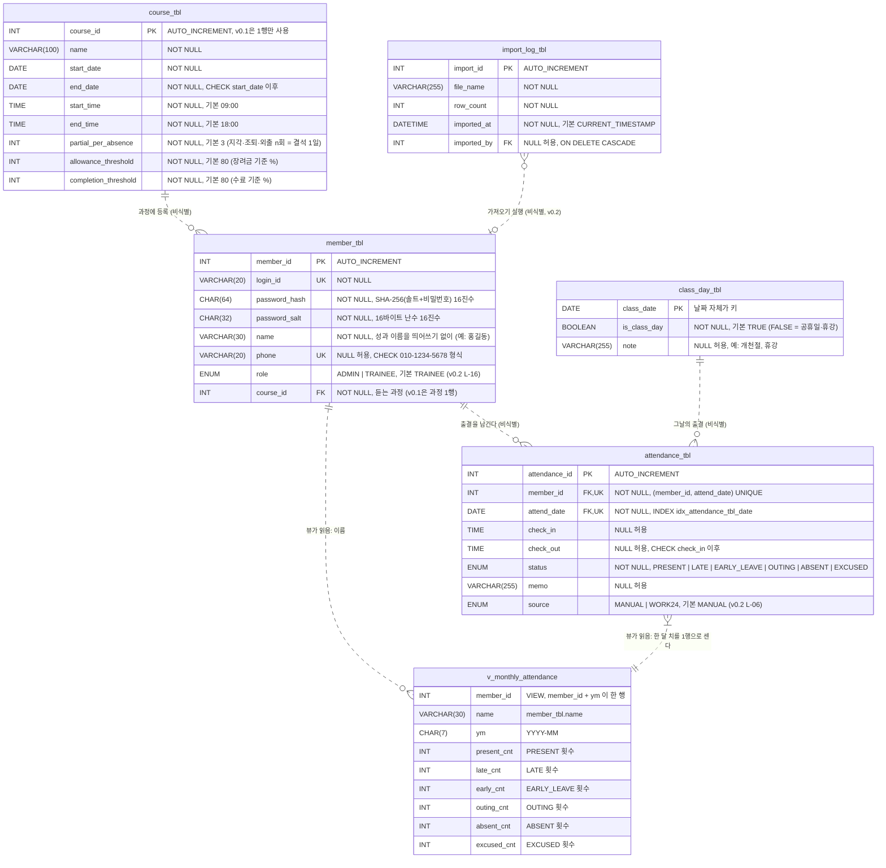
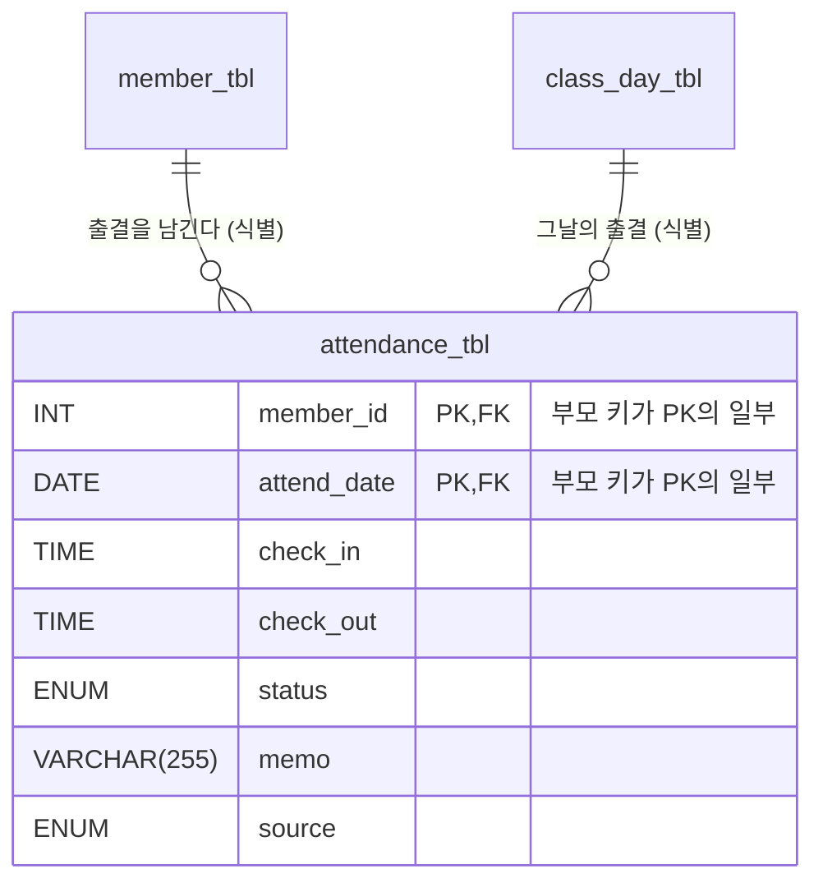
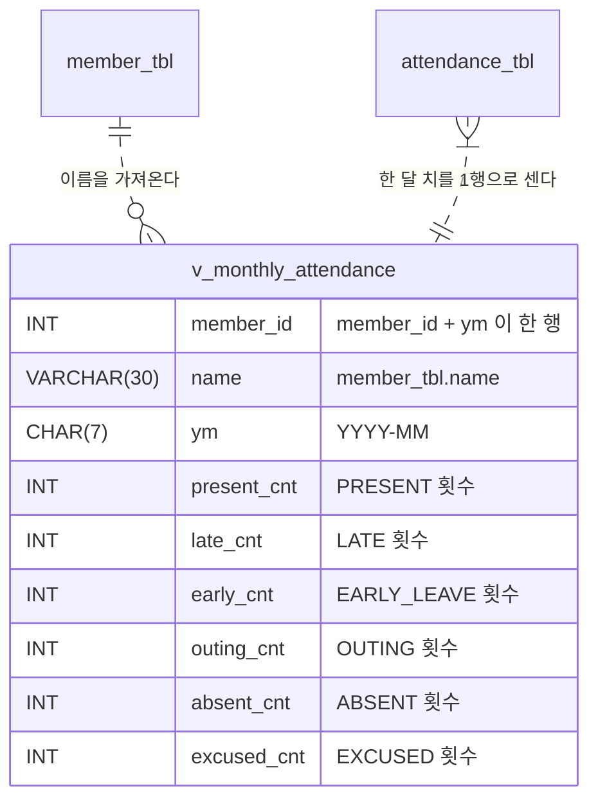
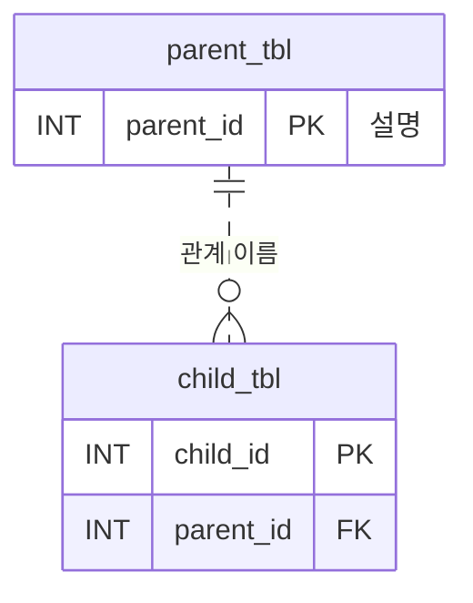

# ERD — 지각 잡는 자바 (초안)

> **상태: 초안.** [PLAN.md 7절](PLAN.md#7-데이터-설계)의 스키마를 옮겼다. 0-B ④ 합의 회의에서 고친 뒤 머지한다 ([PLAN.md 11절 ERD 만드는 순서](PLAN.md#erd-만드는-순서-0-b)).
> 같은 내용을 그린 그림: [erd.excalidraw](erd.excalidraw) (VS Code Excalidraw 확장 또는 [excalidraw.com](https://excalidraw.com)에서 연다).
> Mermaid `erDiagram`이 처음이면 [부록: Mermaid erDiagram 문법](#부록-mermaid-erdiagram-문법)을 먼저 읽는다.

---

## 1. 전체 ERD

`attendance_tbl`을 가운데 두고 그렸다. 스키마 모양이 **스타 스키마**(가운데 팩트 테이블 + 둘레의 차원 테이블)와 비슷하기 때문이다.

| 스타 스키마 | 이 ERD | 이유 |
| --- | --- | --- |
| **팩트** (일어난 일, 1행 = 사건 1건) | `attendance_tbl` | 1행 = "누가 어느 날 몇 시에 와서 어떤 상태였나". 행이 날마다 늘어나고 집계(6절 뷰)의 대상이다 |
| **차원** (누가) | `member_tbl` | 출결을 "누구의 것"으로 묶는다 |
| **차원** (언제) | `class_day_tbl` | 출결을 "어느 수업일의 것"으로 묶는다. 날짜 차원과 같은 역할 |
| **차원의 차원** (무엇을 듣나) | `course_tbl` | 회원이 `course_id`로 가리킨다. 출결은 회원을 거쳐 과정을 안다. 차원에 또 차원이 붙는 모양이라 **스노플레이크**라고 부른다 |
| 팩트 집계 | `v_monthly_attendance` (6절) | 팩트를 회원 × 월로 묶어 센다 |
| 스타 바깥 | `import_log_tbl`(가져오기 기록) | 출결과 FK로 잇지 않는다 |

닮은 것은 **모양**뿐이다. 데이터 웨어하우스의 스타 스키마는 조회를 빠르게 하려고 차원을 일부러 비정규화하기도 한다. 이 스키마는 입력·수정을 위한 설계라 3NF까지 정규화했다 (4절).

**배치 기준** — 그림은 [erd.excalidraw](erd.excalidraw)가 이 기준을 그대로 따른다.

| 위치 | 테이블 |
| --- | --- |
| 맨 왼쪽 열, 위 → 아래 | `import_log_tbl`(회원의 왼쪽 위), `course_tbl` — 둘 다 회원에 붙는 표라 회원 옆 |
| 왼쪽 열, 위 → 아래 | 차원: `member_tbl`, `class_day_tbl` |
| 가운데 | 팩트: `attendance_tbl`, 그 **아래**에 뷰 `v_monthly_attendance` |

아래 Mermaid 그림은 표 위치를 직접 정할 수 없어서 **가능한 만큼만** 따른다. 가져오기 기록·과정 → 차원 → 팩트 순서는 같지만, 뷰는 팩트 **아래**가 아니라 **오른쪽**에 놓인다. Mermaid는 관계로 이어진 두 표를 같은 열에 두지 못하기 때문이다 ([부록: 배치](#배치--표의-위치는-직접-정할-수-없다)).



- **`v_monthly_attendance`는 테이블이 아니라 뷰다.** 데이터를 저장하지 않고, 조회할 때 `member_tbl`과 `attendance_tbl`을 읽어 센다. 그래서 PK·FK가 없다. 뷰로 가는 두 선은 FK 관계가 아니라 **"뷰가 읽는다"** 는 뜻이다. Mermaid에는 뷰 전용 선이 없어 점선으로 그리고, 관계 이름 앞에 `뷰가 읽음`을 붙여 구분한다. 자세한 것은 [6절](#6-뷰--v_monthly_attendance).
- **과정은 회원이 가리킨다** (`member_tbl.course_id`). 출결에는 `course_id`를 두지 않는다. 출결의 과정은 회원으로 정해지므로, 출결에도 두면 같은 사실을 두 번 적게 된다 ([4절 3NF](#3nf--이행-함수-종속을-없앤다)). v0.1은 과정이 1행뿐이고, 출결 규칙(`AttendanceRule`)이 그 행의 시각·기준 %를 읽어 판정한다.
- **v0.2용인 `role`, `source`, `import_log_tbl`도 미리 둔다.** v0.1 코드는 이 셋을 쓰지 않는다. 확장을 생각한 결정이다 ([PLAN.md 7절](PLAN.md#7-데이터-설계), 14절 10번).
- **자유 입력 메모 열(`note`, `memo`)은 `VARCHAR(255)`로 통일한다.**
- 테이블 사이의 관계선은 모두 **점선 = 비식별 관계**다. 이유는 3절에 있다.

## 2. 테이블 한눈에

| 테이블 | 한 행의 뜻 | 쓰는 기능 | 버전 |
| --- | --- | --- | --- |
| `member_tbl` | 회원(훈련생) 1명 | L-01·L-02 회원가입·로그인, L-11 탈퇴 | v0.1 (`role`은 v0.2) |
| `course_tbl` | 과정 1개와 그 설정 (v0.1은 1행만) | L-01 회원가입(등록할 과정), L-03 과정 설정, 출결 규칙 | v0.1 |
| `class_day_tbl` | 달력의 하루 (수업일인지 아닌지) | L-04 수업일 캘린더, L-05 출결 입력 확인 | v0.1 |
| `attendance_tbl` | 훈련생 1명의 하루 출결 | L-05 출결 입력, L-08 리스크, L-09 반 전체 현황 | v0.1 (`source`는 v0.2) |
| `import_log_tbl` | 출결 가져오기 1회 | L-06 출결 가져오기 | v0.2 |
| `v_monthly_attendance` (뷰) | 훈련생 1명의 한 달 상태별 횟수 | L-09 반 전체 현황 | v0.1 |

### `member_tbl`의 비밀번호 — `password_hash`와 `password_salt`

비밀번호는 그대로 저장하지 않는다. 두 열을 함께 써서 저장한다 ([PLAN.md 12절](PLAN.md#12-기술-선택): JDK의 `SecureRandom` + `MessageDigest`만 쓴다).

| 열 | 무엇인가 | 언제·어떻게 만드나 | 길이 | 비밀인가 |
| --- | --- | --- | --- | --- |
| `password_salt` | 회원마다 다른 **난수** | 가입할 때 한 번, `SecureRandom`으로 16바이트 | 16바이트 → 16진수 32자 → `CHAR(32)` | **아니다.** 그대로 저장한다 |
| `password_hash` | 솔트와 비밀번호를 섞어 **SHA-256**으로 만든 값 | 가입할 때 `SHA-256(솔트 + 비밀번호)` | 32바이트 → 16진수 64자 → `CHAR(64)` | 원래 비밀번호로 **되돌릴 수 없다** |

#### 가입과 로그인의 흐름

```text
가입 (L-01)   salt = SecureRandom 16바이트
              hash = SHA-256(salt + 입력 비밀번호)
              → member_tbl에 salt와 hash를 둘 다 저장

로그인 (L-02) 아이디로 member_tbl 행을 조회해 salt와 hash를 읽는다
              SHA-256(저장된 salt + 입력 비밀번호)를 다시 계산한다
              → 저장된 hash와 같으면 로그인 성공 (비교는 SQL이 아니라 Java에서)
```

#### 왜 두 열이 필요한가

1. **해시는 되돌릴 수 없으니 로그인 때 같은 계산을 다시 해야 한다.** 그러려면 가입 때 쓴 솔트를 알아야 한다. 그래서 해시와 함께 **솔트도 저장**한다. 솔트가 없으면 로그인할 방법이 없다.
2. **솔트가 없으면 같은 비밀번호는 같은 해시가 된다.** 두 회원이 모두 `1234`를 쓴 예:

   | | 회원 A (`1234`) | 회원 B (`1234`) |
   | --- | --- | --- |
   | 솔트 없이 `SHA-256("1234")` | `03ac6742…c846f4` | `03ac6742…c846f4` ← **같다** |
   | 솔트 `9f2c4e1a…` / `4b7e0d93…`를 붙여 해시 | `aea810c2…ef0cff` | `7276bed3…142e4e` ← **다르다** |

   - 솔트가 없으면 DB가 유출됐을 때 같은 해시끼리 묶어 "이 사람들은 비밀번호가 같다"를 알 수 있다.
   - `1234`, `password` 같은 흔한 비밀번호의 해시를 **미리 계산해 둔 표**(레인보우 테이블)로 바로 찾아낼 수 있다.
   - 솔트를 붙이면 회원마다 해시가 달라져서, 공격자는 회원 한 명 한 명에 대해 따로 계산해야 한다.
3. **솔트는 비밀이 아니다.** 해시를 "미리 계산할 수 없게" 만드는 것이 목적이라 같은 행에 그대로 저장해도 된다. 지켜야 할 비밀은 비밀번호 자체다.

**한 열로 합칠 수도 있지 않나?** `솔트:해시`처럼 한 문자열로 저장하는 방식도 있다. 실무 라이브러리(bcrypt 등)가 그렇게 한다. 이 프로젝트는 **열을 나눈다.** 길이가 고정된 `CHAR(32)`, `CHAR(64)`로 둘 수 있고, Java가 문자열을 쪼갤 필요가 없으며, ERD만 보고도 "솔트를 쓴다"는 것이 드러난다.

> 참고: 실무에서는 SHA-256처럼 빠른 함수 대신 **일부러 느리게 만든** bcrypt·PBKDF2·Argon2를 쓴다. 이 프로젝트는 외부 라이브러리 없이 JDK로 해시와 솔트의 원리를 실습하는 것이 목적이라 SHA-256 + 솔트를 쓴다. 위 표의 해시는 16진수 솔트 문자열과 비밀번호를 이어 붙여 계산한 예시 값이다. 솔트를 바이트로 붙일지 문자열로 붙일지는 L-01 구현에서 정하고, 가입과 로그인이 **같은 방식**을 쓰기만 하면 된다.

## 3. 관계 — 식별 관계와 비식별 관계

| 구분 | 뜻 | 선 |
| --- | --- | --- |
| **식별 관계** | 부모의 PK가 자식 **PK의 일부**가 된다. 부모 없이는 자식 행을 구별할 수 없다 | 실선 (Mermaid `--`) |
| **비식별 관계** | 부모의 PK가 자식의 **일반 열(FK)** 로만 들어간다. 자식은 자기 PK로 구별된다 | 점선 (Mermaid `..`) |

| 부모 | 자식 | FK 열 | 카디널리티 | 관계 | 부모를 지우면 | 뜻 |
| --- | --- | --- | --- | --- | --- | --- |
| `course_tbl` | `member_tbl` | `course_id` | 1 : 0..N | 비식별 | 막힌다 (RESTRICT, 오류 1451) | 회원은 반드시 과정 1개에 등록한다. 회원이 있는 과정은 지울 수 없다 |
| `member_tbl` | `attendance_tbl` | `member_id` | 1 : 0..N | 비식별 | **CASCADE** — 출결도 지운다 | 회원은 출결을 0건 이상 남긴다. 출결은 반드시 회원 1명의 것이다 |
| `class_day_tbl` | `attendance_tbl` | `attend_date` | 1 : 0..N | 비식별 | 막힌다 (RESTRICT, 오류 1451) | 출결 날짜는 캘린더에 있는 날이어야 한다. 하루에 훈련생 수만큼 출결이 생긴다 |
| `member_tbl` | `import_log_tbl` | `imported_by` | 0..1 : 0..N | 비식별 | **CASCADE** — 가져오기 기록도 지운다 | 가져오기 기록에 실행한 회원을 남긴다. 비어 있어도 된다 |

**모두 비식별인 이유:** `member_tbl`은 `member_id`, `attendance_tbl`은 `attendance_id`, `import_log_tbl`은 `import_id`라는 **대리 키**(의미 없는 일련번호)를 PK로 쓴다. 부모 키(`course_id`, `member_id`, `attend_date`)는 PK에 들어가지 않고 FK로만 있다.

**하루 한 기록:** 정규화하면 출결의 진짜 키는 `(member_id, attend_date)`다 (4절 2NF). 이것을 PK 대신 `UNIQUE`로 지킨다. 그래서 대리 키를 써도 같은 날 두 건은 들어갈 수 없다.

### 식별 관계로 바꾼다면 (대안 — 합의 때 정한다)

`attendance_id`를 없애고 `(member_id, attend_date)`를 PK로 삼으면 두 관계가 **식별 관계(실선)** 가 된다.



| | 지금 (비식별 + 대리 키) | 대안 (식별 + 복합 PK) |
| --- | --- | --- |
| 하루 한 기록 | `UNIQUE (member_id, attend_date)` | PK가 그대로 보장 |
| 열 수 | `attendance_id` 1열 더 | 1열 적다 |
| 행 하나를 가리킬 때 | `attendance_id` 하나 | `member_id` + `attend_date` 둘 |
| 스켈레톤·JDBC | 스켈레톤과 같은 `AUTO_INCREMENT` + `getGeneratedKeys` | 생성 키가 없다. 모델·쿼리를 스켈레톤과 다르게 짠다 |
| 나중에 출결을 참조하는 테이블이 생기면 | FK 1열 | FK 2열 |

**권장: 지금처럼 비식별로 둔다.** 스켈레톤 스타일과 같고, 하루 한 기록은 `UNIQUE`가 똑같이 지킨다. 정규화 결과(4절)는 식별 관계이고, 구현에서 대리 키로 바꾼 것이다. 이 차이를 알고 고르는 것이 이 절의 목적이다.

## 4. 정규화 — 3NF까지

출결을 **엑셀 출결 대장 한 장**에 적는다고 생각하고, 그 표를 3NF까지 나누면 지금의 테이블이 나온다.

### 출발점 — 출결 대장 한 장 (비정규형)

| 아이디 | 이름 | 전화 | 과정명 | 수업 시작 | 수업 종료 | 출결 |
| --- | --- | --- | --- | --- | --- | --- |
| ry | 홍길동 | 010-1111-2222 | 자바 과정 | 09:00 | 18:00 | 10/20 출석 08:55~18:01, 10/21 지각 09:12~18:00 |
| yy | 김철수 | | 자바 과정 | 09:00 | 18:00 | 10/20 결석, 10/21 출석 08:50~18:02 |

`출결` 칸 하나에 여러 날이 들어 있다 (**반복 그룹**). "10/21에 지각한 사람"을 찾으려면 문자열을 잘라 봐야 한다.

### 1NF — 모든 칸에 값 하나

하루를 한 줄로 펼친다. 이제 한 줄을 구별하는 키는 **(아이디, 날짜)** 다. 휴일 메모도 같은 표에 적는다고 하자.

| **아이디** | **날짜** | 이름 | 전화 | 과정명 | 수업 시작 | 수업 종료 | 수업일? | 휴일 메모 | 입실 | 퇴실 | 상태 |
| --- | --- | --- | --- | --- | --- | --- | --- | --- | --- | --- | --- |
| ry | 10/20 | 홍길동 | 010-1111-2222 | 자바 과정 | 09:00 | 18:00 | Y | | 08:55 | 18:01 | 출석 |
| ry | 10/21 | 홍길동 | 010-1111-2222 | 자바 과정 | 09:00 | 18:00 | Y | | 09:12 | 18:00 | 지각 |
| yy | 10/20 | 김철수 | | 자바 과정 | 09:00 | 18:00 | Y | | | | 결석 |

남은 문제: 이름·전화·과정이 **날마다 반복**된다. 전화번호를 바꾸면 모든 줄을 고쳐야 하고(수정 이상), 출결이 없으면 회원을 적을 곳이 없다(삽입 이상).

### 2NF — 부분 함수 종속을 없앤다

키 **(아이디, 날짜)의 일부에만** 결정되는 열을 떼어 낸다.

| 결정하는 것 | 결정되는 열 | 떼어 낸 테이블 |
| --- | --- | --- |
| 아이디 하나 | 이름, 전화, 과정명, 수업 시작, 수업 종료 | 회원 → `member_tbl` |
| 날짜 하나 | 수업일?, 휴일 메모 | 수업일 → `class_day_tbl` |
| (아이디, 날짜) 전체 | 입실, 퇴실, 상태, 메모 | 출결 → `attendance_tbl` |

이 단계의 출결 테이블은 PK가 `(아이디, 날짜)`이고, 둘 다 부모를 가리킨다. 곧 **식별 관계**다 (3절 대안).

### 3NF — 이행 함수 종속을 없앤다

키가 아닌 열이 **다른 키 아닌 열을 거쳐** 결정되면 떼어 낸다.

- **회원 표:** `아이디 → 과정명 → 수업 시작, 수업 종료, 기준 %`. 수업 시각은 회원이 아니라 과정이 정한다. 그래서 과정을 `course_tbl`로 떼고, 회원에는 `course_id` FK만 남긴다.
- **출결 표에는 과정을 두지 않는다:** 회원 1명은 과정 1개에만 속하므로 `attendance_id → member_id → course_id`가 된다. 출결에도 `course_id`를 두면 이행 종속이 생기고, 회원의 과정과 출결의 과정이 서로 다르게 적힐 수 있다. 출결의 과정이 필요하면 `member_tbl`과 `JOIN`한다.
  - 회원이 **여러 과정**을 듣게 되면 회원만으로는 과정이 정해지지 않는다. 그때는 출결에 과정이 필요해진다 ([8절](#8-합의-때-볼-점)).
- **출결 표에 대리 키를 붙인 뒤:** 출결 표에 이름을 함께 적으면 `attendance_id → member_id → 이름`이 되어 3NF가 깨진다. 그래서 `attendance_tbl`에는 이름을 두지 않는다. 이름이 필요한 화면은 `JOIN`이나 뷰(6절)로 가져온다.

### 결과 점검

| 테이블 | 1NF | 2NF | 3NF | 근거 |
| --- | --- | --- | --- | --- |
| `member_tbl` | ✅ | ✅ | ✅ | 키가 한 열(`member_id`)이라 부분 종속이 없다. 모든 열이 회원 자신을 설명한다. 과정은 `course_id` FK로만 가리키고 과정명·시각은 두지 않는다. `login_id`는 또 하나의 후보 키(NOT NULL + UNIQUE) |
| `course_tbl` | ✅ | ✅ | ✅ | 모든 열이 과정 하나를 설명한다 |
| `class_day_tbl` | ✅ | ✅ | ✅ | 키가 날짜 한 열. 수업일 여부와 메모는 날짜만으로 정해진다 |
| `attendance_tbl` | ✅ | ✅ | ✅ | 후보 키는 `attendance_id`와 `(member_id, attend_date)`. 이름·과정·수업 시각 같은 다른 엔티티의 값을 두지 않는다 |
| `import_log_tbl` | ✅ | ✅ | ✅ | 모든 열이 가져오기 1회를 설명한다. 실행한 회원은 FK로만 가리킨다 |

### 정규화와 헷갈리기 쉬운 것 — 일부러 이렇게 둔 것

- **`attendance_tbl.status`를 저장한다.** 출석·지각·조퇴는 입실·퇴실 시각과 과정 시각으로 판정할 수 있다. 그래도 결석·공결·외출, 고용24에서 가져온 상태는 시각으로 정할 수 없다. 또 과정 시각을 나중에 바꿔도 **그날 판정한 결과**는 그대로 남아야 한다. 그래서 상태는 계산값이 아니라 기록이다. 3NF 위반이 아니다.
- **`ENUM`(상태, 권한, 출처)을 쓴다.** 값 하나만 들어가므로 1NF를 지킨다. 값에 설명(한글 이름 등)을 붙여 DB에서 관리하려면 코드 테이블(`status_tbl`)로 뗄 수 있다. v0.1에서는 Java `enum`이 이름을 가진다.
- **뷰(`v_monthly_attendance`)는 계산 결과다.** 그래도 저장하지 않고 조회할 때마다 계산하므로 중복도 이상도 없다.
- **`import_log_tbl.row_count`를 저장한다.** 가져온 출결 행이 가져오기 기록을 가리키지 않으므로 다시 셀 방법이 없다. 그때 몇 행이었는지를 남기는 기록이다.

## 5. 제약조건과 인덱스

PK는 이름을 붙이지 않는다. MySQL은 PK 이름을 항상 `PRIMARY`로 고정한다. 나머지 제약은 `종류_테이블_내용` 형식으로 이름을 붙인다 ([PLAN.md 7절](PLAN.md#7-데이터-설계)). 어기면 MySQL이 아래 오류 코드를 낸다. Java에서는 `SQLException.getErrorCode()`로 구분한다.

| 이름 | 테이블 | 종류 | 내용 | 어기면 |
| --- | --- | --- | --- | --- |
| `PRIMARY` | 모든 테이블 | PK | 각 테이블의 `..._id`, `class_day_tbl`은 `class_date` | 1062. L-04에서 같은 날짜를 두 번 넣으면 여기서 걸린다 → 트랜잭션 롤백 |
| `uq_member_tbl_login_id` | `member_tbl` | UNIQUE | `login_id` | 1062 → "이미 쓰는 아이디입니다" |
| `uq_member_tbl_phone` | `member_tbl` | UNIQUE | `phone` (NULL은 여러 행이어도 된다) | 1062 → "이미 등록된 전화번호입니다" |
| `ck_member_tbl_phone` | `member_tbl` | CHECK | `phone IS NULL OR phone REGEXP '^010-[0-9]{4}-[0-9]{4}$'` | 3819 → "010-1234-5678 형식으로 입력해 주세요" |
| `fk_member_tbl_course_tbl` | `member_tbl` | FK | `course_id` → `course_tbl` | 1452 (과정 행이 없는데 회원가입 → "과정이 아직 없습니다"), 1451 (회원이 있는 과정을 지움) |
| `ck_course_tbl_period` | `course_tbl` | CHECK | `end_date >= start_date` | 3819 |
| `fk_attendance_tbl_member_tbl` | `attendance_tbl` | FK | `member_id` → `member_tbl`, ON DELETE CASCADE | 1452 (없는 회원) |
| `fk_attendance_tbl_class_day_tbl` | `attendance_tbl` | FK | `attend_date` → `class_day_tbl` | 1452 (캘린더에 없는 날짜), 1451 (출결이 있는 날짜를 캘린더에서 지움) |
| `uq_attendance_tbl_member_date` | `attendance_tbl` | UNIQUE | `(member_id, attend_date)` — 하루 한 기록 | 1062 → "이미 기록이 있습니다" |
| `ck_attendance_tbl_time` | `attendance_tbl` | CHECK | `check_out IS NULL OR check_in IS NULL OR check_out >= check_in` | 3819 |
| `fk_import_log_tbl_member_tbl` | `import_log_tbl` | FK | `imported_by` → `member_tbl`, ON DELETE CASCADE | 1452 (없는 회원) |
| `idx_attendance_tbl_date` | `attendance_tbl` | INDEX | `attend_date` | — (날짜 범위 조회를 빠르게: L-09, 7절 쿼리) |

- 1062·1451·1452는 `SQLIntegrityConstraintViolationException`으로 온다. 3819(CHECK)는 SQLState가 `HY000`이라 그냥 `SQLException`으로 온다.
- **전화번호 정규식** `^010-[0-9]{4}-[0-9]{4}$`: `^`와 `$`는 문자열의 처음과 끝이다. 그래서 앞뒤에 다른 글자가 붙으면 안 된다. `[0-9]{4}`는 숫자 4개다. `01012345678`(하이픈 없음), `010-123-5678`(가운데 3자리), `011-…`은 막힌다. **Java도 같은 정규식으로 먼저 확인**해 다시 입력받는다. DB `CHECK`는 마지막 안전장치다.
- **이름은 안내만 한다.** 회원가입에서 "성과 이름을 띄어쓰기 없이 입력해 주세요"를 보여 준다. DB 제약은 없다 ([8절](#8-합의-때-볼-점) 4번).
- `NOT NULL`과 `DEFAULT`는 MySQL에서 이름을 붙일 수 없어서 열 옆에 쓴다. ERD에서는 각 열의 설명(따옴표 안)에 적었다.
- **FK는 수업일인지까지 확인하지 않는다.** 공휴일·휴강일도 `class_day_tbl`에 `is_class_day = FALSE`로 들어 있으므로 FK를 통과한다. "수업일이 아닙니다"(L-05의 3a)는 Java가 INSERT 전에 확인해야 한다.

## 6. 뷰 — `v_monthly_attendance`

훈련생별·월별로 상태마다 몇 번인지 센다. **SQL은 세기만 하고, 출석률 계산은 Java(`AttendanceRule`)가 한다.**



```sql
CREATE OR REPLACE VIEW v_monthly_attendance AS
SELECT m.member_id,
       m.name,
       DATE_FORMAT(a.attend_date, '%Y-%m')                       AS ym,
       SUM(a.status = 'PRESENT')                                  AS present_cnt,
       SUM(a.status = 'LATE')                                     AS late_cnt,
       SUM(a.status = 'EARLY_LEAVE')                              AS early_cnt,
       SUM(a.status = 'OUTING')                                   AS outing_cnt,
       SUM(a.status = 'ABSENT')                                   AS absent_cnt,
       SUM(a.status = 'EXCUSED')                                  AS excused_cnt
FROM member_tbl m
JOIN attendance_tbl a ON a.member_id = m.member_id
GROUP BY m.member_id, m.name, DATE_FORMAT(a.attend_date, '%Y-%m');
```

### 뷰 읽는 법

- 뷰는 테이블이 아니다. 데이터를 따로 저장하지 않고, 조회할 때마다 위 `SELECT`를 실행한다. 그래서 PK·FK가 없다. ERD에서는 "어느 테이블을 읽는지"만 점선으로 보여 준다. 식별·비식별 관계가 아니라 **읽는 관계**다.
- `SUM(a.status = 'LATE')`: MySQL에서 비교식은 참이면 1, 거짓이면 0이다. 그래서 `SUM`이 곧 "LATE인 행의 수"가 된다.
- **`JOIN`(INNER JOIN)이라서 그 달 출결이 한 건도 없는 훈련생은 뷰에 나오지 않는다.** 그런 훈련생은 7절 쿼리로 따로 찾는다.

## 7. 그 달 기록이 없는 훈련생 찾기 — LEFT JOIN + IS NULL

L-09 반 전체 현황의 "기록 없음" 명단이다 (`AttendanceRepository.findMembersWithoutRecord`).

```sql
SELECT m.member_id, m.name
FROM member_tbl m
LEFT JOIN attendance_tbl a
       ON a.member_id = m.member_id
      AND a.attend_date BETWEEN ? AND ?          -- 그 달 1일 ~ min(말일, 어제)
WHERE a.attendance_id IS NULL;
```

**어떻게 동작하나** — 회원 3명 중 YI만 10월 기록이 없을 때:

| 단계 | 결과 |
| --- | --- |
| ① `LEFT JOIN` | 회원은 **모두** 남는다. 짝이 되는 출결이 없는 YI의 행은 `a.*`가 전부 NULL이다 |
| ② `WHERE a.attendance_id IS NULL` | 출결 짝이 없는 행만 남긴다 → YI |

| member_id | name | a.attendance_id (①) | ② 후 |
| --- | --- | --- | --- |
| 1 | RY | 11, 14, … | 빠짐 |
| 2 | YY | 12, 15, … | 빠짐 |
| 3 | YI | NULL | **남음** |

**날짜 조건을 `WHERE`가 아니라 `ON`에 두는 이유:** `WHERE`로 옮기면 YI 행의 `a.attend_date`가 NULL이라 `BETWEEN`이 참이 되지 못한다. 그러면 YI가 빠지고 결과가 늘 비게 된다. `ON`에 두면 "그 기간의 출결과만 짝을 지어 보고, 짝이 없으면 NULL로 남긴다"가 된다.

`?` 두 개는 `PreparedStatement`로 넣는다. 첫째는 그 달 1일이고, 둘째는 그 달 말일과 어제 중 이른 날이다. 계산 기준일이 어제이기 때문이다 ([PLAN.md 4절 공통 규칙](PLAN.md#공통-규칙)).

## 8. 합의 때 볼 점

초안을 옮기며 눈에 띈 것이다. 회의에서 정하고, 바꾸면 같은 PR에서 PLAN.md 7절도 고친다.

1. **출결을 식별 관계로 바꿀지.** 권장은 지금처럼 비식별 + 대리 키다 ([3절 대안](#식별-관계로-바꾼다면-대안--합의-때-정한다)).
2. **뷰는 날짜를 거르지 않는다.** 오늘 입력한 출결도 이번 달 횟수에 들어간다. "어제 기준" 계산에 뷰를 쓸 때 오늘 기록을 빼야 하는지 L-09 담당(A)과 출결 규칙 담당(B)이 맞춘다.
3. **[PLAN.md 3절](PLAN.md#3-출결-규칙-코드의-심장)의 `unit_period_days`(단위기간) 설정 컬럼이 `course_tbl`에 없다.** 열을 추가할지, 3절에서 "월 단위 고정"으로 정리할지 정한다.
4. **이름 띄어쓰기는 안내만 하고 막지 않는다.** 막으려면 Java에서 공백을 확인하거나 `CHECK (name NOT LIKE '% %')`를 둔다.
5. **`phone`은 형식이 13자로 고정됐다.** `VARCHAR(20)`을 `CHAR(13)`으로 줄일지 정한다. 어느 쪽이든 `CHECK`가 형식을 지키므로 동작은 같다.
6. **회원이 여러 과정을 듣게 되면 (v0.1 범위 밖).** 지금은 "회원 1명 = 과정 1개"라서 과정을 회원에만 둔다. 재수강이나 연속 과정을 받으려면 세 가지가 함께 바뀐다.
   - 수업일이 과정마다 달라지므로 `class_day_tbl`의 PK가 `(course_id, class_date)`가 된다.
   - 출결에 `course_id`가 생기고, FK가 `(course_id, attend_date)` → `class_day_tbl`이 된다.
   - 하루 한 기록이 `UNIQUE (member_id, course_id, attend_date)`가 된다. 회원과 과정의 관계는 수강 등록 테이블(회원 N : 과정 M)로 옮긴다.

---

## 부록: Mermaid erDiagram 문법

이 문서의 그림은 모두 Mermaid로 그렸다. GitHub와 노션은 ` ```mermaid ` 코드 블록을 그림으로 보여 준다. VS Code에서는 "Markdown Preview Mermaid Support" 확장을 깔면 미리보기에 나온다. 바로 고쳐 보려면 [mermaid.live](https://mermaid.live)에 붙여 넣는다.

### 기본 모양

````text

````

- 첫 줄은 항상 `erDiagram`이다.
- **엔티티 이름은 영문·숫자·`_`로 쓴다.** 한글 이름은 따옴표 없이 쓰면 문법 오류가 난다. 한글 뜻은 관계 이름이나 열 설명에 적는다.
- **관계 한 줄** = `왼쪽엔티티 [왼쪽 기호][선][오른쪽 기호] 오른쪽엔티티 : "이름"`.
- **엔티티 블록** = `{ }` 안에 열을 한 줄에 하나씩 쓴다. 관계가 없는 테이블도 블록만 쓰면 그려진다.
- `%%`로 시작하는 줄은 주석이다.

### 카디널리티 기호 — 선 끝에 붙는 "몇 개"

기호는 **선에서 가까운 쪽이 최소, 엔티티에 가까운 쪽이 최대**다. `|`는 1, `o`는 0, `{` `}`는 여러 개다.

| 왼쪽에 쓸 때 | 오른쪽에 쓸 때 | 뜻 | 이 ERD의 예 |
| --- | --- | --- | --- |
| `\|o` | `o\|` | 0 또는 1 | `member_tbl \|o..o{ import_log_tbl` — `imported_by`가 NULL일 수 있다 |
| `\|\|` | `\|\|` | 정확히 1 | `member_tbl \|\|..o{ attendance_tbl` — 출결은 반드시 회원 1명의 것 |
| `}o` | `o{` | 0 이상 | 회원은 출결이 0건일 수도 있다 |
| `}\|` | `\|{` | 1 이상 | `attendance_tbl }\|..\|\| v_monthly_attendance` — 뷰 1행은 출결 1건 이상에서 나온다 |

**읽는 순서:** `member_tbl ||..o{ attendance_tbl`은 양쪽에서 읽는다.

- 오른쪽 기호 `o{`: 회원 1명은 출결을 **0개 이상** 가진다.
- 왼쪽 기호 `||`: 출결 1건은 회원을 **정확히 1명** 가진다.

### 선 모양 — 식별 관계와 비식별 관계

| 선 | 이름 | 뜻 | 이 문서의 예 |
| --- | --- | --- | --- |
| `--` (실선) | 식별 관계 | 부모 키가 자식 **PK의 일부**가 된다 | [3절 대안](#식별-관계로-바꾼다면-대안--합의-때-정한다) |
| `..` (점선) | 비식별 관계 | 부모 키가 자식의 **일반 열(FK)** 로만 들어간다 | 1절의 모든 관계 |

### 열 한 줄 — `타입 이름 키 "설명"`

```text
VARCHAR(20) login_id UK "NOT NULL"
```

| 자리 | 쓰는 것 | 규칙 |
| --- | --- | --- |
| 타입 | `INT`, `VARCHAR(20)`, `DATE` … | 괄호는 되지만 **쉼표와 따옴표는 안 된다.** 그래서 `ENUM('ADMIN','TRAINEE')`는 `ENUM`으로만 쓰고 값은 설명에 적는다 |
| 이름 | 열 이름 | 공백 없이 |
| 키 (선택) | `PK`, `FK`, `UK` | 여러 개면 쉼표로: `FK, UK`, `PK, FK`. `UK`는 UNIQUE |
| 설명 (선택) | `"..."` | 큰따옴표 안에 자유롭게. NOT NULL, 기본값, 뜻을 적는다. 큰따옴표 자체는 쓸 수 없다 |

### 배치 — 표의 위치는 직접 정할 수 없다

Mermaid는 표를 자동으로 배치한다. 위치를 좌표로 정할 수는 없고, 두 가지로 방향만 바꾼다.

1. **배치 방향:** 맨 위에 설정을 둔다. 기본은 위 → 아래(`TB`)이고, `LR`이면 왼쪽 → 오른쪽으로 놓는다.

   ```text
   ---
   config:
     er:
       layoutDirection: LR
   ---
   erDiagram
   ```

2. **관계를 쓰는 방향:** 관계 한 줄의 **왼쪽 엔티티가 앞(왼쪽 또는 위)** 에 놓인다. 1절은 이렇게 썼다.
   - `import_log_tbl }o..o| member_tbl`, `course_tbl ||..o{ member_tbl` → 가져오기 기록과 과정이 회원 앞(왼쪽)
   - `member_tbl ||..o{ attendance_tbl`, `class_day_tbl ||..o{ attendance_tbl` → 두 차원이 같은 열에 위아래로, 팩트는 그 오른쪽
   - 순서를 뒤집어 쓸 때는 기호도 함께 뒤집으므로 뜻은 같다: `class_day_tbl ||..o{ attendance_tbl` = `attendance_tbl }o..|| class_day_tbl`.

#### 할 수 없는 것

- 관계로 이어진 두 표는 **같은 열(LR) 또는 같은 줄(TB)에 놓을 수 없다.** 그래서 팩트와 이어진 뷰를 팩트 **아래**에 둘 수 없다. 관계 줄 순서 120가지를 모두 렌더링해 봐도 차원을 왼쪽에, 뷰를 팩트 아래에 두는 순서는 없었다 (Mermaid 11.4.1).
- 관계가 없는 표의 자리는 정할 수 없다.
- 정확한 배치가 필요하면 [erd.excalidraw](erd.excalidraw)처럼 좌표를 직접 정하는 도구로 그린다.

`erDiagram` 아래에 `direction LR`을 쓰는 방법은 Mermaid 버전에 따라 지원되지 않는다. 지원되지 않는 버전에서는 `direction`과 `LR`이 표로 그려지니 쓰지 않는다.

### Mermaid로 나타낼 수 없는 것

- **NOT NULL, DEFAULT, CHECK, 복합 UNIQUE, INDEX, ON DELETE** → 열 설명에 적거나 이 문서의 표(3절, 5절)에 적는다.
- **뷰** → 엔티티로 그리고 원본 테이블과 점선으로 잇는다 (6절). 뷰라는 표시는 이름의 `v_` 접두사와 설명으로 한다.
